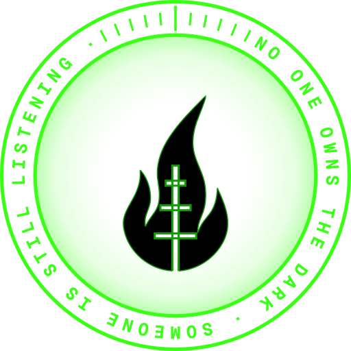
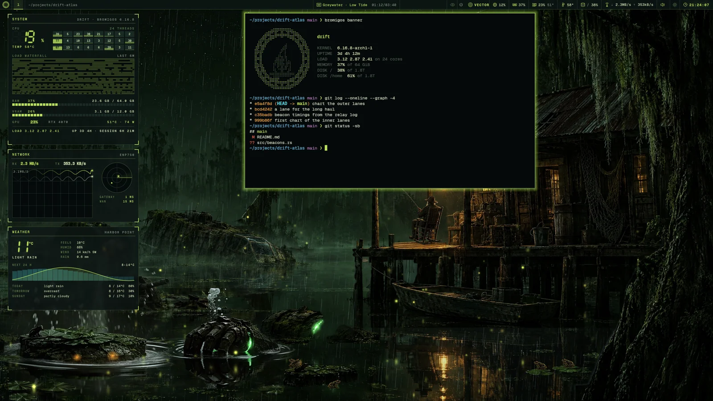
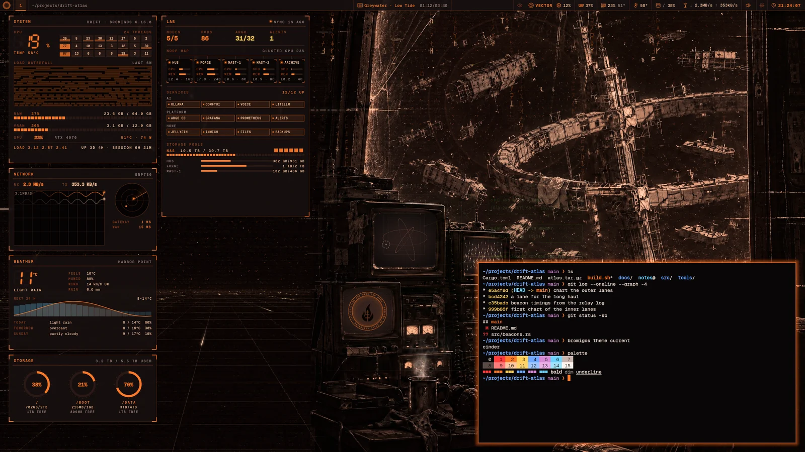
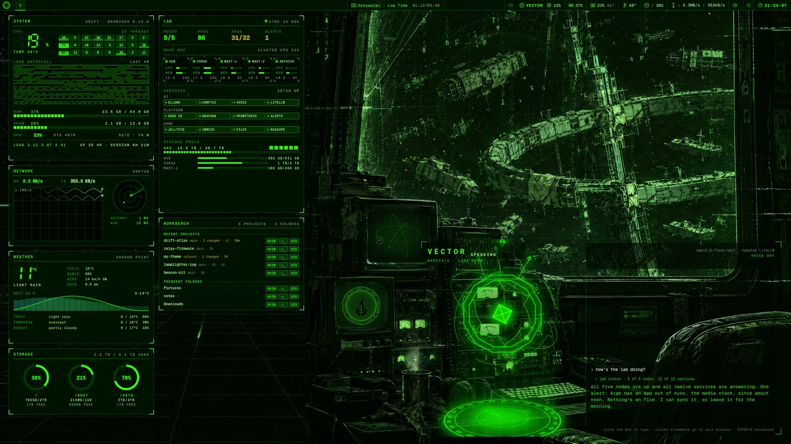
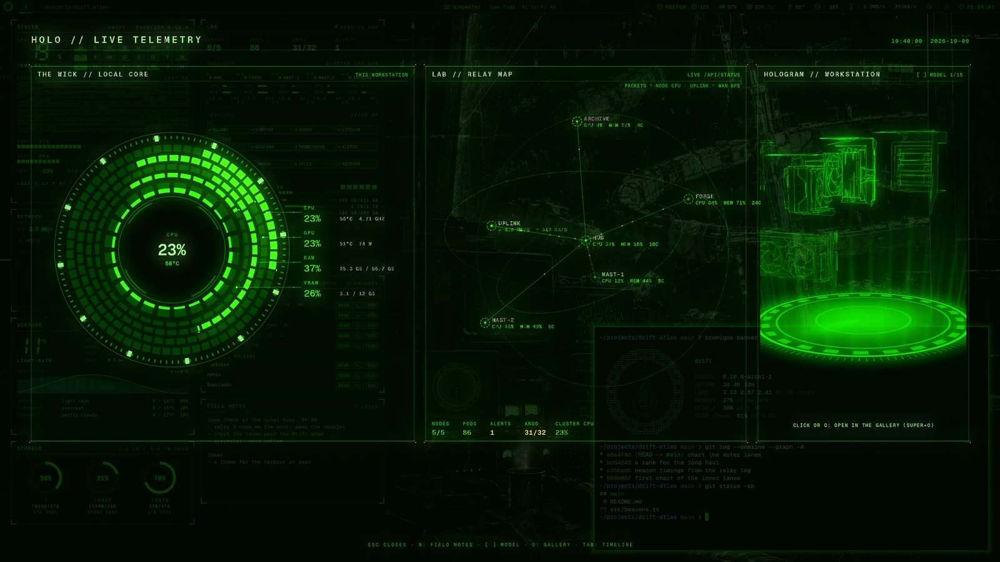
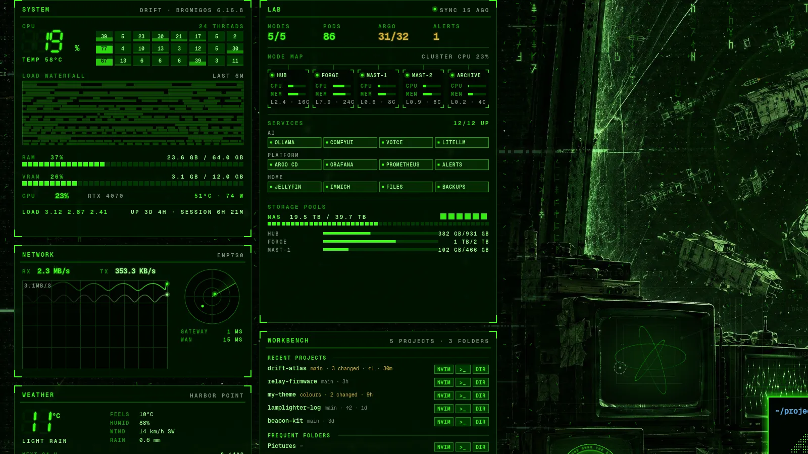
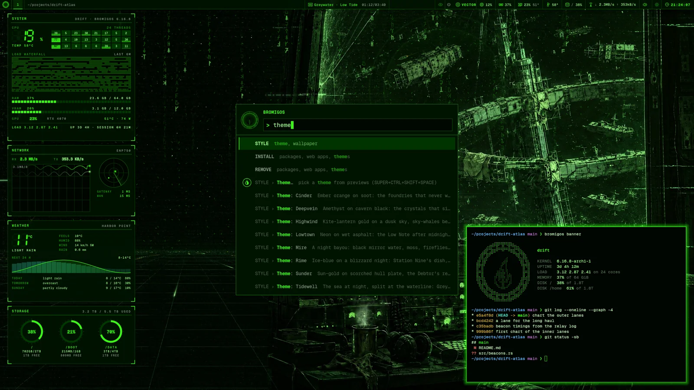
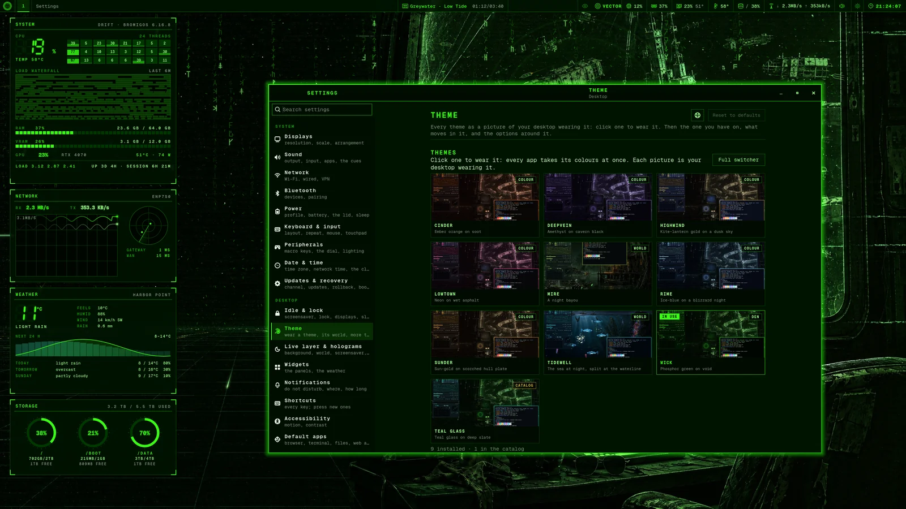
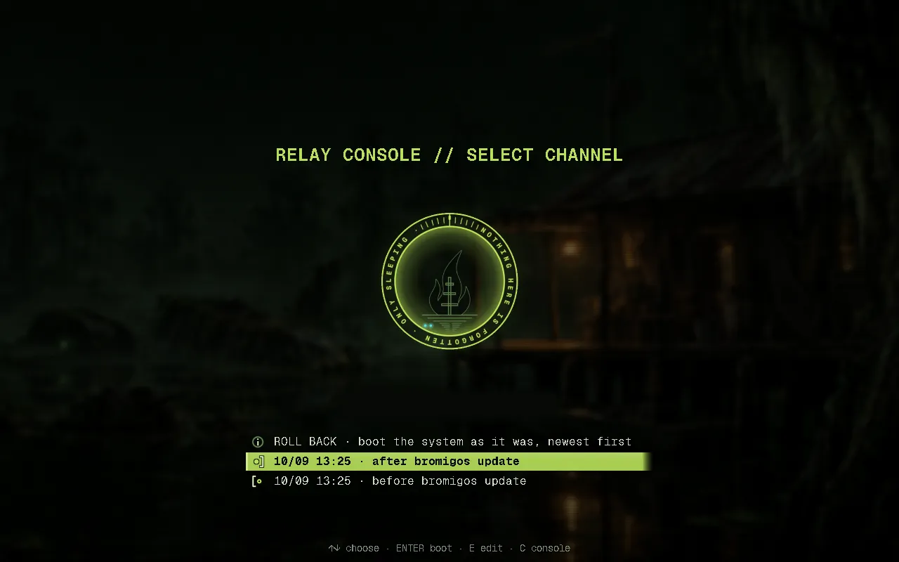

<div align="center">



# bromigOS

**A desktop based on Arch Linux and Hyprland. The wallpaper is alive, the widgets show
real readings, your homelab is on screen, and an AI with a voice lives on your desk.**

[](https://github.com/bromigos-org/bromigOS/actions/workflows/packages.yml)
[](https://github.com/bromigos-org/bromigOS/actions/workflows/docs.yml)
[](https://github.com/bromigos-org/bromigOS/actions/workflows/manual.yml)
[](https://github.com/bromigos-org/bromigOS/actions/workflows/install-smoke.yml)
[](https://github.com/bromigos-org/bromigOS/actions/workflows/iso-check.yml)

[Install](#install) · [Manual](manual/src/index.md) · [Docs](docs/README.md) ·
[Contributing](CONTRIBUTING.md) · [Code of conduct](CODE_OF_CONDUCT.md) ·
[Website](https://bromigos.org/os)

</div>


*Tidewell is one of bromigOS's two worlds: themes whose wallpaper is a living scene. Its
glowing creatures are your AI coding agents at work, and its trawlers carry your network
traffic.*

bromigOS turns a fresh Arch Linux install into a complete desktop. It installs as a set
of signed packages, with one command to theme, update and undo an update. It's in early
access.


*The Wick, the default theme, with the widgets and a terminal.*

## What you get

<table>
<tr>
<td width="50%" valign="top">

<h3>Living worlds</h3>
<p>A world is a theme whose wallpaper is a living scene. In Mire, a night bayou, old
machines rise from the water as your AI coding agents work, fireflies follow your network
traffic, and a heron takes off when a notification arrives.</p>
</td>
<td width="50%" valign="top">

<h3>One theme for every app</h3>
<p>A theme recolours the bar, terminal, notifications, lock screen, GTK and Qt apps,
Neovim, tmux, btop and the browser at once. In a colour theme like Cinder, even the
den's painting changes colour.</p>
</td>
</tr>
<tr>
<td width="50%" valign="top">

<h3>VECTOR, your assistant</h3>
<p>VECTOR is the desktop's AI assistant. Type to him or talk to him. He opens apps,
arranges windows, takes notes, reads your homelab, and makes images and 3D holograms.
<b>Super+Ctrl+Escape</b> switches him off at once.</p>
</td>
<td width="50%" valign="top">

<h3>Holograms</h3>
<p>Decks are full-screen holographic views you open with a key. <b>Super+H</b> shows this
machine, <b>Super+T</b> the last 72 hours, and <b>Super+M</b> a star chart of the
Bromigos universe.</p>
</td>
</tr>
<tr>
<td width="50%" valign="top">

<h3>Widgets with real readings</h3>
<p>Small dashboards sit between the wallpaper and your windows. bromigOS calls them
panels. They show your system, network, storage, homelab, recent projects, notes and
shortcuts. Every number is a live reading.</p>
</td>
<td width="50%" valign="top">

<h3>One menu for everything</h3>
<p>Press <b>Super+Space</b> and type. Apps, settings, commands, themes and toggles are
all in one list.</p>
</td>
</tr>
<tr>
<td width="50%" valign="top">

<h3>Settings in one window</h3>
<p>Displays, sound, network, Bluetooth, power, idle and lock, themes, shortcuts,
accessibility and updates, in one searchable window. You can undo every change.</p>
</td>
<td width="50%" valign="top">

<h3>Updates you can undo</h3>
<p>bromigOS takes a snapshot before and after every update. One command undoes an
update, and the boot menu can start the system as it was before.
<a href="#updating-and-undoing-an-update">How it works</a>.</p>
</td>
</tr>
</table>

### Your homelab on the desktop

If you run servers at home, bromigOS can show them on the desktop and to VECTOR.
`bromigos setup homelab` finds your services and writes one config file. It works with
Prometheus, Kubernetes, Argo CD, Docker, Proxmox, Vault, LiteLLM, Ollama and more.
`bromigos lab` adds a dashboard, a model manager, a queue for GPU jobs and a health
check. Media and Lab show actions for the current tab, with keyboard help on `?`.
Dialogs support arrows and Enter, with Cancel selected before destructive changes.
Its provisioner creates reviewed VM and Kubernetes plans, with monitoring.
`bromigos lab maintenance` guides an ordered shutdown and startup for rack work.
`bromigos lab power` reads supported PDU outlets and plans reviewed power changes.
All of it stays off until you set it up.


## Nine themes


bromigOS comes with nine themes:

- **The Wick**, phosphor green on black. It's the default.
- **Two worlds**, Mire (a night bayou) and Tidewell (the sea at night).
- **Six colour themes**: Rime, Sunder, Cinder, Lowtown, Highwind and Deepvein.

To switch, press **Super+Ctrl+Shift+Space**, or run `bromigos theme set <name>`. You can
make your own, or install one from a Git repository.

`bromigos storage` plans a separate data drive and verified file migrations. It keeps
the original data until you review the switch, groups shared filesystem capacity,
shows terminal-aware usage bars, and cleans selected caches or explicitly planned
originals and local snapshots.
See [Storage](manual/src/storage.md).

## What you need

- **A 64-bit x86 PC.** The packages are built for `x86_64`.
- **A graphics card that runs Hyprland and OpenGL 3.3.** NVIDIA cards from the GTX 16
  and RTX 20 series onwards get NVIDIA's open driver. Older NVIDIA cards use nouveau.
  AMD and Intel use Mesa. The installer picks the drivers for you.
- **Arch Linux,** freshly installed, with a user who can use `sudo` and a working
  network. archinstall's minimal profile is enough. Or start from the ISO, below.
- **No AUR.** Everything comes from Arch's repositories and bromigOS's own. bromigOS does
  install paru, an AUR helper, for software only the AUR has. You can leave it out.
- **A btrfs root filesystem,** recommended. Without it, updates work but can't be rolled
  back.
- **No GPU needed for VECTOR.** Without one, he speaks with a voice that runs on the CPU
  and thinks with any OpenAI-compatible service. With a GPU of 8 GB or more, he can run
  a model locally.

## Just the lab console

The lab console also runs on plain Arch Linux. Install `bromigos-lab` from the AUR
and run `bromigos-lab`. It includes the terminal dashboard, adapters, model catalog
and provisioning. The bromigOS desktop is optional.
See [installing the standalone console](manual/src/lab.md#install-on-plain-arch).

## Install

If you already use the AUR, you can [install the keyring and mirrorlist first](manual/src/install.md#start-from-the-aur).

On a fresh Arch install, signed in as your own user, download the installer and read it.
It's about eighty lines.

```bash
curl -fsSLO https://pkgs.bromigos.org/bromigos/install.sh
less install.sh
```

Then run it:

```bash
bash install.sh
```

The script adds the bromigOS repository and checks its signing key against a fingerprint
written into the script. Then `bromigos install` takes over. It installs the desktop,
sets up your graphics drivers and update snapshots, and asks a few questions: your
monitors, a theme, where VECTOR runs, and your homelab. When it's done, reboot and sign
in.

The installer also adds paru, a helper for the AUR. The AUR (Arch User Repository) is
where Arch users share build recipes for software Arch doesn't carry. bromigOS itself
never needs it. To leave paru out, run `bash install.sh -- --no-aur`, or
choose "Off" on the setup's AUR page.

**From the ISO.** The ISO boots straight into a live bromigOS desktop, so you can try it
first. From there, `sudo bromigos-iso-install` installs it to a disk, encrypted by
default, with no network needed. During early access the ISO isn't published. You can
build it from this repository with `iso/build.sh`.


More detail: the manual's [Install](manual/src/install.md) page, and
[docs/install.md](docs/install.md) and [docs/iso.md](docs/iso.md) for what each step does.

## First steps

| Keys | What they do |
|---|---|
| Super+Space | Open the menu. Type to search apps, settings and commands. |
| Super+E | Open VECTOR. Hold Super+V to talk instead of typing. |
| Super+W | Show or hide the widgets. |
| Super+H | Open the holo deck: this machine's readings as holograms. |
| Super+Ctrl+Shift+Space | Open the theme switcher. |
| Super+, | Open Settings. |
| Super+K | List every shortcut. |
| Alt+Shift+Enter | Open a terminal. |

Window management uses **Alt**. Alt+1 to Alt+0 switch workspaces, and Alt+C closes a
window. The manual's [Keys](manual/src/keys.md) page lists them all.

Most things also have a command. To change the theme from a terminal:

```bash
bromigos theme set mire
```

Every app changes colour within a second. `bromigos --help` lists the commands, and the
manual's [Commands](manual/src/commands.md) page describes each one.

## Updating and undoing an update

```bash
bromigos update               # update the packages and everything that depends on them
bromigos update --check       # show what an update would do, without doing it
bromigos update --rollback    # undo the last update
```

bromigOS takes a snapshot before and after every update. If an update breaks something,
`bromigos update --rollback` undoes it. If the machine won't boot, choose an earlier
snapshot from the boot menu. Snapshots need a btrfs root filesystem, and the boot menu
lists them when the machine boots with GRUB.

`bromigos update` also updates the packages you installed from the AUR. It does that after
the others, between the same two snapshots, so `--rollback` undoes those too. paru shows
you each recipe's changes before it builds. `bromigos update --no-aur` leaves the AUR
out.

Each machine follows a *channel*. The default, `stable`, gets tagged releases.
`bromigos channel edge` follows every change as it lands. The manual's
[Updating and rolling back](manual/src/update-and-rollback.md) page has the details.

## Read more

- **[The manual](manual/src/index.md)** explains how to use bromigOS. Start with
  [Getting around](manual/src/desktop.md) and [Common tasks](manual/src/common-tasks.md).
  Its [glossary](manual/src/glossary.md) defines every bromigOS term.
- **[docs/](docs/README.md)** explains how bromigOS is built and how to extend it with
  themes, widgets, decks and tools.
- **[CONTRIBUTING.md](CONTRIBUTING.md)** covers building, testing and the repository's
  layout.
- **[CODE_OF_CONDUCT.md](CODE_OF_CONDUCT.md)** is the code of conduct everyone here
  follows.
- **[bromigos.org/os](https://bromigos.org/os)** has more pictures and the roadmap.

## Status

bromigOS is in early access. Installing on Arch, the ISO, updates with rollback, the
themes and worlds, VECTOR, the widgets, Settings and the homelab console all work today.
Lab provisioning now includes Proxmox and KVM VMs, cluster growth and monitoring.
Further service setup and Git-based changes remain planned. The decisions
are in [docs/PLAN.md](docs/PLAN.md).

## The story behind it

bromigOS comes from the Bromigos universe. There, the Wick is a relay station at the
edge of a region of space called the Drift, and bromigOS is the software on its console.
That's where the names come from. The *den* is the Wick's radio room, and each world is
another outpost in the Drift.

## Licence and Arch Linux

The code is licensed `MIT OR Apache-2.0` ([LICENSE-MIT](LICENSE-MIT),
[LICENSE-APACHE](LICENSE-APACHE)). The Bromigos brand assets are all rights reserved.
That covers the emblem, logos, art, voices and sounds. [docs/ASSETS.md](docs/ASSETS.md)
records where each one comes from and whether it may ship.

bromigOS is based on Arch Linux. It is not affiliated with or endorsed by the Arch Linux
project.

## Dictation

Hold the Menu key to dictate into the selected app. A panel at the top centre shows
microphone activity and your words. Release to insert the text and dismiss the panel.
See [Dictation](manual/src/dictation.md).

## Den TV controls

Skip advances the channel's saved schedule; switching away and back keeps its progress.

Control each den screen with its hover menu, the MEDIA remote or your number pad.
Use **SKIP** in the hover menu or MEDIA widget to play the next item.
The full-screen player has a volume slider that opens when you hover its speaker.
Choose an episode, movie or YouTube video from Den TV, the media library or VECTOR.
See [the den controls](manual/src/themes-and-worlds.md#den-tv-controls).
