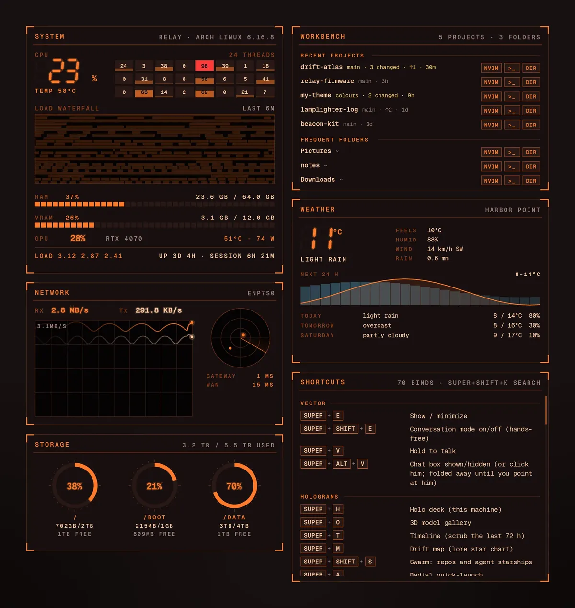
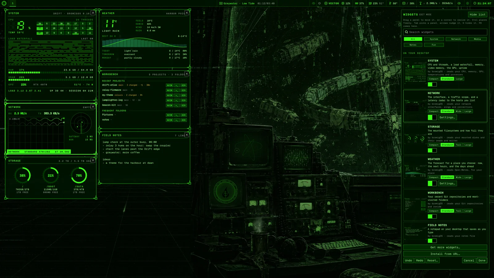

# Panels (widgets)

The panels, which most people call widgets, are small dashboards on the desktop. They sit
above the animated background and below your windows. They start on the primary monitor,
and you can drag each one onto any monitor. Each shows real readings only, and every part
you can hover over explains what it is and what a click does.

This page covers what each panel shows and how to configure it. The manual's
[Panels](../manual/src/panels.md) page is the user's guide. The code is described in
[widgets/README.md](../widgets/README.md), and the package is `bromigos-widgets`.



<!-- site:panels -->
## The panels

| Panel | Shows | On by default |
|---|---|---|
| `system` | CPU and threads, a load waterfall, memory, video memory, the GPU, uptime | Yes |
| `network` | The interface, a traffic scope, and a latency radar to the hosts you list | Yes |
| `storage` | The mounted filesystems and how full they are | Yes |
| `workbench` | Your recent Git repositories and most-visited folders | Yes |
| `notes` | Field notes, a notepad that saves as you type | Yes |
| `shortcuts` | Every key binding, read from Hyprland | Yes |
| `weather` | The forecast for a place you choose ([below](#weather)) | No |
| `connections` | Network connections, Wi-Fi and VPNs ([below](#connections)) | No |
| `lab` | Your homelab at a glance, and any panels you declare ([homelab.md](homelab.md)) | With `bromigos-homelab` and a configured homelab |
| `gpu` | The graphics card: load, video memory, temperature, power, and which programs use it ([below](#gpu)) | No |
| `updates` | Updates waiting, what needs a restart, and your last updates with their snapshots ([below](#updates)) | No |
| `vector` | VECTOR's state, his emergency switch, his recent actions and his pull requests ([below](#vector)) | No |
| `ci` | CI & PRs: the build-status board for the repositories you list ([below](#ci--prs)) | No |
| `github` | Your GitHub feed: notifications, reviews, your repositories ([below](#github)) | No |
| `gitlab` | Your GitLab merge requests, to-dos and pipelines ([below](#gitlab)) | No |
| `calendars` | Today's and the coming days' events from ICS calendars ([below](#calendar)) | No |
| `nowplaying` | What a media player plays, with its cover, the controls and a visualizer ([below](#now-playing)) | No |
| `spotify` | Your Spotify account: what plays on any device, the queue and recent tracks ([below](#spotify)) | No |
| `twitch` | Your Twitch channel, and the channels you follow that are live ([below](#twitch)) | No |
| `youtube` | A channel's latest videos, and whether it's live ([below](#youtube)) | No |
| `discord` | Who's online in a Discord server ([below](#discord)) | No |
| `labjobs` | The lab job queue: what runs, what waits and why ([below](#the-homelabs-widgets)) | No. Offered with `bromigos-homelab` and a configured homelab |
| `solar` | Solar now: what the roof makes, what the house uses, the grid and batteries ([below](#the-homelabs-widgets)) | No. Offered when a homelab source provides energy |
| `games` | Your homelab's game servers: up or down, and who's playing ([below](#the-homelabs-widgets)) | No. Offered when a homelab source provides games |
| `alerts` | The homelab's firing and pending alerts, worst first ([below](#the-homelabs-widgets)) | No. Offered when a homelab source provides alerts |
| `media` | The den TV's now and next, and a media server's continue watching and recently added ([below](#media)) | No. Offered with a Jellyfin or Plex source, or a den TV channel |

## Show or hide a panel

Each panel has a key. Super+W shows or hides them all. Super+S, Super+N, Super+D,
Super+B and Super+F toggle the system, network, storage, workbench and notes panels. The
manual's [Keys](../manual/src/keys.md) page has the full list.

From a terminal:

```bash
bromigos-widgets toggle <name>     # show or hide one panel, or all
bromigos-widgets show <name>       # show one panel, or all; never hides
```

`show` and `notes` start the panels first if they aren't running. The app launcher's
Desktop Panels entry runs `show all`.

A panel's key shows or hides it until you log out. To choose which panels start with
your session, use edit mode, Settings › Widgets or `bromigos panels show|hide <name>`.

To look at a panel without the desktop, draw it offscreen:

```bash
bromigos-widgets render <name> out.png
```

## Edit mode

Edit mode lets you arrange the panels on the desktop itself. To start it, do any of
these:

- press Super+Alt+W;
- right-click a panel (FIELD NOTES: its header);
- choose **Edit widgets** in the menu (Super+Space);
- click **Edit on the desktop** in Settings › Widgets;
- run `bromigos panels edit`.



The panels come up above your windows and keep updating. A frame and a name mark each
one, on every monitor, and the widget gallery opens beside them in a tray you can drag
aside. The tray opens on the monitor you're using.

| To | Do this |
|---|---|
| Move a panel | Drag it. It snaps to an 8 px grid and to the other panels' edges, and a guide line shows what it lined up with. Hold Ctrl to place it freely. |
| Put a panel on another monitor | Drag it over the monitor's edge, or pick it and choose the monitor in the tray's **Monitor** list. |
| Resize a panel | Drag a corner. Each panel has its own smallest and largest size. |
| Hide a panel | Click its ×, or pick it and press H. |
| Show a hidden panel | Flip its switch in the tray. It goes back where it was, or to a free spot if that's taken. **Add to desktop** always finds it a free spot. |
| Pick a panel | Click it, or press Tab and Shift+Tab. |
| Nudge the picked panel | The arrow keys move it 1 px, or 10 px with Shift. Ctrl and an arrow resizes it. |
| Move between the panels and the tray | F6 |
| Undo or redo | Ctrl+Z, Ctrl+Shift+Z, or the tray's buttons |
| Go back to bromigOS's layout | **Reset…** in the tray, then **Reset**. Ctrl+Z undoes it. |
| Save and leave | Esc, **Done**, or Super+Alt+W again |
| Leave without saving | **Cancel**. Everything goes back as it was. |

Saving writes `layout.json` (see [below](#place-the-panels)) with every panel's place,
size and whether it's on. A panel that a bigger monitor left off the screen comes onto it
when edit mode starts, so you can reach it.

Why not just Alt and a drag? Hyprland uses Alt+drag (or Super+drag) to move windows, and
catches the drag before a panel sees it. A panel also never learns that a key is held
while it doesn't have the keyboard. Edit mode takes the pointer and the keyboard for as
long as it's on, so a plain drag works.

### More than one monitor

Each panel can sit on any monitor. Drag it over a monitor's edge and it goes onto that
monitor. The tray's **Monitor** list, shown when there's more than one, does the same for
the picked panel.

A panel remembers its monitor by the monitor's make, model and serial number, so it finds
the monitor again on another port. When a monitor doesn't report those, the panel goes by
the port's name, such as `DP-1`.

When you unplug a monitor, its panels move to the primary monitor. Each goes to its own
place there if that's free, and to a free spot if not. Its place on the unplugged monitor
is kept, even if you save in edit mode meanwhile, and it goes back when you plug the
monitor in again. If you move it by hand while it's on the primary, it stays where you put
it.

A panel you never put on another monitor goes on the primary monitor
([desktop.md](desktop.md#what-goes-on-which-monitor)). `bromigos panels monitor <name>`
puts every panel on one monitor and forgets each one's own.

## The widget gallery

The widget gallery lists every panel there is, including hidden ones. It's in three
places: edit mode's tray, the Widgets tab of the Customize window (`bromigos customize
--tab widgets`, or Ctrl+Tab from the theme switcher), and Settings › Widgets. Its sections
are:

- **On your desktop:** the panels that are on;
- **Built in:** bromigOS's panels that are off, and the homelab's;
- **Installed extensions:** panels from extensions you installed with `bromigos ext`;
- **Your own:** panels from your plugin folder.

Each card shows a picture of the panel, its name, what it shows, who made it and what it
reads. It has an on/off switch, **Add to desktop**, and **Settings…** for a panel with
settings of its own, such as the weather's place. Search finds a panel by any of those
words, and the category buttons narrow the list. There's a button for each category the
widgets declare: bromigOS's System, Network, Homelab, Media, Notes and Fun when a widget is
in them, then any other a widget names. Each button's hint says how many widgets it holds.
`gallery.categories()` in `widgets/gallery.py` makes the list for all three galleries.

**Install from URL** installs a widget from any git repository, or a folder on this
machine. It shows the widget's name, its maker and licence, what it reads, whether it runs
code and what it may reach, before anything is installed. **Install** is your approval
([extensions.md](extensions.md#trust-and-approval) says how it's recorded). In edit mode,
the tray's **Install from URL…** saves, leaves edit mode and opens it in Settings.

**Get more widgets** browses the community catalog, which `bromigos ext search --kind
widget` reads. Each entry shows its author, its licence, a link to its repository, and
whether it runs code. A widget always runs code. So **Install…** opens a terminal, where
`bromigos ext install` shows what the widget can do and asks you first.
[extensions.md](extensions.md) has the rules. **Uninstall** removes an installed one.

A panel tells the gallery about itself through a few class attributes. Writing your own
is in [plugins.md](plugins.md#what-the-gallery-shows).


The Customize window shows the gallery as cards, like the themes beside it. **Arrange on
the desktop** closes it and starts edit mode. A widget you installed or made has
**Remove**: an extension's goes with `bromigos ext remove`, and your own plugin file goes
to the trash. bromigOS's own widgets can only be switched off.

From a terminal:

```bash
bromigos panels gallery           # every panel, with its words and where it sits
bromigos panels add weather       # turn one on, in a free spot
```

## Adding a widget

A new widget is one Python file. Where it goes says who it's for:

| For | Put the file in |
|---|---|
| bromigOS itself, built in | `widgets/plugins/<name>.py` in this repository. The package installs every file there. |
| Everyone, from the catalog | An extension (`bromigos ext new widget <name>`, [extensions.md](extensions.md)) |
| You alone | `~/.config/bromigos/plugins/widgets/<name>.py` |

The steps:

1. Write a `panels.Panel` subclass with `name` and `title`, and set `PANEL` to it.
   `tick()` reads the data every `interval` seconds, and `draw(cr, w, h)` paints it with
   the helpers in `widgets/draw.py`. Give each part a hover hint with `region()`.
2. Fill in what the gallery shows: `description`, `category`, `reads`, `min_size` and
   `max_size` ([plugins.md](plugins.md#what-the-gallery-shows)). Lay the panel out from
   the `w` and `h` that `draw()` gets, so any size in its range looks right.
3. If it needs something that may not be there, such as a configured source, give it an
   `available()` class method that says so. The gallery won't offer it until it is.
4. Set `LAYOUT = {"width": …, "height": …, "visible": False}` if it shouldn't appear
   until someone switches it on. Without a position, it finds a free spot.
5. Read real data only. When there's nothing to read, say so in the panel. For pictures,
   give `demo.py` steady made-up readings for it.
6. Draw it offscreen with `bromigos-widgets render <name> out.png` and look at it at its
   smallest and largest sizes.

To make bigger sizes worth having, give it [size classes](#size-classes).

The panels pick the file up within 2 seconds. It appears in the widget gallery under its
category, with its own picture, and edit mode can place and size it. Nothing else needs
to change: no list to add it to, no key, no layout entry.

## Size classes

A panel can have several sizes, each with a layout of its own: a compact readout, the
standard panel, and wider, taller or larger ones that show more. These sizes are its
*size classes*.

| Class | Meant for |
|---|---|
| `compact` | One reading at a glance |
| `standard` | The panel as it's usually seen |
| `wide` | More across: a longer history, a strip of hours |
| `tall` | More down: a longer list |
| `large` | More of everything, and room for bigger pictures |

In edit mode, a panel resizes freely inside a class. Between two classes it snaps to the
nearest one, so it's never at a size it has no layout for. The gallery's cards have a
size picker, and **Add to desktop** uses the panel's default class.

bromigOS's panels have these:

| Panel | Sizes | What the bigger sizes add |
|---|---|---|
| `system` | compact, standard, large | Compact is one CPU ring with memory and the GPU. Large adds each thread's history, the whole CPU over time, every temperature and the busiest processes. |
| `network` | compact, standard, wide, large | Wide adds the last hour of traffic. Large adds who this machine is talking to, and every interface. |
| `storage` | compact, standard, tall, large | Tall lists every filesystem with its device, and the disks' reads and writes over time. Large puts rings across the top. |
| `workbench` | compact, standard, tall, large | Tall and large add each project's last commit and a fortnight of commits. |
| `shortcuts` | standard, wide | Wide sets the sections out in columns. |
| `weather` | compact, standard, wide, large | Wide is a strip of the next hours. Large adds the week ahead. |
| `connections` | compact, standard, tall | Tall lists every network in reach and the saved ones. |
| `lab` | compact, standard, large | Large adds a turning hologram of the lab's nodes, the holo deck's constellation. Reduced motion holds it still. |

FIELD NOTES has one size: a bigger pad shows more of your notes.

The bigger sizes read more only while they're shown. For example, SYSTEM lists processes
only when it's large, and NETWORK reads its connections only then.

To give a panel size classes:

1. Set `sizes` on your `Panel` subclass. Each class has a smallest and a largest
   (width, height) in pixels, and may have a third, the size it starts at. Without that,
   it starts at its smallest. No size may be in two classes, so keep their ranges apart.
2. Set `default_size` to the class it starts in.
3. In `draw(cr, w, h)`, ask which class you're drawing with `self.size_class(w, h)`,
   and lay out for it. Inside a class, lay out from `w` and `h`, because the user can
   make it any size in the class's range.
4. Draw each class offscreen, at its smallest and largest:
   `bromigos-widgets render <name> out.png --size <w>x<h>`.

```python
class MoonPanel(Panel):
    name, title = "moon", "MOON"
    sizes = {
        "compact": ((240, 120), (360, 180)),
        "standard": ((380, 172), (560, 260), (380, 172)),
        "large": ((640, 400), (960, 720)),
    }
    default_size = "standard"

    def draw(self, cr, w, h):
        top = D.frame(cr, w, h, self.title)
        if self.size_class(w, h) == "compact":
            ...                                # the disc and the percentage
        elif self.size_class(w, h) == "large":
            ...                                # the month ahead as a row of discs
        else:
            ...
```

A panel that declares no `sizes` has one class, `standard`, from `min_size` to
`max_size`, and simply gets the size the user chose. `tick()` can read what the last
draw used, so a panel can sample more only while it's large.

## A widget's settings

A widget can have settings of its own, such as a place, a list of hosts or an account to
sign in to. It declares them, and bromigOS draws the form: the card's **Settings…**
button, in edit mode's tray and in Settings › Widgets, opens it. The values are saved in
`~/.config/bromigos/widgets/<name>.toml`, and the widget reads them again as soon as the
file changes.

1. List the fields in `settings` on your `Panel` subclass. Each is a dict:

   | Key | What it is |
   |---|---|
   | `key` | The name the value is saved under |
   | `label` | What the form calls it |
   | `kind` | `text`, `list`, `number`, `bool`, `choice` or `secret-signin` |
   | `default` | Its value until the user sets one |
   | `hint` | One line under it, saying what it's for |
   | `choices` | For `choice`: a list of `[value, label]` pairs |
   | `min`, `max`, `step` | For `number`: its range |
   | `provider` | For `secret-signin`: `github`, `gitlab`, `twitch` or `spotify` |

2. Read a value with `self.setting("<key>")`. It's the field's default, then the panel's
   key in `layout.json`, then the user's file, last one wins.

```python
class TidePanel(Panel):
    name, title = "tide", "TIDE"
    settings = [
        {"key": "harbour", "label": "Harbour", "kind": "text", "default": "", "hint": "As the tide table names it"},
        {"key": "every", "label": "Check every (minutes)", "kind": "number", "default": 30, "min": 5, "max": 720},
        {"key": "units", "label": "Heights in", "kind": "choice", "default": "metres",
         "choices": [["metres", "Metres"], ["feet", "Feet"]]},
    ]

    def draw(self, cr, w, h):
        D.frame(cr, w, h, self.title, self.setting("harbour").upper())
```

From a terminal, `bromigos panels settings <name>` shows the fields and their values,
`bromigos panels set <name> <key> <value>` changes one, and `bromigos panels unset <name>
<key>` puts it back to its default. A `list` takes several values.

The file is replaced in one step, and a symbolic link stays a link, as with `layout.json`.

### Accounts

A `secret-signin` field isn't a value in the file. It's a sign-in to an online account,
through the shared helper `lib/bromigos_account.py`. The form shows **Sign in**, then
**Signed in as …** with **Sign out**.

- **The sign-in.** For GitHub, GitLab and Twitch, the form shows a short code, large, with
  **Copy**, **Open the page** and how long the code still works. You type the code on the
  service's own page. For Spotify, **Open the sign-in page** opens it, and the form
  finishes by itself when you approve.
- **Connecting a service.** bromigOS has its own apps for GitHub, gitlab.com and Twitch,
  so those go straight to Sign in. Spotify, and a GitLab server of your own, need your own
  app's client ID once (and the GitLab server's address). When one is missing, the form asks for it under **Connect
  <service>**, with where to make the app. It's saved in `~/.config/bromigos/accounts.toml`
  and shared by every widget that uses that service.
- **GitHub through gh.** If you're signed in to the `gh` command, the form says **Signed
  in through gh as …**, and there's nothing to do.
- **A GitLab token.** **Paste a token…** stores a personal access token instead.

Tokens go to your login keyring, never to a file. The form never shows one, and nothing
logs one. A widget gets a usable token with `bromigos_account.token("<provider>")`.

## Place the panels

The layout lives in `~/.config/bromigos/widgets/layout.json`. Edit mode, Settings and
`bromigos panels` write it for you. To edit it by hand, start from a copy of the
packaged default:

```bash
mkdir -p ~/.config/bromigos/widgets
cp /usr/share/bromigos/widgets/layout.json ~/.config/bromigos/widgets/
```

Your file replaces the default whole. Each panel's entry has `x`, `y`, `width`, `height`
and `visible`, plus that panel's own keys. Positions are in pixels from the top left of
the area under the bar, on the panel's monitor. After you edit it, run `bromigos-widgets
reload`.

A panel on a monitor of its own has an `output` key. Edit mode writes it:

```json
{ "name": "system", "x": 28, "y": 16, "width": 470, "height": 470,
  "output": { "make": "Dell Inc.", "model": "DELL U2723QE", "serial": "1A2B3C", "name": "DP-2" } }
```

A panel without `output` goes on the layout's `"monitor"`, or on the primary monitor when
that's `""`. The layout's `"version"` is 2. A layout from before each panel had its own
monitor has one `"monitor"` for every panel. When the panels start, they give each panel
that monitor as its `output` and write the file back, through a symbolic link if it is
one.

Panel plugins and the homelab's panels find free space on their own unless your layout
places them. Once you move or switch one in edit mode, it gets an entry of its own.
[plugins.md](plugins.md) explains how to write a panel of your own.

Your `layout.json` can be a symbolic link, for example into a dotfiles repository. Every
writer replaces the file it points to in one step, and the link stays a link.
`bromigos panels reset` writes bromigOS's layout through the link instead of removing it.

## High contrast

With high contrast on ([accessibility.md](accessibility.md)), the panels take the theme's
high-contrast colours from `palette.json`, like everything else. They also draw their
plates opaque, their lines near solid, and their text without a glow. A plugin panel can
ask whether high contrast is on with `bromigos_theme.high_contrast()`.

## Weather

The weather panel shows:

- **now:** the temperature, the conditions in words, how it feels, humidity, wind, and
  rain in the last hour;
- **the next 24 hours:** temperature as a line and the chance of rain as bars;
- **the next three days:** conditions, low and high, and the chance of rain. Hover for
  sunrise and sunset.

The forecast comes from [Open-Meteo](https://open-meteo.com). It's free, needs no key,
and is licensed CC BY 4.0, which the header's hover credits. The panel fetches it every
10 minutes.

Nothing is fetched until you set a location. Put it in `~/.config/bromigos/weather.toml`,
or in the weather panel's entry in `layout.json`:

```toml
# ~/.config/bromigos/weather.toml
place = "San Diego"        # looked up once through Open-Meteo's geocoder
# lat = 32.72              # or give the coordinates instead
# lon = -117.16
name = "Home"              # the header's label; defaults to the place's name
units = "imperial"         # °F and mph; the default, "metric", is °C and km/h
```

Then turn the panel on by setting `"visible": true` on the `weather` entry in your
`layout.json`.

## Media

The media panel, `widgets/plugins/media.py`, follows the den TV
([live/README.md](../live/README.md#the-den-tv)). It asks the live layer what's on through
`bromigos-live tv state`. When the den isn't drawn, it works out its own channel's schedule
from the same cache (`lib/bromigos_tv.py`).

| Size class | Shows |
|---|---|
| `compact` | What's on, how far in, and what's next |
| `wide` | The TV's buttons (channel, sound, volume, full screen), and continue watching |
| `large` | Recently added too, with posters |

Continue watching and recently added come from the first Jellyfin or Plex source in
`homelab.toml`, or the one the panel's `source` names, every 5 minutes and only while the
panel is wide or large ([homelab.md](homelab.md#video-libraries)).

Its settings, in `~/.config/bromigos/widgets/media.toml`, describe one den TV channel:

| Key | What it sets |
|---|---|
| `source` | A Jellyfin or Plex source's name, or `youtube` |
| `play` | What to play: `library:<name>`, `collection:<name>` or `playlist:<name>`. The form lists what the servers last offered. |
| `youtube` | A YouTube playlist's or channel's address, with `source = "youtube"` |
| `order` | `shuffle` or `in order`. Empty: a playlist in order, the rest shuffled. |
| `screen` | `big`, `wave` or `emblem` |
| `channel_name` | What the TV calls the channel |
| `keep`, `keep_all`, `keep_max_gb` | For YouTube: a folder to keep videos in, whether to keep every video, and a cap in GB |

The panel is offered in the gallery only when there's something to show: a `video`
source in `homelab.toml`, or a den TV channel.

## Connections

The connections panel reads NetworkManager through `nmcli`. It shows:

- what's connected, with its name, kind and device;
- the Wi-Fi networks in reach, with signal strength and a lock for secured ones;
- your VPNs, including WireGuard;
- a switch for the Wi-Fi radio, in the header.

Click a Wi-Fi network to join it. A saved or open network connects straight away. A new
secured network opens `nmtui connect` in a terminal so you can type the password. Click a
VPN to bring it up or down.

The panel checks every 15 seconds. It says so when NetworkManager isn't running. To turn
it on, set `"visible": true` on the `connections` entry in your `layout.json`.

## The built-in widgets

bromigOS ships more widgets than it shows at first. They're all off until you add them
from the [widget gallery](#the-widget-gallery), or with `bromigos panels add <name>`. Each
one:

- has a layout for every [size class](#size-classes). A bigger size shows more, not the
  same thing larger;
- reads its source only while you can see it, and stops while it's hidden or covered;
- says what's missing when its source isn't set up, and how to set it up;
- keeps its own settings on its card's **Settings…**, saved in
  `~/.config/bromigos/widgets/<name>.toml` ([above](#a-widgets-settings)).

The widgets that read an online account sign in through Settings, or with `bromigos
account` ([Accounts](#accounts)).

### GPU

The GPU panel shows the graphics card's load, video memory, temperature, power draw,
clocks and fan. It also lists the programs that use the card, with each one's video
memory, and on NVIDIA its share of the card's work.

- **NVIDIA** cards are read through NVML, the library the driver installs. The panel
  reads it directly, every 2 seconds, without starting `nvidia-smi`.
- **AMD** cards are read from the kernel's files in `/sys/class/drm`. The kernel doesn't
  say which program uses an AMD card, so the panel says so.
- **Intel** cards give only their clock there. The panel says that the load needs
  `intel_gpu_top`.

Large and wide add ten minutes of history for the load, video memory, temperature and
power. With several cards, the first is shown and large lists the others.

### Updates

The updates panel shows what `bromigos update` would do: the upgrades waiting in the
repositories and the AUR, migrations, and anything that needs a restart or a reboot. It
also shows your last updates and the snapshots taken before and after each one.

- **Update** runs `bromigos update` in your terminal. It asks before it changes anything.
- **Check** checks now.

Checking syncs a throwaway copy of the package databases, so the panel checks at most
every 3 hours while it's on screen, and again when packages change. It keeps the answer
in `~/.cache/bromigos/widgets/updates.json`, so starting the panels again doesn't check
again. It needs `pacman-contrib` for `checkupdates`.

### VECTOR

The VECTOR panel shows:

- what he's doing now, with his mood, voice and model, from his state file;
- his emergency switch. A click is the same as Super+Ctrl+Esc: off at once, and back on
  only after you answer YES;
- his recent actions from his audit log: each tool, whether it went through, and when.
  The values he passed are never shown, only their names, and anything that looks like a
  token is hidden;
- his open pull requests, through your own `gh` login, every 5 minutes. Click one to
  open it.

His GitHub account is the `account` setting. It's `bromigodev` unless you change it. When
VECTOR isn't installed, the gallery doesn't offer the panel.

### CI & PRs

The CI & PRs panel is the build-status board. For each repository you list, it shows
whether the default branch's latest commit passes its checks, and the last ten commits as
a strip of lights. Under them are the pull requests that ask for your review, and your own
open ones with their checks and review state.

It reads GitHub through your `gh` login, in one query every 3 minutes while it's on
screen. Its settings:

```toml
# ~/.config/bromigos/widgets/ci.toml
repos = ["owner/name", "owner/other"]
mine = true            # your own open pull requests too
```

With no repositories, it shows only the pull requests. The [GitHub](#github) panel is the
personal feed.

### GitHub

The GitHub panel is your personal feed:

- your notifications;
- pull requests that ask for your review, and issues or pull requests assigned to you;
- your repositories, newest push first, with their stars, and what happened on them
  lately, such as stars, forks and new issues.

Large adds your open pull requests and your contribution graph for the last year. Click
any row to open it on GitHub.

If you've signed in to the `gh` command, the panel uses that login. It asks `gh` for the
token each time and never stores it. Without `gh`, click **Sign in** in its
**Settings…** ([Accounts](#accounts)) and enter the code on GitHub's page. bromigOS has its
own GitHub app for this, so there's nothing to register. To use an app of your own, make an
OAuth app at github.com › Settings › Developer settings › OAuth Apps with **Enable Device
Flow** ticked and **Expire user access tokens** unticked, then run
`bromigos account configure github client_id=ID`.

The panel reads GitHub every 4 minutes while you can see it. Each request carries the
last answer's ETag, so an unchanged answer doesn't count against GitHub's rate limit. It
reads the contribution graph once an hour, and only while large. Settings: `repos` (how
many repositories to list) and `activity_repos` (how many to read activity from).

### GitLab

The GitLab panel shows your work on gitlab.com or on your own GitLab:

- merge requests that ask for your review or are assigned to you, with their pipeline's
  state and any merge conflicts;
- your to-do list;
- the latest pipelines of the projects you were last active in. Wide, tall and large
  show each project's recent pipelines as a strip.

On gitlab.com, click **Sign in** in the panel's **Settings…** and enter the code on
GitLab's page; bromigOS has its own gitlab.com app. For your own GitLab server, set its
address once: `bromigos account configure gitlab base=https://git.example.org`. Then sign
in one of two ways:

- **The device flow**, on GitLab 17.2 or later. In GitLab, User settings › Applications:
  add an application, untick **Confidential**, tick **Device authorization grant**,
  `read_api` and `read_user`, and give the redirect URI `http://localhost`. Give the panel
  its application ID.
- **A personal access token** with `read_api`: **Paste a token…** in the panel's
  settings, or `bromigos account set-token gitlab`.

The panel reads GitLab every 4 minutes while you can see it. Setting: `projects`, how
many projects show their pipelines.

### Calendar

The calendar panel (`calendars`) shows today's events and the days ahead. It reads ICS
calendars, the format almost every calendar app can share. You don't sign in to anything.

| Size | Shows |
|---|---|
| Compact | The next event, and how long until it starts or ends |
| Standard | Today's events, then the next few |
| Wide | Three to five days side by side |
| Tall | The next seven days as a list |
| Large | A week as a grid of hours, with a line at the time now |

Hover over an event for its time, place and notes. If its place is a web address, or its
notes hold a video-call link, a click opens it.

```toml
# ~/.config/bromigos/widgets/calendars.toml
calendars = [
  "https://calendar.example.org/me/basic.ics",   # an address; webcal:// works too
  "~/Documents/holidays.ics",                    # a file
  "~/.local/share/calendars/home",               # a folder of .ics files (vdirsyncer)
]
week_start = "monday"     # the large grid's first day: "today" (the default), "monday" or "sunday"
```

To give a calendar a name or a colour, write it as a table instead:

```toml
[[calendars]]
source = "https://calendar.example.org/team.ics"
name = "Work"
colour = "#58a6ff"
```

A CalDAV server, such as Nextcloud, Radicale or Fastmail, gives each calendar an export
or subscription address. vdirsyncer syncs a CalDAV account to folders of `.ics` files.

The panel fetches each address every 15 minutes while you can see it, and asks first
whether anything changed. It keeps the last copy, so it still works offline. It reads
files again when they change. Repeating events, time zones, all-day events and moved or
cancelled meetings are handled. It needs `python-icalendar` and `python-dateutil`, and
says so when they're missing.

### Now playing

The now playing panel shows what a media player on this computer plays: Spotify,
Firefox, mpv, VLC, or any other player that speaks MPRIS, the desktop's standard way for
players to say what they play and take commands. It shows the title, artist, album and
cover, the position (click the bar to jump), previous, play or pause and next, and a
visualizer when [cava](https://github.com/karlstav/cava) is installed.

With several players open, it shows the one playing. Tall and large list every player;
click one to show it. Covers from the web are downloaded once and kept in
`~/.cache/bromigos/widgets/art/`. It needs `playerctl`.

The visualizer runs cava only while something plays and the panel is on screen. It stops
when the music pauses, when the panel is hidden, and when motion is reduced
([accessibility.md](accessibility.md)). Settings: `player` (always show this player when
it's open) and `visualizer` (off for no visualizer).

### Spotify

The Spotify panel shows what your Spotify account plays on any device: a phone, a
speaker or this computer. It shows the track and cover, the device, its volume, shuffle
and repeat, and previous, play or pause and next. Tall and large add what's up next and
what you played recently.

It works with [now playing](#now-playing). When the Spotify app runs here, this panel's
clicks go to the app, which is instant and works with a free account. Without the app,
they go through Spotify's Web API, which allows them for Premium accounts only.

To set it up:

1. Create an app at [developer.spotify.com/dashboard](https://developer.spotify.com/dashboard)
   with **Web API** ticked.
2. Add the redirect URI `http://127.0.0.1:8898/callback`, exactly as written.
3. Give the panel the app's client ID, then sign in ([Accounts](#accounts)). Your browser
   opens Spotify's page; approve it.

The panel listens on `127.0.0.1:8898` only while you sign in. To use another port, run
`bromigos account configure spotify port=NNNN` and change the redirect URI to match.

It asks Spotify what's playing every 5 seconds while something plays and the panel is on
screen, and every 20 seconds while paused. It reads the queue and the history once a
minute, and only while tall or large. Setting: `show_queue`.

### Twitch

The Twitch panel shows your own channel (live or offline, viewers, title, category) and
the channels you follow that are live now, busiest first. Click one to open it on
twitch.tv. Large adds the featured stream's picture and its chat activity, in messages a
minute. Chat activity comes from Twitch's read-only guest chat. The panel counts messages
and never keeps or shows what they say, and connects only while it's large, on screen and
the stream is live.

To set it up, open its **Settings…** and click **Sign in** ([Accounts](#accounts)).
Twitch's activation page opens; enter the code the panel shows. bromigOS has its own
Twitch app, so there's nothing to register.

To use an app of your own instead, register one at
[dev.twitch.tv/console/apps](https://dev.twitch.tv/console/apps) with **Client Type**
**Public** and the OAuth redirect URL `http://localhost` (Twitch asks for one; the sign-in
doesn't use it), then run `bromigos account configure twitch client_id=ID`.

The panel reads Twitch every minute while you can see it. Setting: `channels`, more
channels to watch, by their Twitch login.

### YouTube

The YouTube panel shows a channel's latest videos and whether it's live, with no account
and no API key. Set `channel` to an @handle or a channel ID (UC…). A handle is looked up
once and remembered. Set `shorts = false` to leave Shorts out.

- **The videos** come from the channel's public feed, every 15 minutes while the panel is
  on screen.
- **Live or not:** the feed doesn't say, so the panel opens the channel's `/live` page
  every 10 minutes. When it can't tell, it says the live status is unknown rather than
  guess.

Click a video to open it. Wide and tall add a chart of the latest videos' views. Large
shows each video's picture, fetched only while the panel is large.

### Discord

The Discord panel shows how many members of a Discord server are online, with no sign-in
and no token. It reads Discord's public invite and server widget:

```toml
# ~/.config/bromigos/widgets/discord.toml
invite = "abc123"          # an invite code, or a discord.gg/… link
server = "1234567890"      # a server ID whose widget is on
```

- **An invite** gives the server's name and icon, the members online and the members in
  all. Use one that doesn't expire.
- **A server ID** gives who's online by name, their status, and who's in each voice
  channel. The server's widget must be on: in Discord, **Server Settings › Widget ›
  Enable Server Widget**, which also shows the server ID.

The panel reads Discord every 3 minutes while you can see it, and draws the online count
over time. Discord's counts are approximate and can lag a few minutes.

### The homelab's widgets

`bromigos-homelab` adds four widgets. The gallery offers each one only when your
`homelab.toml` has a source for it ([homelab.md](homelab.md)).

- **LAB JOBS** reads the lab job queue, the same as `bromigos lab jobs`. It shows the job
  that runs and how far along it is, the jobs that wait and why, and the GPU's free
  memory, with what the next job needs outlined. Large adds the last 6 hours and each
  kind's count and time. Click a finished job to open what it made, or another job to
  read its log. The × cancels a job after a second click.
- **SOLAR** reads an Enphase gateway (an `enphase` source): what the roof makes, what the
  house uses, what goes to or comes from the grid, and the batteries. Large draws them
  joined by lines as thick as the power on them, and today's curve. The gateway keeps no
  history on the network, so the curve is the panel's own samples, kept for a week in
  `~/.local/state/bromigos/widgets/`, unless the source's `history_metric` names one.
- **GAME SERVERS** shows each server (`minecraft` and `pelican` sources), whether it's up,
  and how many play. Minecraft servers also give their version and, when they list them,
  the players' names. Click a Minecraft server to copy its address.
- **ALERTS** shows what fires and what's pending, worst first, with how long each has
  lasted. Click one to open its page on the source that raised it.

They read every 3 seconds (LAB JOBS), 30 seconds (SOLAR, ALERTS) or a minute (GAME
SERVERS), and stop while the panel is hidden.
