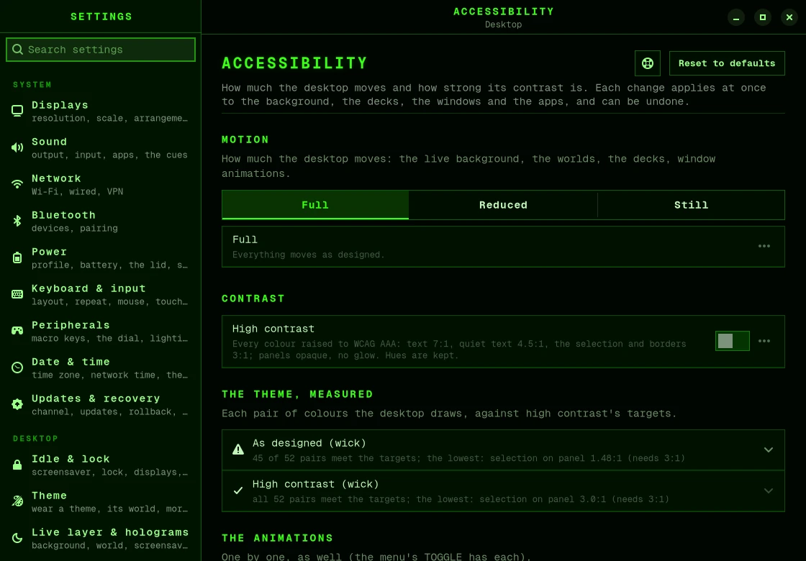

# Accessibility

bromigOS has two accessibility settings:

- **Motion**: how much the desktop moves. Choose full, reduced or still.
- **Contrast**: how strongly colours stand out. Choose normal or high.

Both work with every theme, your own included. A change shows at once.

## Change motion or contrast

1. Open **Settings › Accessibility** (<kbd>Super</kbd>+<kbd>,</kbd>).
2. Under motion, choose **Full**, **Reduced** or **Still**.
3. Turn **High contrast** on or off.



The page also shows how your theme's colours measure against contrast guidelines.

Other ways:

- **The menu.** Open **TOGGLE** and choose **Reduced motion**, **Still background** or
  **High contrast**.
- **A terminal:**

  ```bash
  bromigos accessibility                  # what's set, and how your theme's colours measure
  bromigos accessibility motion reduced   # full, reduced or still
  bromigos accessibility contrast high    # normal or high
  bromigos accessibility check mire       # measure a theme's colours, normal and high
  ```

  `a11y` is a shorter name for the same command: `bromigos a11y motion still`.
- **The first run** asks both questions.

## Motion

### Full

Everything moves as designed.

### Reduced

The same desktop, calmer. The animated background keeps its look and its life, at less
than half the speed. It loses what can trouble your eyes or your balance:

- the background no longer shifts as you move the mouse;
- nothing flickers, blinks or flashes: no lightning, no bursts of static;
- lights hold steady. A coding agent that needs you glows brighter instead of blinking;
- nothing spins, and no craft cross the sky.

Also:

- unlocking and logging in fade in, with no static and no sudden black;
- windows and workspaces fade instead of sliding;
- the animations inside GTK apps are off;
- [holograms](holograms.md) don't drift on their own.

### Still

Everything in Reduced, and the background holds still, like a photograph. It's drawn again
only when something it shows changes, such as an agent starting or finishing, the weather,
the hour or your homelab's health, or once a minute. Windows don't animate at all.

## High contrast

High contrast makes every colour in your theme stronger. On a dark theme, backgrounds get
deeper, and text, lines and the selected item get brighter.

- Text reaches a contrast of at least 7:1, and quieter labels at least 4.5:1.
- Each colour keeps its hue, so the theme still looks like itself.
- The bar, the menus, notifications and the terminal become solid instead of see-through.
- Window borders get wider.
- The panels lose their glow.

The painted scenery of the worlds, the login screen and the start-up screen keep their own
colours.

## Screen reader

The bromigOS USB stick can start with spoken output, for installing. See
[The install stick](boot-menu.md#the-install-stick).

## Your settings file

Your choices are in `~/.config/bromigos/accessibility.toml`. Updates don't overwrite it.
