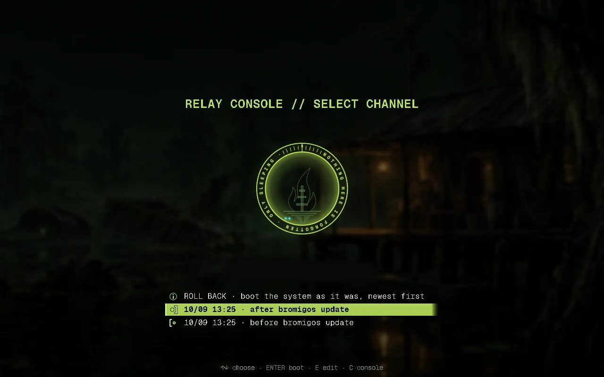
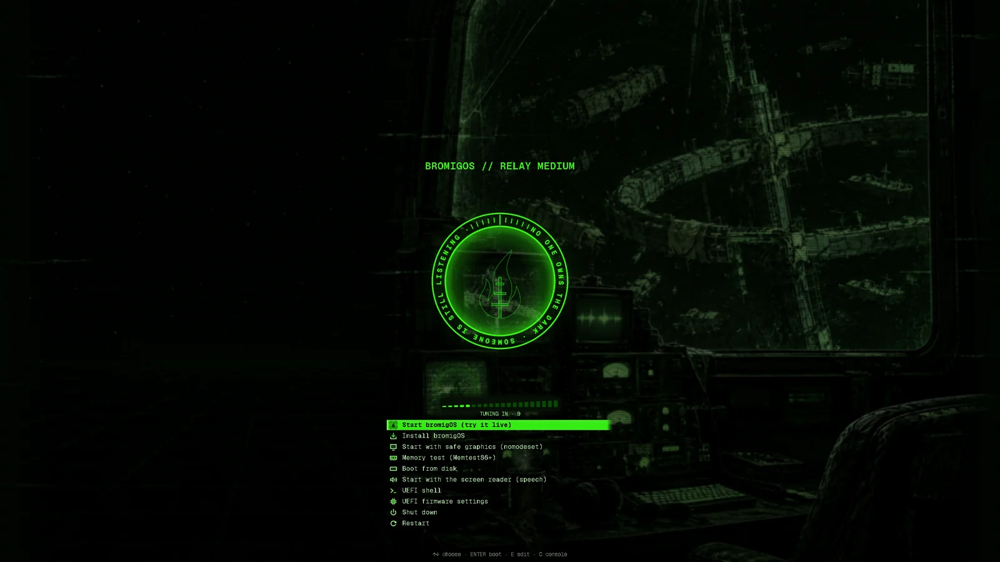

# The boot menu

The boot menu is the list you see for a few seconds when the computer starts, before
bromigOS loads. It lets you start bromigOS normally, or start it as it was before an
update. bromigOS dresses it in your theme.

The menu shows your theme's lock-screen picture with the [burn-in](glossary.md#burn-in)
in the middle, a signal meter that fills while it counts down, and the list of things you
can start. If you press nothing, the first entry starts.

The first entry, **bromigOS Linux**, starts bromigOS. **Advanced options for bromigOS
Linux** lists each installed kernel on its own, for when you need to choose one.

**More ways to start** lists other ways to start, each said in plain words:

- **Start without the desktop (text mode)**: a login prompt. Restart to get the desktop back.
- **Start with basic graphics**: for a screen that stays black. No graphics driver.
- **Start without the NVIDIA (or AMD, or Intel) driver**: another graphics card takes over,
  or the basic display.
- **Start and show every message**: no splash, for finding where it stops.
- **Start an older snapshot**: bromigOS as it was before an update.
- **bromigOS Field Kit**: [repairs, the lab and tools](fieldkit.md), without the desktop.

**Help: what do these do?** (or <kbd>H</kbd>) shows a page explaining every entry.

## Use the boot menu

| Key | What it does |
|---|---|
| <kbd>↑</kbd> <kbd>↓</kbd> | Choose an entry. |
| <kbd>Enter</kbd> | Start it. |
| <kbd>E</kbd> | Change the entry's start-up commands, for this start only. |
| <kbd>C</kbd> | Open GRUB's command line. |

## Start an older version after a bad update

On a btrfs system, bromigOS takes a [snapshot](glossary.md#snapshot) before and after
every update. If an update stops the computer from starting:

1. In the boot menu, choose **Roll back to a snapshot**.
2. Choose the snapshot from before the update. They're listed newest first, with the date
   and time, such as `10/09 00:28 · before bromigos update`.
3. Choose **Boot it: linux**. bromigOS starts as it was then.



A system started this way is temporary. Any changes you make last only until you restart.

To keep it, open a terminal (<kbd>Alt</kbd>+<kbd>Shift</kbd>+<kbd>Enter</kbd>) and run:

```bash
bromigos update --rollback
```

It shows which snapshot you started and what it will do, and asks first. Then restart, and
choose the first entry, **bromigOS Linux**. From now on the computer starts as it was in
that snapshot. Your home folder isn't touched.

If the update changed the kernel, the snapshot may stop at a black screen that says
"You are in emergency mode" and asks for the root password. Type it. On a computer
installed from the bromigOS USB stick, it's your own password. Then run these two
commands, with your user name in place of `<you>`:

```bash
su - <you>
bromigos update --rollback
```

It puts the snapshot's kernel back too.

See [Updating and rolling back](update-and-rollback.md#if-the-computer-wont-start) for
more.

## Theme the boot menu, or turn it off

When you change your theme, the boot menu follows. If `sudo` needs your password, the
change waits until your next `bromigos update`, and a notification tells you so. The
themes that come with bromigOS are drawn already. Your own themes, and high contrast, are
drawn on your machine.

```bash
bromigos boot theme           # is it on, which theme, and is it up to date
bromigos boot theme apply     # put the current theme in the boot menu now
bromigos boot theme off       # GRUB's plain menu, and it stays plain
bromigos boot theme on        # the themed menu again
```

With the theme off, the entries take GRUB's own names, such as **Arch Linux**, because
bromigOS is based on Arch Linux.

The themed menu is for GRUB, the boot loader bromigOS installs. If your computer starts
with another boot loader, such as systemd-boot or Limine, bromigOS leaves its menu alone.

Before it changes anything, bromigOS keeps a copy of your GRUB settings as
`/etc/default/grub.bromigos-bak`. It checks the new menu before it replaces the old one.

## The startup and shutdown splash

When Plymouth is enabled, the Wick's flame and turning ring stay on screen while the
system starts. The progress line and any disk passphrase prompt appear underneath.
On shutdown it says **SHUTTING DOWN**; on restart it says **RESTARTING**. A moving
marker shows activity, without guessing a percentage. Messages appear below the label.
Press <kbd>Escape</kbd> to see the detailed output.

The USB installer sets this up. On an existing GRUB system, check the settings and
enable the shutdown and restart visuals:

```sh
bromigos splash status
sudo bromigos splash on
```

This needs `plymouth` and `bromigos-settings` installed. The command selects the theme,
adds the saved `splash` kernel setting, and checks the generated boot menu before
replacing it. It prints where it saved the backups and log. Reboot once to load the
new kernel setting; subsequent shutdowns and restarts can show the visuals.

To undo the settings this command added:

```sh
sudo bromigos splash off
```

Your earlier theme choice and unrelated settings are preserved. Other boot loaders
and GRUB configurations with extra `.cfg` files need manual setup. The command reports
these cases without changing them.

An early startup splash also needs Plymouth in the initramfs, the small system loaded
before the main one. `bromigos splash` leaves that setup alone. The
[activation steps](https://github.com/bromigos-org/bromigOS/blob/main/docs/boot.md#activate-plymouth-on-an-existing-installation)
cover it. The [keyboard power menu](power-menu.md) works independently of the splash.

## The install stick

The bromigOS USB stick has a boot menu of its own, in the same style. Its entries:



| Entry | What it does |
|---|---|
| Start bromigOS (try it live) | Start the full desktop from the stick. Nothing is installed. |
| Install bromigOS | Start the desktop with the installer already open. See [Install](install.md#install-from-the-usb-stick). |
| Install bromigOS (text mode) | The same installer in text, with no desktop: for a computer whose picture doesn't come up, a serial console, or a screen reader. |
| Start with safe graphics (nomodeset) | Use this if the screen stays black with the first entry. |
| Memory test (Memtest86+) | Test the computer's memory. |
| Boot from disk | Start whatever is installed on the disk instead. |
| Start with the screen reader (speech) | Start with spoken output. Press <kbd>S</kbd> in the menu to choose it. |

UEFI computers also get entries for the UEFI shell and the firmware settings. Older BIOS
computers get a hardware information tool. Both have **Shut down** and **Restart**.
