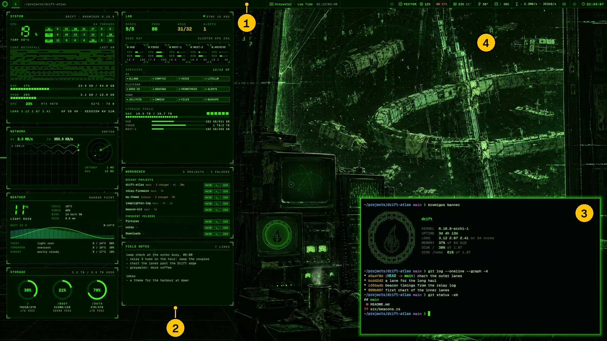
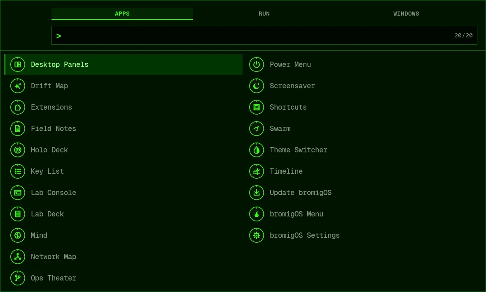

# Getting around

This page shows what's on the screen, the keys to learn first, and how to open apps, lock
the screen and log out.

## What's on the screen

1. **The bar**, along the top. It shows your workspaces, the window you're in, what's
   playing, and readings such as processor use and the clock. Click its parts to act on
   them. See [The bar](#the-bar), below.
2. **The panels**, on the left of your main monitor. They show live readings and your
   notes, under your windows. See [Panels](panels.md).
3. **Your windows**, such as this terminal. They tile: each new window takes a share of the
   screen, and nothing overlaps unless you ask. See [Windows and workspaces](windows.md).
4. **The background.** In the default theme it's the den, a radio room whose screens and
   meters move with your machine's readings. Other themes bring other scenes. See
   [Themes and worlds](themes-and-worlds.md).

Hover over anything on the bar or the panels. It says what it is and what it does.

## The keys to learn first

**Super** is the key with the Windows or logo symbol on it.

| Keys | What it does |
|---|---|
| <kbd>Super</kbd>+<kbd>Space</kbd> | Open the [menu](menu.md). Type to find any app or command. |
| <kbd>Alt</kbd>+<kbd>P</kbd> | Open the app launcher. |
| <kbd>Alt</kbd>+<kbd>Shift</kbd>+<kbd>Enter</kbd> | Open a terminal. |
| <kbd>Alt</kbd>+<kbd>C</kbd> | Close the window you're in. |
| <kbd>Super</kbd>+<kbd>,</kbd> | Open [Settings](settings.md). |
| <kbd>Super</kbd>+<kbd>K</kbd> | Show or hide the SHORTCUTS panel, which lists every key. |

The keys for windows use **Alt**, and so do everyday ones such as the launcher, the
terminal, screenshots and the power menu. bromigOS's other keys use **Super**. To change
any key, see [Your own shortcuts](shortcuts.md).

To search the keys by name, press <kbd>Super</kbd>+<kbd>Shift</kbd>+<kbd>K</kbd>, type,
and press <kbd>Enter</kbd> to run the one you pick. Every key is listed in
[Keys](keys.md).

## Open an app

- Press <kbd>Alt</kbd>+<kbd>P</kbd>, type part of the app's name, and press
  <kbd>Enter</kbd>.
- Or press <kbd>Super</kbd>+<kbd>Space</kbd> and type. The menu finds apps, settings and
  bromigOS's own tools.
- Or click the emblem at the left end of the bar.

bromigOS's own windows are in the launcher too, each with its own icon: **bromigOS
Settings**, **Theme Switcher**, **Shortcuts**, **Extensions**, **Update bromigOS** and the
[holograms](holograms.md).

To keep a website as an app of its own, see [Web apps](webapps.md).

## The bar

From left to right:

| Part | What it shows | Click it to |
|---|---|---|
| Emblem | The bromigOS flame. | Open the app launcher. Right-click to run a command. Middle-click for the power menu. |
| Workspaces | Your [workspaces](windows.md) that have windows. | Go to that workspace. |
| Window title | The window you're in. | |
| Music | What's playing, in the middle of the bar. | Play or pause. Right-click for the next track. Scroll to jump five seconds forwards or back. |
| GAME MODE | [Game mode](games.md) is on. | Leave game mode. Ctrl+Shift+F12 also leaves it. |
| Eye | What happens when you leave the computer. See [Idle and lock](idle.md). | Stay awake for an hour. Middle-click to stay awake until you stop it. Right-click for its settings. |
| Power mark | VECTOR's [emergency switch](vector.md#the-emergency-switch). A red VECTOR OFF while he's off. | Switch VECTOR off at once. While he's off, click to switch him back on, after a YES. |
| VECTOR | What [VECTOR](vector.md) is doing, and how many replies you haven't read. | Show him. Right-click to change his voice. Middle-click to mute his voice. |
| Processor, memory, graphics | How busy each is. Amber means busy, red means very busy. | Open a task manager. |
| Temperature | The processor's temperature. | |
| Disk | How full your disk is. | Open your home folder. |
| Network | Your connection, and how fast data is moving. | Copy your address. Right-click to edit connections in a terminal. |
| Bluetooth | Whether Bluetooth is on, how many devices are connected, and the main one's battery. See [Bluetooth](bluetooth.md). | Open the Bluetooth panel. Right-click for the quick menu. Middle-click to turn Bluetooth on or off. |
| Power profile | Laptops only. Saver, balanced or performance. | Switch to the next profile. |
| Battery | Laptops only. The charge: `+` while charging, `=` when plugged in but not charging. | |
| Volume | The speakers' volume. Rest the pointer on it for the sound popup. | Keep the sound popup open. Right- or middle-click to mute. Scroll to change the volume. |
| Tray | Icons that some apps add. | Depends on the app. |
| Gear | Settings. | Open [Settings](settings.md). Right-click for Idle & lock. |
| Clock | The time. Hover for a calendar. | Show the date. |

To hide the bar, press <kbd>Alt</kbd>+<kbd>B</kbd>. Press it again to bring the bar back.

### The sound popup

Rest the pointer on the volume for a moment and the sound popup opens under it. It closes
when the pointer has left both the volume and the popup. Click the volume, or anywhere in
the popup, to keep it open. Then <kbd>Esc</kbd>, a second click on the volume, or a click
anywhere else closes it. A click elsewhere still reaches what you clicked.

- **OUTPUT** lists your speakers, headphones, screens with speakers (HDMI or DisplayPort)
  and Bluetooth headphones. The one in use says **IN USE**. Click another to switch to it:
  what's playing moves there.
- **INPUT** lists your microphones the same way.
- Each has a volume slider and **MUTE**.
- Bluetooth headphones show whether they're in **HI-FI** or **HEADSET + MIC**, and the
  codec. [Bluetooth](bluetooth.md#pair-headphones-or-a-speaker) explains both.
- **OPEN AUDIO SETTINGS →** opens **Settings › Sound**, with each app's volume and the
  desktop's own sounds.

(`bromigos sound popup`)

### Wine tray icons

Battle.net, Wine apps and older X11 apps appear in the bar's tray, with their mouse
menus. bromigOS starts a bridge at login. If an app already has its own floating tray,
close that app and open it again after logging out and back in following an update.

## Notifications

Notifications appear in a corner of the screen and go after a few seconds. Critical ones
stay until you close them. To stop them
for a while, turn on **Do not disturb** in **Settings › Notifications**, or run
`bromigos notifications dnd on`. The same page sets which corner they use and how long
they stay.

## Sound

The volume keys on your keyboard work as usual. The desktop also makes its own sounds:
short cues from the theme, and VECTOR's voice. To mute those and leave your apps alone,
press <kbd>Super</kbd>+<kbd>Shift</kbd>+<kbd>M</kbd>. Press it again to unmute.

To choose your speakers or microphone, open **Settings › Sound**.

## Lock, log out and shut down

| To | Do this |
|---|---|
| lock the screen | Press <kbd>Super</kbd>+<kbd>L</kbd>. Your password opens it again. |
| suspend, log out, restart or shut down | Press <kbd>Alt</kbd>+<kbd>Shift</kbd>+<kbd>E</kbd> for the power menu, and choose. |

The screen also locks by itself when you leave the computer for a while. See
[Idle and lock](idle.md) to change when, or to stop it.

## Next

- [The menu](menu.md): everything bromigOS does, in one place.
- [Windows and workspaces](windows.md): moving, resizing and arranging windows.
- [Common tasks](common-tasks.md): step-by-step answers to everyday jobs.
