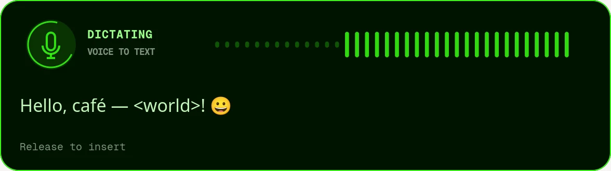

# Dictate at your cursor

Hold the **Menu** key to turn your speech into text in the app you have selected.
Release it to insert the words at your cursor. The Menu key often has a small sheet of
paper on it, beside the right Ctrl key.

1. Click the text field where you want your words.
2. Hold **Menu** and speak. A panel at the top centre shows your microphone activity
   and a preview of the words.
3. Release **Menu**. The panel briefly says **Finishing**, inserts the text, and disappears.

The panel does not take focus or move your cursor. It follows your colour theme and
motion setting. It leaves your clipboard alone and does not press Enter after the text.



## Microphone and speech

Dictation uses your default PipeWire microphone. Choose it in **Settings › Sound**.
It transcribes in English through your configured voice service, or the existing local
speech service when it is running. Set up a voice service in **Settings › Lab** if needed.
Dictation does not start a conversation with VECTOR.

The microphone closes when you release the key. A recording lasts at most two minutes.
Audio and text are not kept after the recording finishes. If you select another app
before release, dictation stops instead of putting the words in a different window.

To discard a recording, run:

```bash
bromigos dictate cancel
```

## Use another button

Open **Settings › Shortcuts** and change **Dictate at the cursor (hold)**.
Its press and release actions move together. For example, to use F8:

```bash
bromigos keys bind F8 --default code:135
```

The [shortcut guide](shortcuts.md) explains how to change or reset a key.
`bromigos dictate status` reports whether dictation is listening, finishing or idle.
