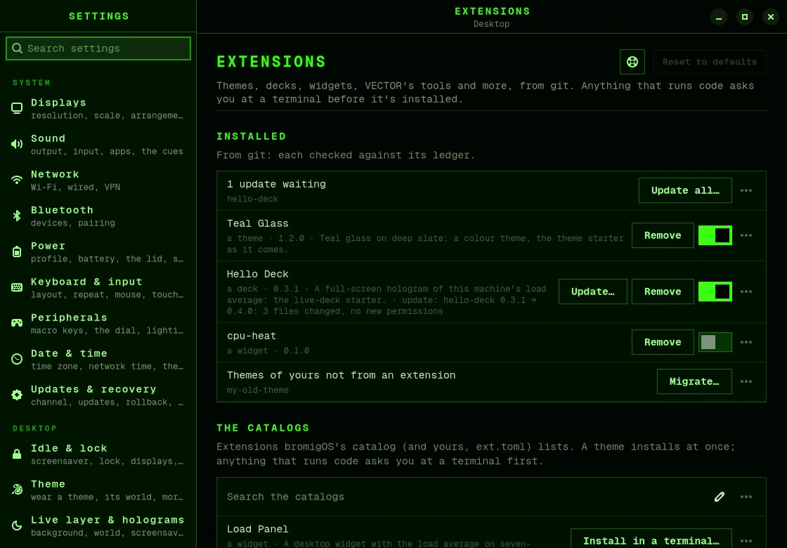

# Extensions

Extensions are add-ons that other people share. An extension can be:

- a theme;
- a [hologram](holograms.md) deck, or a layer over the background;
- a desktop [panel](panels.md);
- a tool or a skill for [VECTOR](vector.md);
- support for a service in [your homelab](homelab.md);
- a `bromigos` command;
- something to run whenever the theme changes.

Each extension is a git repository. Installing one never changes bromigOS itself, and you
can turn it off or remove it at any time.

## Find and install an extension

The easiest way is the Extensions window:

1. Open the app launcher (<kbd>Alt</kbd>+<kbd>P</kbd>) and choose **Extensions**. Or open
   the menu and choose **INSTALL › Extension catalog…**.
2. The window lists what you have, then the catalog, with a preview of each.
3. Choose an extension, and choose what to do: install it, update it, see what changed,
   turn it off or on, or remove it.

Each action opens a terminal that stays open, so you can see what it asks and what it did.



The theme switcher also lists the catalog's themes after yours. Choosing one installs it
and switches to it.

### From a terminal

```bash
bromigos ext search                  # what the catalog has
bromigos ext search --kind theme     # just the themes
bromigos ext info hello-deck         # what it would install, and what it may do
bromigos ext install hello-deck      # install one from the catalog, by name
bromigos ext install https://github.com/someone/thing@v1.0   # any repository, at a version
```

## What an extension may do

A theme installs straight away. It's only colours and pictures.

Anything else shows you its parts, and what it says it needs: the network, files outside
its own folder, VECTOR's tools, or running code. It installs only when you type **y**.
If an update would let it do more, it says **NEW PERMISSIONS** and asks you again.

After installing, `bromigos ext install` tells you what to do next. For example:

- a theme: `bromigos theme set` and its name;
- a deck: `bromigos-live plugin` and its name;
- a tool for VECTOR: `bromigos restart vector`.

### VECTOR can't install extensions

VECTOR can list extensions, read about them and search the catalog. He can't install,
update or remove them. The folders they live in are read-only to him.

If a VECTOR tool you installed is changed by hand on disk, his guard notes it in its log.
See [His terminal and its limits](vector.md#his-terminal-and-its-limits).

## Keep extensions up to date

```bash
bromigos ext list                    # what's installed, from where, at which version
bromigos ext update --all            # show what changed in each, ask, then update
bromigos ext update thing --check    # just look
```

An extension installed at a version, such as `@v1.0`, stays on that version. `update`
tells you about newer versions, and `bromigos ext update thing --ref v1.1` moves to one.

## Turn off or remove an extension

```bash
bromigos ext disable thing           # turn it off, and keep it
bromigos ext enable thing            # turn it back on
bromigos ext remove thing            # remove it
```

Or in the menu: **REMOVE › Extension…**. **Settings › Extensions** also has a switch for
each one.

## Make your own

```bash
bromigos ext new widget my-panel      # a working panel in ./my-panel, to edit
bromigos theme new dusk --from wick   # a theme, starting from the Wick
bromigos ext validate my-panel        # check it
bromigos ext install --copy ./my-panel   # install it from the folder
```

Every kind of extension has a starter. The kinds are `theme`, `live-deck`, `live-layer`,
`widget`, `vector-tool`, `vector-memory`, `vector-skill`, `homelab-adapter`, `command` and
`hook`.

The full guide covers the manifest, permissions, testing an extension without touching
your desktop, and publishing it to a catalog. It's in the developer docs:
[extensions.md](https://github.com/bromigos-org/bromigOS/blob/main/docs/extensions.md).

## Where extensions live

- `~/.local/share/bromigos/ext/`: each extension's files, and the links the desktop reads.
- `~/.local/state/bromigos/ext/ledger.json`: a record of what you installed, from where,
  and what you approved.

Extensions never write to your own `~/.config/bromigos`.
