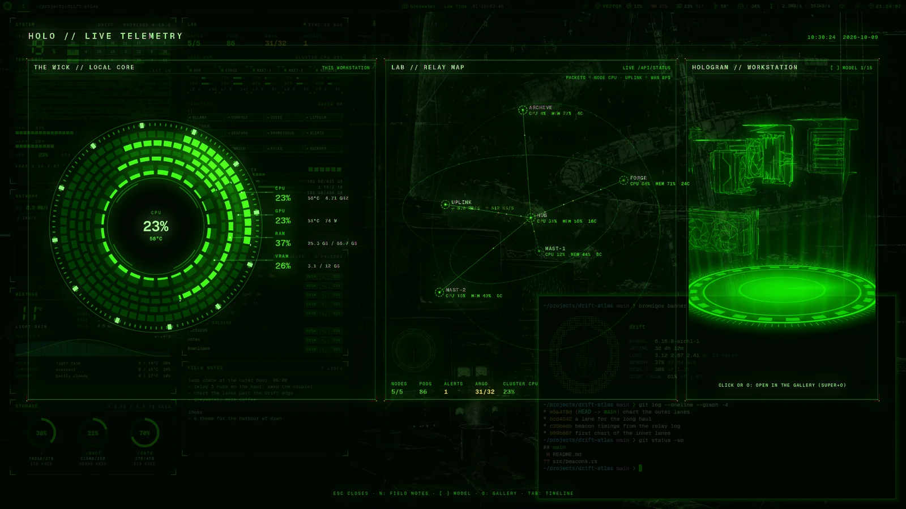
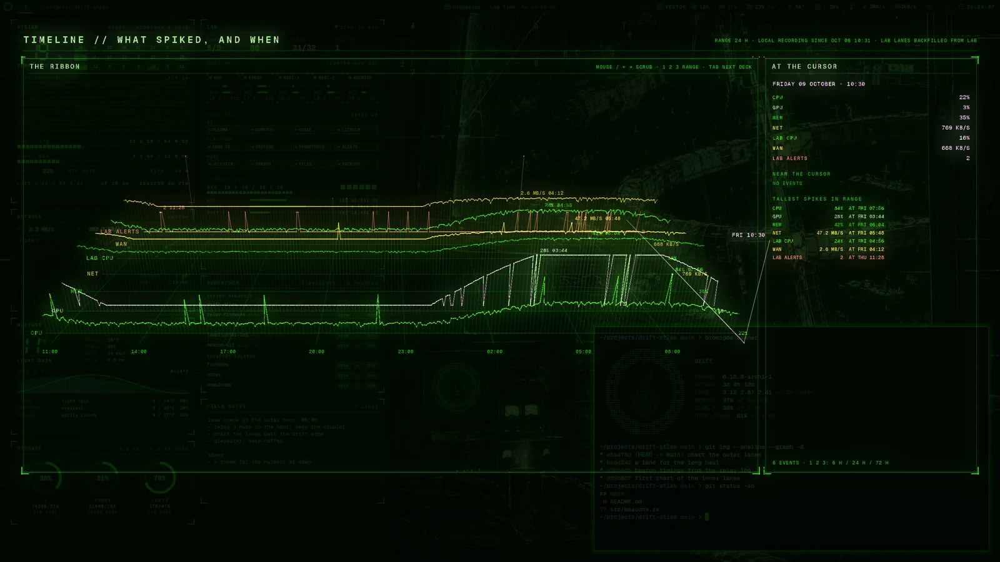
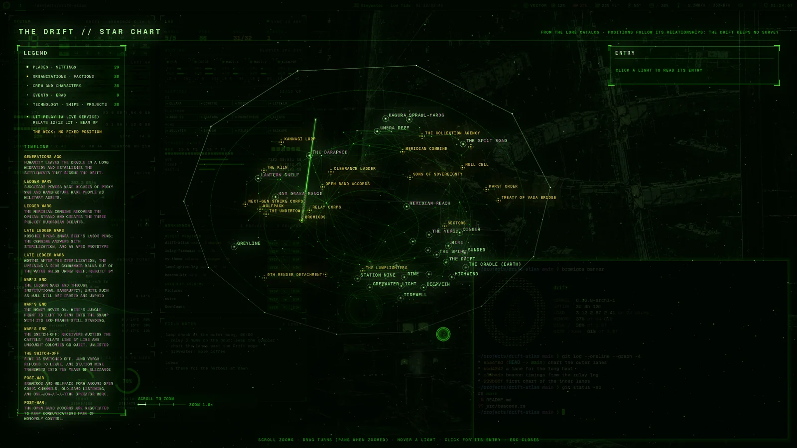
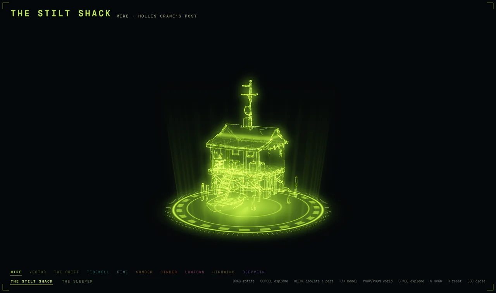

# Holograms

Holograms are glowing 3D views that open over your windows. There are two kinds:

- **Decks**: full-screen views of your machine, your history, your projects or your
  homelab, drawn from live readings.
- **The hologram gallery**: 3D models you can turn, take apart and look inside.

Each hologram opens with a key, and the same key closes it. <kbd>Esc</kbd> closes any of
them.

## The decks

One deck shows at a time. Opening another closes the one that's showing. Press
<kbd>Tab</kbd> in a deck to move to the next one. The Drift map isn't in this cycle.

| Deck | Key | What it shows |
|---|---|---|
| [Holo deck](#holo-deck) | <kbd>Super</kbd>+<kbd>H</kbd> | This machine: its readings, and its 3D model. |
| [Timeline](#timeline) | <kbd>Super</kbd>+<kbd>T</kbd> | The last 72 hours of readings. |
| [Drift map](#drift-map) | <kbd>Super</kbd>+<kbd>M</kbd> | A star chart of the bromigOS story's places. |
| [Swarm](#swarm) | <kbd>Super</kbd>+<kbd>Shift</kbd>+<kbd>S</kbd> | Your code projects, and your coding agents. |
| [Lab deck](#lab-deck) | <kbd>Super</kbd>+<kbd>Shift</kbd>+<kbd>H</kbd> | Your homelab as a server rack. |
| [Mind](#mind-ops-theater-and-network-map) | none | What VECTOR remembers. |
| [Ops theater](#mind-ops-theater-and-network-map) | none | Your code going from a push to running in your homelab. |
| [Network map](#mind-ops-theater-and-network-map) | none | Your home network. |

The last four need a [connected homelab](homelab.md).

Decks without a key open from the menu's **HOLOGRAMS** group, from the app launcher, or
with <kbd>Tab</kbd> from another deck. You can give any of them a key: see
[Your own shortcuts](shortcuts.md).

From a terminal, `bromigos live` and the deck's name opens or closes it, such as
`bromigos live timeline`. `bromigos-live decks` lists every deck.

### Holo deck

Your machine at a glance: rings for the processor, graphics card and memory, your
homelab's machines if you have one, and 3D models from the gallery.

- Press <kbd>N</kbd> for your [field notes](panels.md#field-notes).
- Press <kbd>[</kbd> and <kbd>]</kbd> to change the model.
- Press <kbd>O</kbd> to open the model in the gallery.

### Timeline

Your machine's readings, minute by minute, as a ribbon you can scroll back through:
processor, graphics, memory, network, and your homelab's readings and alerts. The panel
on the right shows the values where your pointer is, and the tallest spikes.

- Move the mouse, or press <kbd>←</kbd> and <kbd>→</kbd>, to move through time.
- Press <kbd>1</kbd>, <kbd>2</kbd> or <kbd>3</kbd> to show 6 hours, 24 hours or 72 hours.

The timeline records while you're logged in, one reading a minute. It keeps 72 hours.

### Drift map

A star chart of the places in the bromigOS story, with your homelab's services shown as
relays. It's for exploring. You don't need it to use the desktop.

### Swarm

Your code projects as planets, and your [coding agents](glossary.md#coding-agent) as
ships. Each ship waits at the project its agent works in. When an agent needs you, its
ship turns to face you, with an amber light.

A bigger planet has had more commits in the last two weeks. An amber halo means changes
you haven't committed or pushed. The Swarm finds projects in folders named like
`~/github.com/<organisation>/<project>`.

### Lab deck

Your homelab as a server rack. Each part lights up with its readings: red for a machine
that's down, a slow pulse while a graphics card is working. Your machines orbit the rack,
dials along the bottom show the essentials, and the queue of AI jobs sits below them.

Hover over anything to see what it is. Click a part, a machine, a dial or a card to see
more. See [The lab console](lab.md) for the same information in a terminal.

### Mind, Ops theater and Network map

- **Mind** shows what VECTOR remembers, and a knowledge base, as a constellation.
- **Ops theater** follows your code from a push, through its tests, to running in your
  homelab, with VECTOR's tasks alongside.
- **Network map** draws your home network from your homelab's readings: the machines, the
  traffic between them, and how quickly each one answers.

### Zoom and turn the maps

Mind, the Swarm, the Network map and the Drift map can zoom:

| To | Do this |
|---|---|
| zoom in or out | Scroll, or press <kbd>+</kbd> and <kbd>-</kbd>. |
| move around while zoomed in | Drag. |
| turn the view | Drag. Once zoomed in, <kbd>Shift</kbd> and drag, or drag with the right mouse button. |
| go back to the start | Double-click empty space, or press <kbd>0</kbd>. |

Zooming in shows more detail. Labels appear when there's room for them.

## The hologram gallery

The gallery holds every 3D model on your machine: VECTOR's, the ones he made for you, and
each world's. Open it with <kbd>Super</kbd>+<kbd>O</kbd>.

Models are grouped in shelves: one for VECTOR, one for the Drift, and one for each world.
The world you're in comes first, and each world's shelf is drawn in its colours.

| To | Do this |
|---|---|
| turn the model | Drag it. |
| take it apart | Scroll, or press <kbd>Space</kbd>. |
| look at one part on its own | Click the part. |
| go to the next or previous model | <kbd>→</kbd> or <kbd>←</kbd> |
| go to the next or previous shelf | <kbd>Page Down</kbd> or <kbd>Page Up</kbd> |
| scan the model | <kbd>S</kbd> |
| put it back as it was | <kbd>R</kbd> |
| close the gallery | <kbd>Esc</kbd> |

Hover over a model's name to read what it is. To add models, ask
[VECTOR](vector.md#ask-him-to-make-things) for a hologram.

## Other things on the background

- **The quick-launch ring.** Press <kbd>Super</kbd>+<kbd>A</kbd> for a ring of shortcuts: a
  terminal, a browser, and the [FIELD NOTES](panels.md#field-notes) panel, ready to type
  in.
- **The scanner.** Hold <kbd>Super</kbd>+<kbd>Z</kbd> to see a drawing of your machine's
  hardware with live readings. Press <kbd>Super</kbd>+<kbd>X</kbd> to keep it showing.
- **The screensaver.** It starts when you leave the computer. To see it now, open the
  menu's **TOGGLE** group and choose **Screensaver**. See [Idle and lock](idle.md).
