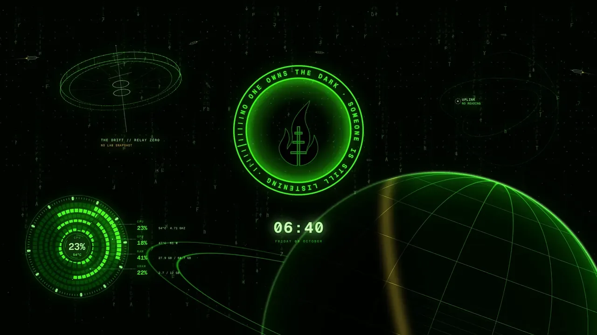
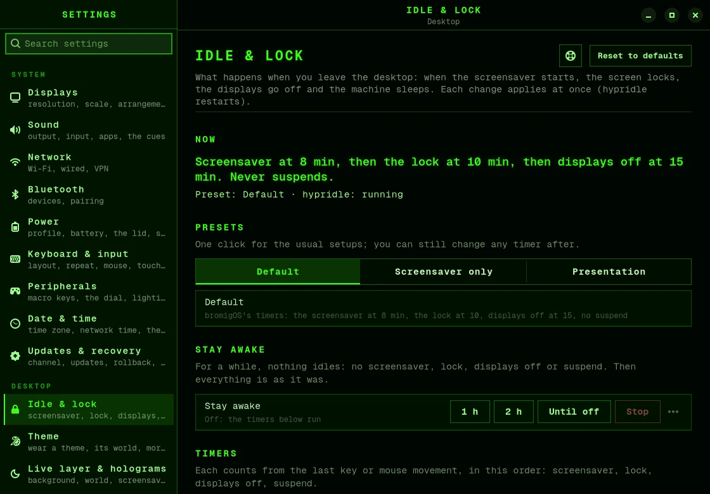

# Idle and lock

When you leave the computer, bromigOS waits, then starts the screensaver, locks the
screen and turns the displays off. This page shows how to change those times, how to stop
the screen locking, and how to keep the machine awake for a film or a long download.

## What happens when you leave

| After | What happens | To come back |
|---|---|---|
| 8 minutes | The screensaver starts: the Drift, full screen, with the time and the burn-in. | Press any key or move the mouse. |
| 10 minutes | The screen locks. | Type your password. |
| 15 minutes | The displays turn off. | Press any key or move the mouse. |
| never | The machine suspends. This step is off until you turn it on. | |



The screen also locks whenever the machine goes to sleep: when it suspends, when you close
a laptop's lid, or when you choose Suspend in the power menu.

To lock the screen yourself at any time, press <kbd>Super</kbd>+<kbd>L</kbd>.

## Change the times

1. Open **Settings › Idle & lock** (<kbd>Super</kbd>+<kbd>,</kbd>).
2. Each step has a switch and a slider. Turn a step off, or slide it to a new time.



The line at the top of the page says what will happen, in plain words. Each change
applies at once. To take one back, choose **Undo** in the note at the bottom. If a
combination looks odd, such as the screensaver set to start after the lock, the page says
so, but it still does what you asked.

Or from a terminal:

```bash
bromigos idle                        # what happens now, step by step
bromigos idle set screensaver 5      # the screensaver after 5 minutes
bromigos idle set lock off           # never lock when idle
bromigos idle set displays 30        # displays off after 30 minutes
bromigos idle set suspend 1h         # suspend after an hour
bromigos idle undo                   # take back the last change
```

## Turn off the lock, keep the screensaver

1. Open **Settings › Idle & lock**.
2. Choose the **Screensaver only** preset.

Now the screensaver starts at its time, and nothing else happens: the screen doesn't
lock, the displays stay on, and the machine doesn't suspend. Any key ends the screensaver.
The eye on the bar shows NO LOCK while this is on.

To go back, choose the **Default** preset.

From a terminal: `bromigos idle preset screensaver-only`, and
`bromigos idle preset default` to go back.

### The presets

| Preset | What it does |
|---|---|
| Default | bromigOS's own times, as above. |
| Screensaver only | The screensaver, and nothing else. Nothing locks, the displays stay on, and the machine doesn't suspend. |
| Presentation | Nothing happens when you leave: no screensaver, no lock, no displays off, no suspend. |

## Stay awake

For a film or a long download, you can stop everything for a while. When the time is up,
everything goes back to how it was.

- **On the bar:** click the eye to stay awake for an hour. Click it again to stop.
  Middle-click it to stay awake until you stop it.
- **In Settings:** open **Idle & lock**, and under **Stay awake** choose **1 h**, **2 h** or
  **Until off**.
- **In the menu:** choose **TOGGLE › Stay awake**.
- **From a terminal:** `bromigos idle stay-awake 2h`, or
  `bromigos idle stay-awake until-off`. `bromigos idle off` stops it.

While you're staying awake, the eye on the bar becomes a cup, with the time left.

## The eye on the bar

The eye, on the right of the bar before VECTOR's power mark, shows what will happen when
you leave.

| It looks | It means |
|---|---|
| dim | The usual times apply. |
| lit, with NO LOCK | The Screensaver only preset is on. |
| lit, with NO IDLE | The Presentation preset is on. |
| a cup, with the time left | You're staying awake. |
| red | The service that watches for idle isn't running. |

Hover over it to see what will happen. Right-click it to open the settings.

## Your settings file

Your idle settings are in `~/.config/bromigos/idle.toml`. It holds only what you changed,
and updates don't overwrite it. If you edit it by hand, run `bromigos idle apply` to use it.

To run a command of your own after some idle time, add it to
`~/.config/hypr/hypridle.conf`, after its `source` line.
