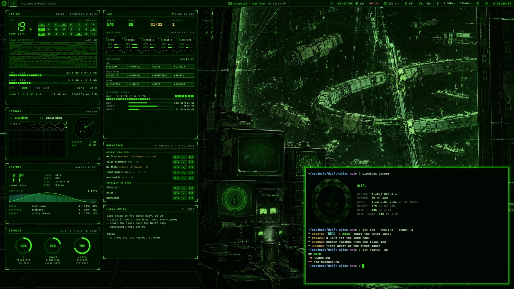

# Welcome

bromigOS is a desktop for Linux, based on Arch Linux. It gives you:

- a desktop where the windows tile themselves, and every action has a key;
- an animated background that shows what your machine is doing;
- [panels](panels.md) with live readings: processor, network, disks, your notes;
- [themes](themes-and-worlds.md) that recolour every app at once, and two
  [worlds](glossary.md#world), living scenes that react to your work;
- [VECTOR](vector.md), an AI assistant you can talk to, who runs your tools and makes
  images and 3D holograms;
- [your homelab](homelab.md) on the desktop, if you run one, with AI work sent to its
  graphics cards instead of a paid service.

This manual shows you how to use it. It's for people who have installed bromigOS, or are
about to. How bromigOS is built is in the developer docs, in the repository's `docs/`
folder.

## Start here

1. [Install](install.md) bromigOS.
2. Answer the [first-run questions](first-run.md).
3. Learn [the first few keys](desktop.md#the-keys-to-learn-first). They get you everywhere.
4. Try a few [common tasks](common-tasks.md).

## Find your way

| To | Read |
|---|---|
| find your way around the screen | [Getting around](desktop.md) |
| do something specific, step by step | [Common tasks](common-tasks.md) |
| change how it looks | [Themes and worlds](themes-and-worlds.md) |
| change a setting | [Settings](settings.md) |
| talk to VECTOR | [VECTOR](vector.md) |
| look up a key or a command | [Keys](keys.md), [Commands](commands.md) |
| look up a word | [Glossary](glossary.md) |
| fix a problem | [Troubleshooting](troubleshooting.md) |

## Help on the desktop

- Press <kbd>Super</kbd>+<kbd>K</kbd> to see every key on the desktop.
- Hover over anything on the bar, the panels or in Settings. It says what it is and what
  it does.
- In Settings, press <kbd>F1</kbd> to open this manual on the page you're looking at.
- In a terminal, add `--help` to any `bromigos` command.

## The story

bromigOS has a story behind its look. The default theme, the Wick, is a relay station at
the edge of a stretch of space called the Drift, kept lit by whoever is on shift. That's
you. VECTOR keeps the line open. The story gives names to some parts of the desktop. The
[glossary](glossary.md) explains each one.
