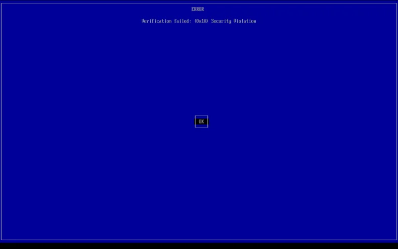
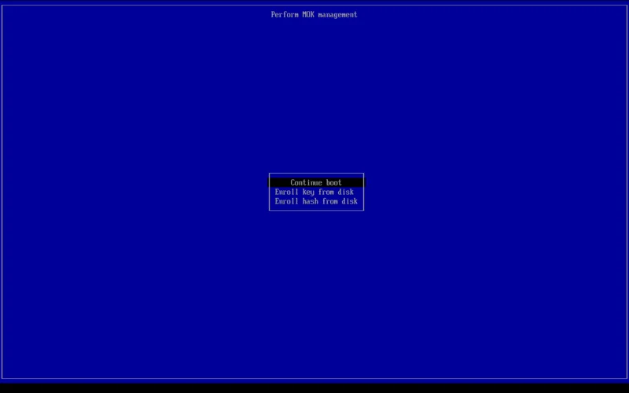
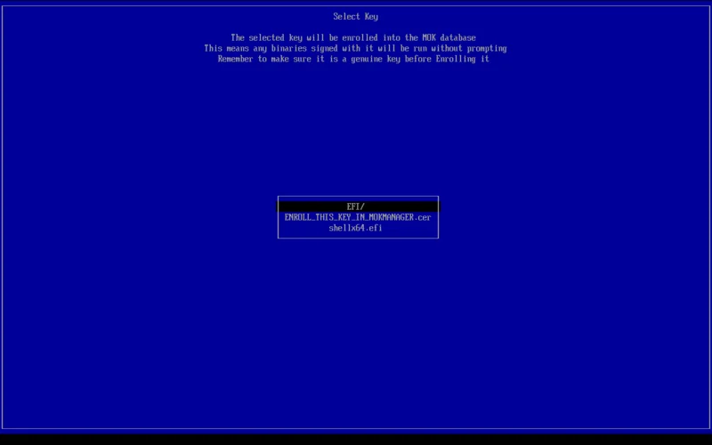
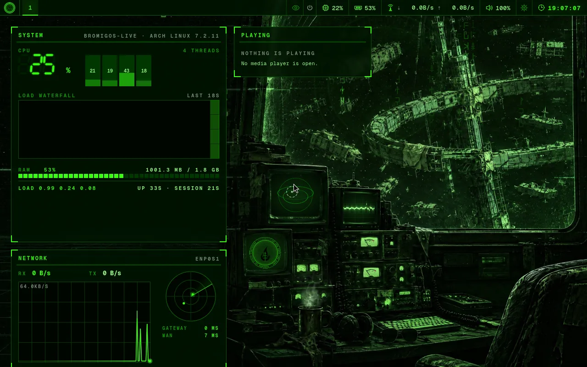
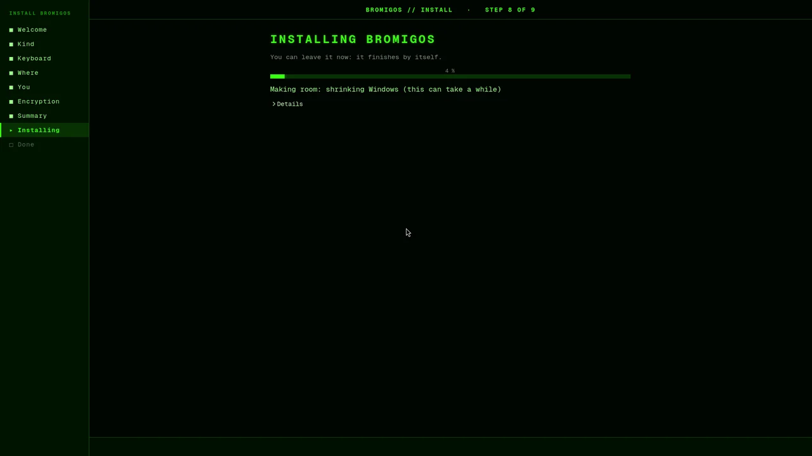
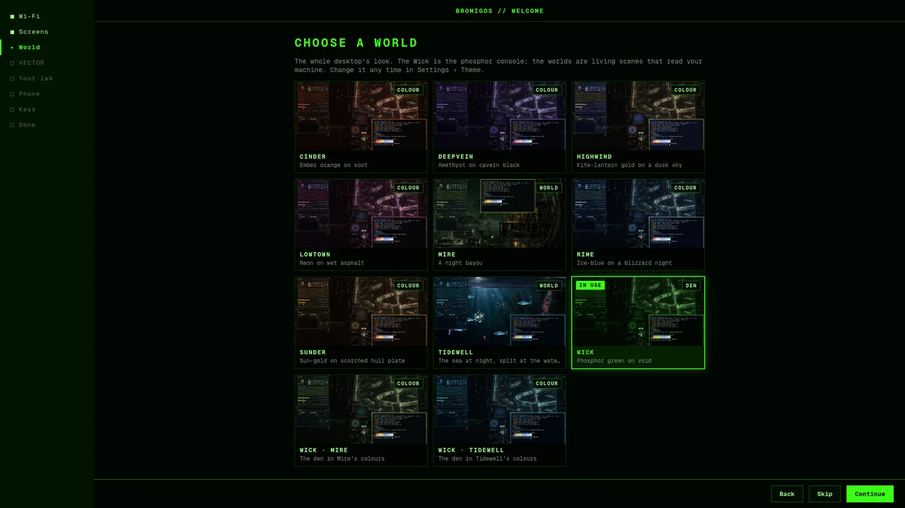

# Install

You can install bromigOS on an existing Arch Linux system or from a USB stick.
On an existing system, use the script below or [start from the AUR](#start-from-the-aur).


- **On an Arch Linux system you already have.** A short script adds bromigOS's packages
  and sets everything up.
- **From the bromigOS USB stick.** It boots straight into the desktop, and installs from
  there. Download it from the [Download page](https://bromigos.org/download), then see
  [Install from the USB stick](#install-from-the-usb-stick).

## Install only the lab console

For the console on an existing Arch system, install `bromigos-lab` from the AUR.
It needs Python and Textual, a library for terminal interfaces. It does not install
Hyprland, the desktop or VECTOR. Follow [Install on plain Arch](lab.md#install-on-plain-arch).

## Before you start

You need:

- a computer with Arch Linux installed, and a user account that can use `sudo`;
- a network connection.

## Install on Arch Linux

1. Log in as your own user, not as root.
2. Download the installer:

   ```bash
   curl -fsSLO https://pkgs.bromigos.org/bromigos/install.sh
   ```

3. Read it if you like. It's short: `less install.sh`.
4. Run it:

   ```bash
   bash install.sh
   ```

   To install from another copy of the repository, such as your own mirror, add
   `--repo <address>`. If that copy has its own security certificate, add
   `--ca <certificate file>` too.

5. Type your password when `sudo` asks, and answer the package manager's questions.
6. Answer the [first-run questions](first-run.md) when they appear.
7. Restart the computer, and sign in at the bromigOS login screen.

### What the installer does

1. It adds bromigOS's package repository and its signing key. The key's fingerprint is
   written into the script, so a wrong key stops it.
2. It installs bromigOS's packages. The list is in [What gets installed](packages.md). It
   also installs paru, a helper for the [AUR](apps.md#install-an-app-from-the-aur), unless
   you already have one.
3. It turns on networking, the login screen and sound, and Bluetooth if it's installed.
   If you already use another login screen or network manager, it keeps yours. To switch
   to bromigOS's login screen anyway, add `--force-dm`.
4. It sets up your [hardware](hardware.md): the graphics driver, and a laptop's power
   profiles.
5. If your system disk uses btrfs, it sets up [snapshots](glossary.md#snapshot), so you
   can undo an update.
6. It puts bromigOS's settings files in your home folder, applies the default theme, and
   themes the [boot menu](boot-menu.md).
7. It asks the [first-run questions](first-run.md).

Running it again is safe. It only changes what's missing. It writes everything it does to
`~/.local/state/bromigos/install.log`.

### Installer options

Add these after `bash install.sh`:

| Option | What it does |
|---|---|
| `--channel stable` | Follow tagged releases. This is the default. |
| `--channel rc` | Follow release candidates, the versions about to become stable. |
| `--channel edge` | Get every change as soon as it's built. |
| `--aur-route` | Print the AUR bootstrap steps and exit. |
| `--dry-run` | Say what it would do, and change nothing. |
| `--with bromigos-apps` | Also install the [app bundle](apps.md). Repeat `--with` for more packages. |
| `--no-setup` | Skip the first-run questions. Run `bromigos setup` later. |
| `--force-dm` | Use bromigOS's login screen even if another one is turned on. |
| `--no-aur` | Don't install an AUR helper, and leave the AUR out of updates. |

You can change the channel later. See [Channels](update-and-rollback.md#channels).


## Start from the AUR

If you already use an AUR helper, you can install the repository's signing key
and mirrorlist first. The mirrorlist is the file that lists package servers.

```bash
paru -S bromigos-keyring bromigos-mirrorlist
```

Read the PKGBUILDs before building them. Both packages use a pinned source tag
and checksums. The keyring imports and locally trusts the bromigOS signing key.
Neither package edits `/etc/pacman.conf`.

Add these two lines to `/etc/pacman.conf` yourself:

```ini
[bromigos]
Include = /etc/pacman.d/bromigos-mirrorlist
```

The mirrorlist follows stable releases at
`https://pkgs.bromigos.org/$repo/stable/$arch`. The shorter path without `stable`
serves edge builds. Extra mirrors can be added as more `Server` lines.

Then install the command and start the desktop installer:

```bash
sudo pacman -Syu bromigos-core
bromigos install
```

`bromigos channel` can switch channels afterwards. Versions before the mirrorlist
support was added need a `Server` line in place of `Include` to use that command.
The package install message shows the two lines above. `bash install.sh --aur-route`
prints these steps without changing anything.

## Install from the USB stick

The stick starts the whole bromigOS desktop before anything is installed, and installs it
from there with no network. The [Download page](https://bromigos.org/download) has these
same steps with pictures. Each step starts with the plain way; **From a terminal** is the
same step by hand.

### 1. Download it

Download the newest image from the [Download page](https://bromigos.org/download). It's
one file of about 5 GB.

**From a terminal.** Every release's image is at
`https://pkgs.bromigos.org/iso/<version>/bromigos-<version>-x86_64.iso`, beside its
`.sha256`, `.sig` and `.json`. `https://pkgs.bromigos.org/iso/latest.json` names the
newest; `https://pkgs.bromigos.org/iso/edge/latest.json` the weekly edge build. The
newest three releases are kept.

```bash
url=$(curl -fsSL https://pkgs.bromigos.org/iso/latest.json | jq -r '.isos[] | select(.edition == "bromigos") | .url')
curl -fLO "$url" -fLO "$url.sha256" -fLO "$url.sig"
```

### 2. Check it (optional)

The Download page shows the image's SHA-256 checksum. On Windows, PowerShell's
`Get-FileHash .\bromigos-<version>-x86_64.iso` prints it; on a Mac,
`shasum -a 256 bromigos-<version>-x86_64.iso`. The two must match.

**From a terminal.** The checksum, then the signature by bromigOS's key, whose fingerprint
is `393E 7D54 F7DE 58FE 75B9 7214 947C 9D61 93D3 DD8B`:

```bash
sha256sum -c bromigos-<version>-x86_64.iso.sha256
curl -fsSLO https://pkgs.bromigos.org/bromigos/bromigos.asc
gpg --show-keys --with-fingerprint bromigos.asc
gpg --import bromigos.asc
gpg --verify bromigos-<version>-x86_64.iso.sig bromigos-<version>-x86_64.iso
```

### 3. Make the USB stick

You need a USB stick of 8 GB or more. **Everything on it is erased.**

- **Windows:** [Rufus](https://rufus.ie). Choose the stick, then SELECT the image. Keep
  the partition scheme GPT and the target system UEFI. Press START, and when Rufus asks
  how to write an "ISOHybrid image", choose **Write in DD Image mode**.
  [balenaEtcher](https://etcher.balena.io) works too: Flash from file, Select target,
  Flash.
- **macOS:** balenaEtcher, the same three steps. When it's done, macOS may say the disk
  isn't readable: that's expected, choose Eject.
- **Linux:** balenaEtcher, or GNOME Disks (Restore Disk Image).
- **Ventoy:** copy the `.iso` onto a Ventoy stick, like any other image.

**From a terminal.** It's an isohybrid image, for BIOS and UEFI alike, so it goes on the
whole device as it is. Find the stick with `lsblk` (here `/dev/sdX`; the wrong device
erases that disk):

```bash
sudo dd if=bromigos-<version>-x86_64.iso of=/dev/sdX bs=4M status=progress oflag=sync
# or: sudo cp bromigos-<version>-x86_64.iso /dev/sdX && sync
```

There's no netboot image: the medium carries an offline copy of every package an install
needs, which is most of its size.

### 4. Start the computer from the stick

Plug it in, restart, and tap the computer's boot menu key as it starts, then choose the
stick (on UEFI computers, "UEFI: " and its name). Common keys: Dell F12; HP Esc, then F9;
Lenovo F12; ASUS F8 or Esc; Acer F12; MSI F11; Gigabyte F12; ASRock F11; Microsoft
Surface: hold Volume Down while you press Power. From Windows, any brand: Settings, System,
Recovery, Advanced startup, Restart now, then Use a device.

The stick's boot menu comes up:


**From a terminal**, or rather the menu's own editor: press <kbd>e</kbd> on an entry in
GRUB (UEFI), or <kbd>Tab</kbd> in the BIOS menu, to change its kernel line. The entries
share archiso's line (`archisobasedir=arch archisosearchuuid=… splash quiet`); **Install
bromigOS** adds `bromigos.install`, which opens the installer at login, safe graphics adds
`nomodeset`, the screen reader `accessibility=on`. archiso's own options work too, such
as `copytoram` to run from memory and free the stick, or `cow_spacesize=4G` for more room
for changes in the live session. [The boot menu](boot-menu.md#the-install-stick) describes
every entry.

### Secure Boot

Most Windows computers have Secure Boot on. **It can stay on.** The stick starts with it,
and so does bromigOS once it's installed. Each asks you to approve bromigOS once, in a blue
screen called MokManager: the stick the first time it starts on a computer, the installed
system at its first start. Use the arrow keys and <kbd>Enter</kbd>; the mouse doesn't work
there.

**The stick**, the first time on each computer:

1. **ERROR: Verification failed: (0x1A) Security Violation.** Press <kbd>Enter</kbd>.

   

2. **Shim UEFI key management: Press any key to perform MOK management.** Press any key
   within ten seconds.
3. Choose **Enroll key from disk**.

   

4. Choose the stick, **ARCHISO_EFI**.
5. Choose **ENROLL_THIS_KEY_IN_MOKMANAGER.cer**.

   

6. Choose **Continue** (**View key 0** shows the certificate first).
7. **Enroll the key(s)?** Choose **Yes**.
8. Choose **Reboot**, and choose the stick again in the boot menu if Windows starts.

**The installed system**, at its first start. The installer's last page shows a
four-digit code; this is where you type it.

1. **Shim UEFI key management: Press any key to perform MOK management.** Press any key
   within ten seconds. (If you miss it, the next start asks again.)
2. Choose **Enroll MOK**, then **Continue**. (**View key 0** shows the key, with your
   computer's name.)
3. **Enroll the key(s)?** Choose **Yes**.
4. **Password:** type the code, then press <kbd>Enter</kbd>.
5. Choose **Reboot**. Then the boot menu, and your disk's passphrase, as every time.

Lost the code? At step 2, choose **Enroll key from disk** instead, then the disk, then
`EFI`, `bromigos-secureboot` and `ENROLL_THIS_KEY_FOR_THIS_PC.cer`, then **Continue** and
**Yes**: no code needed.

The boot menu looks the same with Secure Boot on or off. After an update, bromigOS signs
the new kernel by itself. If it ever can't, the computer starts the kernel from before the
update, and a message says to run `sudo bromigos secureboot resign`.

**Installed bromigOS before this?** It works the same, when you choose:

```bash
sudo pacman -S bromigos-secureboot          # if it isn't installed yet
sudo bromigos secureboot setup --dry-run    # what it would do, changing nothing
sudo bromigos secureboot setup              # do it, and note the code it prints
```

Then restart, approve the key with the code as above, and turn Secure Boot on in the
computer's setup if it's off. `bromigos secureboot` says where it stands.

**If you'd rather turn Secure Boot off**, that works too, as it always has: in the
computer's setup (often F2, F10, F1 or Del as it starts; from Windows: Advanced startup,
Troubleshoot, Advanced options, UEFI Firmware Settings), under Boot or Security, then save
and exit. If Windows uses BitLocker, have its recovery key ready first
([aka.ms/myrecoverykey](https://aka.ms/myrecoverykey)).

**From a terminal.** The stick's chain is firmware (Microsoft's keys) → shim 16.1, Fedora's
Microsoft-signed build, pinned by checksum → GRUB, signed with bromigOS's key → the kernel,
signed with the same key. The installed system's is the same shim → GRUB built on the
computer → its kernels, both signed with a key made on the computer and kept root's only.
Microsoft's keys and Windows' boot files aren't touched. GRUB runs in lockdown and carries
its theme's fonts inside itself. The stick's certificate is at its root and in the
repository (`iso/secureboot/bromigos-secureboot.crt`; SHA-1
`5F:EC:1D:6C:E1:8B:6B:D3:B9:6E:ED:E9:87:AE:B4:E9:EE:62:49:86`, as MokManager's
**View key 0** shows it). Memtest86+ and the UEFI shell are unsigned, so they don't start
with Secure Boot on. If you run your own keys with `sbctl`, enroll bromigOS's certificate
in `db` instead of MokManager, and sign the installed system with your keys. The project's
[docs/secureboot.md](https://github.com/bromigos-org/bromigOS/blob/main/docs/secureboot.md)
has the details: the keys, the hooks, recovery.

### 5. Try it, then install



1. In the boot menu, choose **Install bromigOS**. Or choose **Start bromigOS (try it
   live)** to look around first: a welcome card offers **Try bromigOS** or **Install
   bromigOS**, and the desktop's INSTALL panel opens the installer whenever you're ready.
2. Follow the installer. You can go back and change anything until you press
   **Install**. It asks:
   - **your language and time zone.** No network is needed: everything is on the stick.
   - **what kind of computer this is:** **bromigOS (desktop)** for a computer you sit at,
     or **bromigOS Server**, with no desktop, for servers and lab machines.
   - **your keyboard,** with a box to try it in.
   - **where to install.** Choose the disk, then either:

     

     - **Install alongside Windows** (or the other system it found). Windows and its files
       stay. If there isn't free space, the installer makes Windows' part of the disk
       smaller; a slider sets how much each gets. Every time the computer starts, you
       choose which system to use. If it can't be offered, the screen says why and what to
       do, for example turning off Windows' Fast Startup.
     - **Erase the whole disk.** Everything on the disk is deleted, and the screen says
       what that is.
   - **your name, user name, password, and a name for the computer.**
   - **whether to encrypt the disk.** It's on by default. Your password unlocks it when
     the computer starts, or you can give it a passphrase of its own.

     > **Remember the password or passphrase.** Nobody can recover it. Without it, the
     > disk can't be read.

   - for bromigOS Server: whether to turn on **SSH** (signing in from another computer),
     the **firewall**, and **automatic updates**.
3. Check the summary, then press **Install** (or **Erase disk and install**). A progress
   bar shows how far it has got. It takes about ten minutes.

   

4. Press **Restart now**, and take out the stick when the screen goes dark. Type the
   disk's passphrase if you chose encryption, then sign in. With Secure Boot on, turn it
   off first (above): the installed system can't start with it on yet. The installer's
   **Before you start** step reminds you.

If Windows on the disk uses **BitLocker**, the installer first asks you to save its
recovery key, because Windows may ask for it once after the install. If something goes
wrong, the installer says what to do, and **Save a problem report** puts the details on a
USB drive for whoever helps you.

**No picture, or a computer with only a text screen?** Choose **Install bromigOS (text
mode)** in the stick's menu. It's the same installer, with the same steps, in text. With
**Install with the screen reader (speech)**, the installer asks its questions one at a time,
read aloud.

Every step, alongside Windows, reinstalling and the text installer are explained in
[The installer](installer.md).

**Installing many computers?** An answer file on the stick installs with no questions
([answer files](installer.md#answer-files)).

At your first sign-in, the [welcome tour](welcome-tour.md) opens: Wi-Fi, your screens, a
world, VECTOR, your lab, your phone and the keys worth knowing. Every step has **Skip**.



**For power users:** each tour step writes the same answers as `bromigos setup`; see
[First run](first-run.md).

The installed system updates from the package repository the stick was made for. The boot
menu's other entries are described in [The boot menu](boot-menu.md#the-install-stick).

### How the image is made

Every release's image is built by CI from the release's tag: archiso's releng profile with
bromigOS laid over it, and an offline repository of every package an install needs. It's
checked (the privacy guard, no keys, no proprietary packages), tested in QEMU with KVM (an
encrypted UEFI install with its first update and rollback, an offline BIOS install, and
Secure Boot with the MokManager enrollment), signed and published
([iso.yml](https://github.com/bromigos-org/bromigOS/blob/main/.github/workflows/iso.yml),
[docs/iso.md](https://github.com/bromigos-org/bromigOS/blob/main/docs/iso.md)). To build
one yourself, with Docker and about 20 GB free:

```bash
git clone https://github.com/bromigos-org/bromigOS && cd bromigOS
iso/build.sh --repo https://pkgs.bromigos.org --channel stable --out ~/bromigos-iso
iso/ci-test.sh ~/bromigos-iso/bromigos-*-x86_64.iso --out ~/bromigos-iso/tests   # needs /dev/kvm
```

## Next

- [First run](first-run.md): the questions bromigOS asks.
- [Getting around](desktop.md): what's on the screen, and the first keys to learn.
