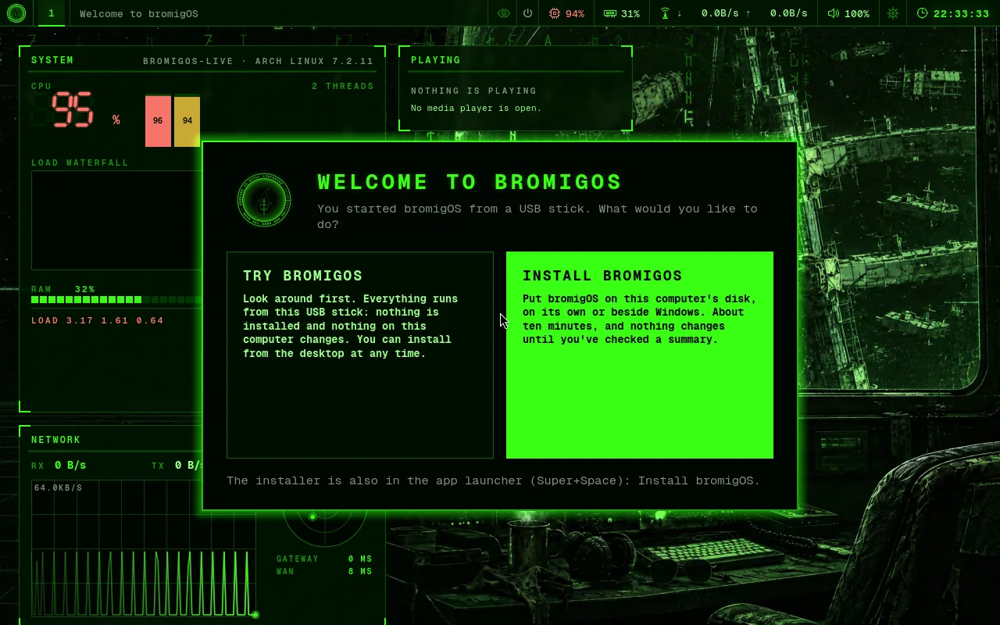

# The installer

The bromigOS USB stick has one installer in two forms. The **graphical installer** opens
full screen on the live desktop. The **text installer** runs on a plain text screen, for a
computer whose picture doesn't come up, a serial console, or a screen reader. Both ask the
same questions in the same words, and both install the same way.

Nothing on any disk changes until you press **Install** on the last screen. Until then you
can go back and change anything.

## Starting it

- In the stick's boot menu, choose **Install bromigOS**. The live desktop starts with the
  installer already open.
- Or choose **Install bromigOS Server** for [bromigOS Server](server.md), the edition with no
  desktop. It opens the text installer. A [Field Kit](fieldkit.md) stick has the same entry.
- Or open **More options ›** and choose **Install bromigOS with the text installer** for the
  desktop's text installer. There's no desktop while it runs.
- Or choose **Start bromigOS (try it first)** to look around first. A welcome card offers
  **Try bromigOS** or **Install bromigOS**. Later, the desktop's **INSTALL** panel or
  "Install bromigOS" in the app launcher opens the installer.



On a computer with no working graphics, "Install bromigOS" opens the text installer by
itself. See [The text installer](#the-text-installer).

## The steps

1. **How would you like to be guided?** Choose what helps you, before anything else. Each
   choice works at once, and your new system starts the same way:
   - **VECTOR's voice guide.** VECTOR reads each step aloud. It's off until you turn it on
     here. **Play a sample** lets you hear him first.
   - **Screen reader.** Reads everything on the screen aloud: Orca in the graphical
     installer, the console's speech in the text installer. VECTOR stays quiet while it
     talks, so you never hear two voices.
   - **Larger text.** Bigger letters everywhere. In the text installer this is
     **Bigger letters on this screen**, which works on the computer's own screen. A
     terminal window or SSH can't change its own letters: make them bigger in that
     terminal's settings, often with <kbd>Ctrl</kbd> and <kbd>+</kbd>.
   - **High contrast.** Stronger colours: solid panels, white text, no glow.
   - **Reduce motion.** Nothing moves or pulses on its own.
   - **Language.** The language your new system uses.

   

2. **Welcome.** Your time zone, and whether you're online. You don't need the internet:
   everything is on the stick.
3. **Before you start.** Shown only when there's something to know: running on battery
   (plug in the charger), less than 4 GB of memory, a disk that reports it's failing, a
   graphics card bromigOS can't drive well, Secure Boot. Each line says what to do. None
   of them stops you. Secure Boot needs nothing here: the install sets bromigOS up to start
   with it on ([Secure Boot](install.md#secure-boot)).

   

4. **What kind of computer is this?** **bromigOS (desktop)** for a computer you sit at.
   **bromigOS Server** has no desktop, for servers and lab machines.

   

5. **Your keyboard.** Pick the layout that matches your keys. Try it in the box.
6. **Where to install.** Every disk, with its size, model and what's on it. Pick one, then
   choose how:
   - **Install alongside Windows** (or the other system it found). Windows and its files
     stay. You choose which system to start each time the computer starts. If there isn't
     enough free space, the installer makes Windows' part of the disk smaller. A slider
     sets how much each gets. Windows keeps what it uses now plus 10 GB to grow, and
     bromigOS gets at least 20 GB.
   - **Erase the whole disk.** Everything on the disk is deleted. The screen says what
     that is.
   - **Reinstall bromigOS and keep my files**, when bromigOS is already on the disk. You
     get a fresh system, and your home folder stays as it is.

   

   

7. **Save Windows' recovery key**, only when Windows uses BitLocker (below).
8. **About you.** Your name, a user name for signing in, a password, and a name for the
   computer. The user name and computer name are suggested from your name.

   

9. **Encryption.** On by default. The disk can only be read after the passphrase is typed
   when the computer starts. By default your password is the passphrase. You can give the
   disk its own instead.

   > **Remember it.** Nobody can recover a forgotten passphrase, and the disk can't be read
   > without it.

   

10. **Reach it from anywhere.** How you get to this computer when you're away from home.
    **Through BRODEC only** is the default and the safest: your phone reaches it, end to end
    encrypted. You can also join your lab's private network, or use WireGuard or
    Tailscale. The same step as the server's ([Reach it from
    anywhere](server-setup.md#reach-it-from-anywhere)).
11. **bromigOS Server's own steps**, for a server only: what it will do, where its keys and
    passwords live, its network, who can sign in, how to reach it from anywhere, data disks,
    how its disk unlocks, how it updates, and what it runs. A server has no About you or
    Encryption step: these replace them. See [bromigOS Server](#bromigos-server).
12. **Summary.** Every choice in plain words. The button says **Install**, or **Erase disk
    and install** when the disk is erased.

    

13. **Installing.** A progress ring, the stage it's on, and a look at the desktop you're getting.
    **Details** shows every step. It takes about ten minutes.

    

14. **Done.** Press **Restart now**. Take out the stick when the screen goes dark. On a
    computer that starts the newer way (UEFI), this page also shows a four-digit code in large
    letters, with the blue screen's steps beside it: note it. At the first start, a blue screen asks you to approve bromigOS once, with that
    code ([Secure Boot](install.md#secure-boot)). Secure Boot can stay on.

    

## Installing alongside Windows

The installer won't change Windows' drive when that isn't safe. It says so, and what to
do:

- **Windows is paused (Fast Startup or hibernation).** Windows didn't really shut down, so
  its drive can't be changed safely. In Windows, open Control Panel › Power Options ›
  Choose what the power buttons do. Click "Change settings that are currently
  unavailable" and untick **Turn on fast startup**. Then hold **Shift** while you click
  **Shut down**. Start the installer again.
- **Windows wants to check its drive.** Start Windows, let it finish starting, then hold
  **Shift** while you click **Shut down**.
- **Windows uses BitLocker (Device encryption).** The installer never makes a BitLocker
  drive smaller. Either turn BitLocker off in Windows (Settings › Privacy & security ›
  Device encryption) and wait until it's done, or make free space yourself: in Windows,
  open Disk Management, right-click the C: drive, choose **Shrink Volume** and leave at
  least 20 GB free. bromigOS then installs in that free space.

After installing beside Windows, Windows checks its drive once the next time it starts.
That's normal.

### BitLocker's recovery key

When Windows uses BitLocker, the installer first asks you to save its recovery key.
Installing bromigOS changes how the computer starts, and Windows may then ask for that key
once. Without it, Windows' files can't be opened.

To get it: in Windows, open Settings › Privacy & security › Device encryption ›
BitLocker drive encryption › **Back up your recovery key**. Or sign in at
aka.ms/myrecoverykey on another device. The key is 48 digits. Keep it somewhere that isn't
this computer, then turn on **I've saved the BitLocker recovery key**.


## Reinstalling and keeping your files

When the disk already has bromigOS, **Reinstall bromigOS and keep my files** gives you a
fresh system and keeps your home folder: your documents, pictures, settings and
everything else in it. The old system is kept as a snapshot, so nothing is lost. If the
disk is encrypted, type the passphrase you use when the computer starts. The disk keeps
it. If the reinstall stops partway, your old bromigOS is put back as it was, and the
computer starts as before.

## bromigOS Server

bromigOS Server has no desktop. It starts to a text screen, and you look after it from your
phone, your desktop, or another computer. After **What kind of computer is this?** you pick
**bromigOS Server**, and the installer asks what a server needs instead of About you:

1. **What will this server do?** Six cards, and you can tick several: **Lab node**
   (computing and graphics cards for your lab), **Storage** (shared folders and backups),
   **Home services** (apps for the household), **Game server**, **Media** (your own movies,
   shows and music), or **Just a server** (the safe base and nothing more). The roles
   suggest what's installed and switched on. You can change any of it on the Run step.
2. **Where should this server keep its keys and passwords?** Your lab's Vault, a new
   Vault, this server (encrypted and sealed to its security chip), or sops + age.
3. **Your keyboard** and **Where to install**, as for the desktop.
4. **Its network.** The network port (a cable, if it has one), whether your router gives it
   its address or it keeps a fixed one, and its name. The address other computers will use
   is shown big. **Wake-on-LAN** lets your phone switch it on over the cable.
5. **Who can sign in.** The admin's name and password, and how you sign in from your own
   computer. **Keys only** is the safe choice: the installer reads keys from the stick's
   `fieldkit` folder, you can paste one, or it fetches your public keys from GitHub and
   shows them so you can check them. A password login is offered too, with a warning.
6. **Reach it from anywhere.** Through BRODEC only (the default), your lab's private
   network, WireGuard or Tailscale.
7. **Data disks.** Other disks for your files and apps, at `/srv/data`. With two or more
   you can keep **two copies** of everything (RAID1), so one disk can fail.
8. **Lock the disk.** If the computer has a security chip (TPM 2.0), the chip unlocks the
   disk at every start, so updates can restart it at night. Without one, you choose: type
   the passphrase after every restart, or leave the disk unlocked.
9. **How it updates.** By itself (the default), download and ask your phone, or only when
   you say. It updates in a window at night, 3 to 5 AM unless you pick another, and restarts
   only in that window and only when it has to.
10. **What should this server run?** Its place in your lab, then the services and apps your
    roles ticked. Change any of them.


**Ready to install** then shows every choice, and how you'll sign in once it's installed:
`ssh admin@` and the server's address, with a QR code an SSH app on your phone can scan.

What each step means, and what it sets up, is in [Setting up bromigOS Server](server-setup.md).

## The text installer

The text installer has the same steps, in the same words, on a plain text screen. The steps
are listed on the left, VECTOR's line is below them, and the bottom line says what the
highlighted control does.


Type in the boxes as usual. <kbd>Tab</kbd> moves between them, and
<kbd>Ctrl</kbd>+<kbd>N</kbd> or **Continue** goes on.


On the summary, each part has a **Change** button with a number: press the number to go
back to that step. **Continue** brings you back to the summary.


For bromigOS Server, the server's steps come after **What kind of computer is this?**, as
in the graphical installer.


## VECTOR's voice

VECTOR, bromigOS's AI assistant, guides you through the install. Each step shows a short
line from him beside his orb, and he can read it aloud. This is the voice guide. It works
offline: his lines are recorded on the stick.

- It's off until you turn it on, on the first step or with
  <kbd>Ctrl</kbd>+<kbd>Alt</kbd>+<kbd>V</kbd>. It needs a sound device.
- Press <kbd>Ctrl</kbd>+<kbd>Alt</kbd>+<kbd>V</kbd> again to mute him, and again to
  unmute. The bar at the bottom says whether he's on, and clicking it does the same. The
  installer remembers, and your new system's welcome tour does too.
- On the computer's own text screen, <kbd>Ctrl</kbd>+<kbd>V</kbd> does the same, except
  while you're typing in a box.
- <kbd>Esc</kbd>, **Back** or the next step cuts off his line. Going back doesn't read the
  step again.
- He stays quiet while a screen reader talks, such as Orca or the stick's speech entry.
  His words are still on screen.
- With no sound device, such as on a serial console, the installer says so once. Then the
  words are on screen only.

## When something goes wrong

The installer says what stopped and what to do, in plain words. **Save a problem report**
puts the install's logs, a summary of the hardware and your answers (never your password)
on a USB drive, and says where it went. Send that file when you ask for help.
**Back to the summary** lets you change something and try again.


## Keyboard only and screen readers

Every step works with the keyboard alone:

| Keys | What they do |
|---|---|
| <kbd>Tab</kbd>, <kbd>Shift</kbd>+<kbd>Tab</kbd> | Move between choices |
| <kbd>↑</kbd> <kbd>↓</kbd> | Move within a list of choices |
| <kbd>Space</kbd> | Pick a choice, turn a switch on or off |
| <kbd>Enter</kbd> | Continue |
| <kbd>Esc</kbd> | Go back a step |
| <kbd>←</kbd> <kbd>→</kbd> | Move the split between Windows and bromigOS (<kbd>Shift</kbd>: 10 GB at a time) |
| <kbd>Ctrl</kbd>+<kbd>N</kbd> | Continue (text installer) |
| <kbd>F2</kbd> | Show or hide the install's details (text installer) |
| <kbd>Ctrl</kbd>+<kbd>Alt</kbd>+<kbd>V</kbd> | Turn VECTOR's voice on, then mute or unmute it |
| <kbd>Ctrl</kbd>+<kbd>Alt</kbd>+<kbd>T</kbd> | A terminal (graphical installer) |
| <kbd>F12</kbd> | A shell (text installer) |

Every control has a hint. In the graphical installer it shows when you hover over the
control, and a screen reader (Orca) reads it. In the text installer the line at the
bottom of the screen says what the focused control does.

With the stick's **Install with the screen reader (speech)** entry (press <kbd>S</kbd> in
the stick's menu), the installer starts straight away with the screen reader on. It asks
its questions one at a time as plain lines, which the screen reader reads in order. The
first questions are how you'd like to be guided: whether your new system keeps the screen
reader, reduces motion, or uses high contrast. VECTOR's voice stays off there, so the
screen reader is the only voice.

Screen reader keys, if you need them:

| Keys | What they do |
|---|---|
| <kbd>Insert</kbd>+<kbd>S</kbd> (or <kbd>Caps Lock</kbd>+<kbd>S</kbd> on a laptop layout) | Orca: stop or start speech for a moment |
| <kbd>Insert</kbd>+<kbd>Q</kbd> | Orca: quit Orca |
| <kbd>Insert</kbd>+<kbd>Space</kbd> | Orca: its settings |
| <kbd>Keypad Enter</kbd> | Console speech (speakup): be quiet until there's something new |
| <kbd>Keypad 8</kbd> | Console speech: read the current line again |
| <kbd>Keypad 7</kbd>, <kbd>Keypad 9</kbd> | Console speech: read the line above or below |

## For power users

Everything below is optional. The plain steps above are the whole install.

### What runs

The installers write your answers to a file only root can read and run:

```bash
sudo bromigos-iso-install --answers FILE
```

That turns the answers into archinstall's two files with
`/usr/local/lib/bromigos-iso/answers.py`: `config.json` and `creds.json`, created with
mode 0600. The password and the disk passphrase go in `creds.json` only, never in the
config, on a command line or in a log. Then it runs archinstall silently, sets up bromigOS
in the new system, and prints its progress. You can also run archinstall's files
yourself:

```bash
python3 /usr/local/lib/bromigos-iso/answers.py --answers FILE --out DIR
sudo bromigos-iso-install --config DIR/config.json --creds DIR/creds.json
```

`--menu` (with `--config`) opens archinstall's own menu, filled in, so you can change
anything before it installs. The install's log is `/var/log/bromigos-iso-install.log` on
the live system. The installed system keeps your answers, without the password and
passphrase, in `/var/log/bromigos/install-answers.toml`: add a password and it's an answer
file that repeats the install.

**Show what will run** and **Advanced.** Both installers have a **Show what will run**
toggle on the summary. It shows the archinstall configuration with every secret replaced
by `********`, and the `bromigos setup` lines the install will run. The **Advanced**
expander on the Where step, out of the way unless you open it, offers custom partitioning
(archinstall's own partitioning menu), the root's file system options, swap (zram by
default), the kernel (`linux`, `linux-lts` or `linux-zen`) and the boot loader. The shell
key (<kbd>Ctrl</kbd>+<kbd>Alt</kbd>+<kbd>T</kbd> in the graphical installer,
<kbd>F12</kbd> in the text installer) gives you a root shell on the live system at any
step.

### The voice guide's files

VECTOR's lines are in one catalogue, `/usr/share/bromigos/guide/lines.toml`. Each line has
an id, such as `installer.edition`, and its words. His clips, one small Opus file per line,
are beside it in `clips/`, with `clips/manifest.json` saying which clip speaks which words.
The clips are made when bromigOS is built, so the stick needs no voice model.

Mute and on or off are kept in `~/.local/state/bromigos/voice-guide.json`, as
`{"enabled": true, "muted": false}`. On the live system that's the installer's own user
(the live user for the graphical installer, root for the text one). The first step's other
choices go in `~/.local/state/bromigos/accessibility.json`:

```json
{
  "screen_reader": false,
  "large_text": true,
  "high_contrast": true,
  "reduce_motion": false,
  "console_font": false,
  "applied": false
}
```

The install writes both files into your new account (`bromigos-iso-install`, from the
answers' `guidance`), and the welcome tour reads them when it starts. Reduce motion and
high contrast are also passed to `bromigos setup` as `--motion reduced` and
`--contrast high` (the same as `bromigos accessibility`). A screen reader adds Orca to a
desktop and `espeakup` (started at every boot) to bromigOS Server. The console's bigger
letters add `terminus-font` and `FONT=ter-v32n` in `/etc/vconsole.conf`. The desktop's
welcome tour sets the session's own settings to match, once (`applied` turns true).

Boot options: `bromigos.voice=on` or `bromigos.voice=off` turns the voice guide on or off
for that boot. The speech entry is `accessibility=on bromigos.install=text
bromigos.voice=off`.

To change a line or make the clips again, see `docs/voice-guide.md` in the repository. It
covers the catalogue's format, `tools/voice/make-clips.py`, and the check CI runs
(`tools/voice/make-clips.py --check`).

### Answer files

An answer file installs with no questions. After a 10-second countdown with **Cancel**,
the install runs by itself. A file with problems is never half-used: the installer says
what's wrong and asks the questions instead.


The installer looks for one:

1. at `bromigos.answers=PATH` on the kernel line: a file on the live system, or a path on
   the stick;
2. else at `bromigos/install.toml` or `fieldkit/install.toml` on a USB drive: a partition
   formatted FAT, exFAT or NTFS, or a stick formatted without a partition table.

Flat YAML (`install.yaml`, one `key: value` per line) works too.

| Key | Type | Default | What it is |
|---|---|---|---|
| `edition` | text | `desktop` | `desktop` or `server` |
| `locale` | text | `en_US` | The system's language, for example `de_DE` |
| `timezone` | text | from the locale | `Region/City`, for example `Europe/Berlin` |
| `keyboard` | text | from the locale | A layout id: `us`, `us-intl`, `gb`, `de`, `fr`, `es`, `it`, `br`, `dvorak`, `colemak` and more |
| `disk` | text | required, or `disk_model` | The disk, for example `/dev/nvme0n1` |
| `disk_model` | text | | The disk by its model instead, for example `"Samsung*990*PRO*"` (`*` matches anything, letter case doesn't matter). It installs only when exactly one disk matches |
| `cpu_model` | text | | Install only on a computer whose processor matches, for example `"9955HX"`. On any other, nothing changes and the installer asks instead |
| `mode` | text | required | `erase`, `alongside` or `reinstall` |
| `bromigos_bytes` | number | the installer's suggestion | Alongside, when it shrinks: bromigOS's share, in bytes |
| `full_name` | text | empty | Your name, as the login screen shows it |
| `user` | text | required | The user name: small letters, digits, `-`, `_` |
| `hostname` | text | `USER-pc` or `USER-server` | The computer's name |
| `password` | text, **secret** | required | The user's password (also root's) |
| `encrypt` | true/false | `true` | LUKS2 under the root |
| `separate_passphrase` | true/false | `false` | The disk gets its own passphrase |
| `passphrase` | text, **secret** | the password | With `separate_passphrase` |
| `ssh` | true/false | `false` | sshd on (desktop and server) |
| `ssh_password` | true/false | `false` | Password sign-in over SSH too (else keys only) |
| `ssh_keys` | list of text | empty | Public keys allowed to sign in as the user |
| `firewall` | true/false | `true` | bromigOS Server's firewall |
| `auto_updates` | true/false | `true` | bromigOS Server's automatic updates |
| `countdown` | number | `10` | Seconds before it starts; `0` starts at once |
| `advanced` | table | the installer's | The Advanced box: `advanced = { fs = "btrfs", kernel = "linux-lts", zram = false }`. `fs` is `btrfs` or `ext4`, `kernel` is `linux`, `linux-lts` or `linux-zen`, and `zram = false` leaves out the compressed swap in memory |
| `[server]` | table | | bromigOS Server's steps: `role`, the network, sign-in, data disks, unlock, updates, services ([Setting up bromigOS Server](server-setup.md#answer-files)) |
| `failing_ok` | true/false | `false` | Install on a disk that reports it's failing |
| `bitlocker_saved` | true/false | `false` | Required beside a BitLocker Windows: you saved its key |

Erase a disk, encrypted, for the desktop:

```toml
[install]
edition = "desktop"
locale = "en_GB"
timezone = "Europe/London"
keyboard = "gb"
disk = "/dev/nvme0n1"
mode = "erase"
full_name = "Alex Rivera"
user = "alex"
hostname = "alex-pc"
password = "correct horse battery staple"
encrypt = true
```

Beside Windows, giving bromigOS 128 GiB:

```toml
[install]
edition = "desktop"
locale = "en_US"
timezone = "America/Chicago"
keyboard = "us"
disk = "/dev/nvme0n1"
mode = "alongside"
bromigos_bytes = 137438953472
user = "sam"
hostname = "sam-laptop"
password = "a long passphrase you will remember"
encrypt = true
separate_passphrase = true
passphrase = "a different one for the disk"
bitlocker_saved = true
countdown = 30
```

bromigOS Server as a Lab node, keys only:

```toml
[install]
edition = "server"
locale = "en_US"
timezone = "UTC"
keyboard = "us"
disk = "/dev/sda"
mode = "erase"
user = "admin"
hostname = "lab-node-1"
password = "used at the console and for sudo"
ssh_keys = ["ssh-ed25519 AAAAC3NzaC1lZDI1NTE5AAAAI…your-key… you@laptop"]
countdown = 10

[server]
role = "lab"
unlock = "tpm"
update_window = "03:00-05:00"
```

There's an example for every role in [Setting up bromigOS Server](server-setup.md#answer-files).

### Boot parameters

| Parameters | What opens |
|---|---|
| `bromigos.install` | The graphical installer, the desktop chosen. With no login screen on the medium (the Field Kit stick), the text installer |
| `bromigos.install bromigos.edition=desktop` | The same, said outright |
| `bromigos.install bromigos.edition=server` | The text installer, bromigOS Server chosen. The edition step still shows |
| `bromigos.install bromigos.text`, or `bromigos.install=text` | The text installer, whichever edition |
| `bromigos.answers=PATH` | That answer file |
| `accessibility=on` | The text installer's plain questions, for a screen reader |
| `bromigos.voice=on` | VECTOR's voice on from the start, for that boot |
| `bromigos.voice=off` | VECTOR's voice off, for that boot. His words are still on screen |

When the text installer is asked for on the full stick, the login screen steps aside for
that boot so the installer has the screen.

### The disk layout

**Erase:**

| Part | What it is |
|---|---|
| Partition table | GPT on UEFI, MBR on BIOS |
| `/boot` | 2 GiB, FAT32, unencrypted. On UEFI it's the EFI system partition |
| The rest | btrfs, on LUKS2 unless encryption is off |

**Alongside:** the disk's own EFI system partition (Windows') is mounted at `/boot/efi`,
untouched apart from GRUB's own folder. A new 2 GiB ext4 `/boot` and the btrfs root go in
the largest free stretch. `/boot`'s partition type is set back to "Linux filesystem"
after archinstall, so the disk keeps one EFI system partition. GRUB goes in `EFI/GRUB`
with a firmware boot entry first in the boot order, not at the removable path
`EFI/BOOT/BOOTX64.EFI`, which is Windows' fallback loader. `GRUB_DISABLE_OS_PROBER=false`
in `/etc/default/grub` makes every `grub-mkconfig` list Windows; the menu waits 10
seconds.

On a BIOS computer the disk must use MBR (GPT needs UEFI), and MBR holds four partitions:
alongside needs two free slots. On a UEFI computer the disk must use GPT.

**btrfs subvolumes:** `@` (`/`), `@home` (`/home`), `@log` (`/var/log`), `@pkg`
(`/var/cache/pacman/pkg`) and `@.snapshots` (`/.snapshots`). The data that isn't the system
has its own too, so rolling back an update never rolls it back: `@containers`
(`/var/lib/containers`: Podman's images and volumes, databases included), `@k3s`
(`/var/lib/rancher`: a lab node's cluster data), `@kubelet` (`/var/lib/kubelet`: its pods'
volumes and scratch space, which change by the minute on a CI node), `@srv` (`/srv`: apps' data and shares) and
`@bromigos-state` (`/var/lib/bromigos/server`: the update history, so a rollback keeps the
record of what it rolled back). None of them is in root's snapshots.

**Installed before these subvolumes?** Your containers' data is inside `/`, so a rollback
would roll it back too. A reinstall that keeps your files moves it into its own subvolume by
itself. To move it by hand instead, with the containers stopped:

```bash
sudo systemctl stop podman.socket podman.service; podman stop --all
dev=$(findmnt -no SOURCE / | sed 's/\[.*//')
sudo mount -o subvolid=5 "$dev" /mnt
sudo btrfs subvolume create /mnt/@containers
sudo cp -a --reflink=always /var/lib/containers/. /mnt/@containers/
sudo mv /var/lib/containers /var/lib/containers.old && sudo mkdir /var/lib/containers
echo "$(findmnt -no SOURCE / | sed 's/\[.*//') /var/lib/containers btrfs $(findmnt -no OPTIONS / | sed 's/subvolid=[0-9]*,\?//; s/subvol=[^,]*/subvol=\/@containers/') 0 0" | sudo tee -a /etc/fstab
sudo umount /mnt && sudo mount /var/lib/containers   # check, then: sudo rm -rf /var/lib/containers.old
```

The same goes for `/var/lib/rancher` (`@k3s`), `/var/lib/kubelet` (`@kubelet`) and `/srv`
(`@srv`). bromigOS doesn't do it
for you on an update: moving a running system's data is the one thing that's safer done by
hand, with the services stopped, than by a package. snapper keeps snapshots of
`/` and `/home`; GRUB lists the root's snapshots (grub-btrfs).

**LUKS:** LUKS2 around the root partition only. The passphrase is your password unless you
gave the disk its own. archinstall adds the `encrypt` hook and the kernel parameter;
the installer adds `plymouth` before it, so the passphrase prompt is part of the boot
splash. `/boot` stays unencrypted: GRUB reads the kernel from it, and GRUB can't open a
LUKS2 volume protected the way archinstall makes it. Your files, the system and the
snapshots are all inside the encrypted part.

### How alongside makes room

When there's 20 GB or more of free space, nothing is resized. Otherwise the biggest NTFS
(or ext4) partition with room to spare is shrunk, after checking again that it isn't
BitLocker, hibernated or waiting for a check:

1. the file system first: `ntfsresize` (or `e2fsck` and `resize2fs` for ext4), a dry run,
   then the real one;
2. then the partition: `sfdisk -N`, a little larger than the file system;
3. then a check that the file system still reads whole (`ntfsresize --info`).

The resize marks the NTFS volume for Windows' own check, so Windows runs it once at its
next start.

### How reinstall works

1. The root is unlocked (LUKS) with the passphrase you typed.
2. The old `@` is kept as a read-only snapshot, `@old-root-DATE`, and `@.snapshots`
   becomes `@old-snapshots-DATE`. A fresh `@` and `@.snapshots` are made. `@home`, `@log`
   and `@pkg` are kept.
3. Everything is mounted at `/mnt` and archinstall installs into it (its pre-mounted
   layout).
4. The people from the old system come back with the same user IDs, groups and passwords
   (from the old `/etc/passwd` and `/etc/shadow`); you get the new password. `/home`'s
   snapper configuration comes back too.
5. The disk's unlocking and GRUB are set up again. Only then are the old kernels, kept
   aside on `/boot` until now, removed.

If the install stops before step 5 finishes, the old system is put back: `@` again from
`@old-root-DATE` (its `fstab` naming the subvolume by name), its snapshots and its kernels.
The computer starts as it did before, and the installer says so.

To look at the old system later, mount the btrfs volume with `subvolid=5` and open
`@old-root-DATE`. Delete it with `btrfs subvolume delete` when you no longer need it.

More detail, for contributors, is in the repository's `docs/iso.md`.
