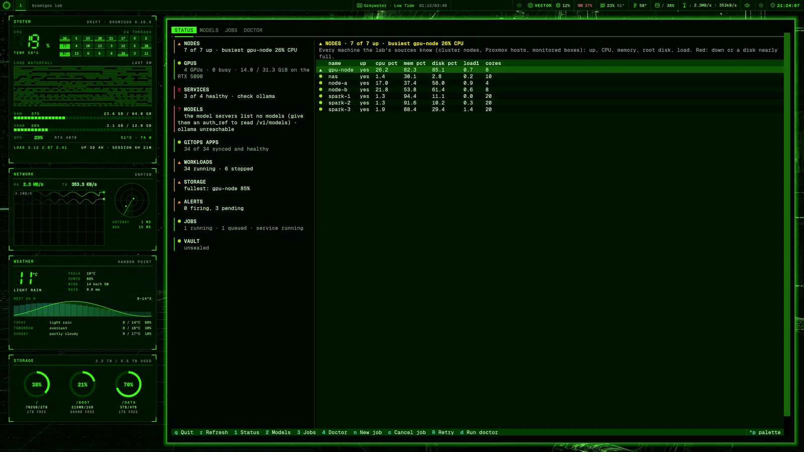
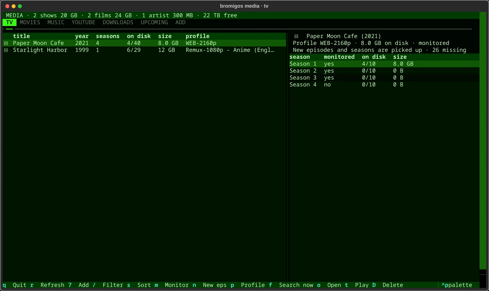
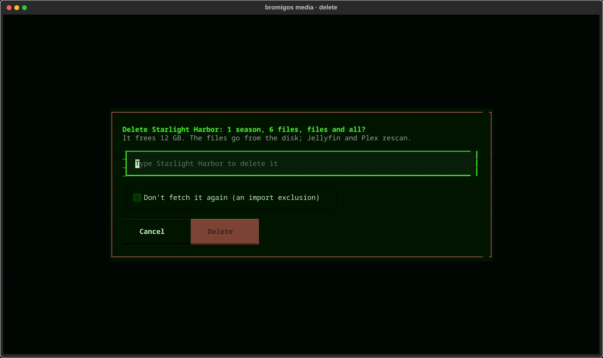

# The lab console

`bromigos lab` is the console for [your homelab](homelab.md). It shows what the lab is
doing and what its graphics cards hold, runs AI jobs on them, and checks the lab for
problems. It reads the services you connected. Anything your lab doesn't have is simply
not shown.

Connect a homelab first with `bromigos-lab connect`, or `bromigos setup homelab` on bromigOS.

## Install on plain Arch

The `bromigos-lab` AUR package runs without the bromigOS desktop. It includes the
terminal dashboard, service adapters, model catalog and provisioning.
With an AUR helper, run `paru -S bromigos-lab`. Without one:

```bash
sudo pacman -S --needed base-devel git
git clone https://aur.archlinux.org/bromigos-lab.git
cd bromigos-lab
less PKGBUILD
makepkg -si
```

Read the recipe before building it. It uses a pinned source release and a SHA-256
checksum. It installs the console without changing your desktop or system settings.
Connect your services and check them:

```bash
bromigos-lab connect
bromigos-lab doctor
bromigos-lab
```

Replace `bromigos lab` with `bromigos-lab` in the commands on this page. Both use
`~/.config/bromigos/homelab.toml` and the same lab state. Provisioning asks for an
explicit `yes` before changing machines. Install the optional tools listed by
`pacman -Qi bromigos-lab` for the services and providers you choose.

On bromigOS, `bromigos-homelab` pulls in this package and keeps `bromigos lab` working.
Its desktop panels, live decks and VECTOR plugins are separate integrations.
Desktop target commands, art jobs and the Den TV media screen need the optional
`bromigos-core` package. The main console, adapters and provisioning run without it.

## Look at your lab

Run `bromigos lab` for the live dashboard. It refreshes every 15 seconds.



| Key | What it does |
|---|---|
| <kbd>1</kbd> | Status: a card for each part of the lab, such as machines, graphics cards, services, storage and alerts. |
| <kbd>2</kbd> | Models: the AI models each machine holds, and their memory. |
| <kbd>3</kbd> | Jobs: the queue of AI jobs. |
| <kbd>4</kbd> | Doctor: problems, and how to fix them. |
| <kbd>n</kbd> | Start a new job. |
| <kbd>c</kbd> | Cancel the job under the cursor. |
| <kbd>R</kbd> | Run the job under the cursor again. |
| <kbd>d</kbd> | Run the doctor's checks now. |
| <kbd>r</kbd> | Read the lab again now. |
| <kbd>q</kbd> | Quit. |

To move around, use the arrow keys or Vim's keys:

| Keys | What they do |
|---|---|
| <kbd>↓</kbd> <kbd>↑</kbd> or <kbd>j</kbd> <kbd>k</kbd> | Move down or up a list: the cards on Status, or a table's rows. On Status, each card shows as you reach it. |
| <kbd>→</kbd> <kbd>←</kbd> or <kbd>l</kbd> <kbd>h</kbd> | On Status, move between the cards and the card's detail. |
| <kbd>g</kbd> <kbd>G</kbd> | Go to the first or last item. |
| <kbd>Ctrl</kbd>+<kbd>D</kbd> <kbd>Ctrl</kbd>+<kbd>U</kbd> | Move a page down or up in a table. |
| <kbd>]</kbd> <kbd>[</kbd> or <kbd>L</kbd> <kbd>H</kbd> | Go to the next or previous tab. |

Hover over anything for what it is.

Or print the same information:

```bash
bromigos lab status           # one line for each part of the lab
bromigos lab models           # what each graphics card and model server holds
bromigos lab doctor           # what's wrong, and how to fix it
```

### As a hologram

Press <kbd>Super</kbd>+<kbd>Shift</kbd>+<kbd>H</kbd> for the lab deck: your lab as a
server rack, lit by the same readings. See [Holograms](holograms.md#lab-deck).

### In Settings

**Settings › Lab** shows the same summary, your models, recent jobs, the doctor, and where
AI runs.

## Make things on your lab

Send a job to your lab's graphics cards:

```bash
bromigos lab run image --prompt "a lighthouse at dusk"
bromigos lab run cutout --input ~/Pictures/robot.png
bromigos lab run upscale --input ~/Pictures/robot.png --scale 2
bromigos lab run hologram --prompt "a brass telescope"
bromigos lab run voice --text "The relays are lit."
bromigos lab run transcribe --input ~/Downloads/talk.m4a
```

| Job | What it makes |
|---|---|
| `image` | A picture from your description. |
| `image-edit` | A changed copy of a picture. |
| `cutout` | A picture with its background removed. |
| `upscale` | A bigger, sharper copy of a picture or a short video clip. Twice the size, or up to four times with `--scale`. |
| `3d` | A 3D model, from a picture of an object. |
| `hologram` | A hologram, from a description or a picture. To show it in the gallery, copy it into `~/.config/bromigos/vector/holo/`. |
| `voice` | Spoken audio of your text. |
| `transcribe` | Text from a recording. |
| `video` | A short looping video, from a picture and a description of how it moves. |
| `batch-llm` | Answers from a language model, for many prompts at once. |

`bromigos lab run --kinds` lists what your lab can do, and says why when it can't do
something.

When a job is done, a notification tells you. The result goes in
`~/Pictures/bromigos/lab/`, in a folder for each kind of job.

You can also ask [VECTOR](vector.md) for a picture, a hologram or a voice line "on the
lab". His jobs show in the queue as his.

### The job queue

```bash
bromigos lab jobs              # what's queued, running and done
bromigos lab jobs watch        # follow the queue until it settles
bromigos lab jobs cancel ID    # cancel a job
bromigos lab jobs retry ID     # run a job again
```

Jobs take turns. One heavy job runs at a time, and only when a graphics card has room for
it. VECTOR's voice always keeps its share. A job that has to wait says why.

### It's free unless you say otherwise

Jobs run on your lab, which costs nothing. A paid cloud service is only used for a job if
you add `--cloud` to it.

## Models

```bash
bromigos lab models                   # what each machine holds
bromigos lab models load NAME         # load an Ollama model
bromigos lab models unload comfyui    # free what ComfyUI holds
bromigos lab models recommend         # better models that fit your graphics cards
```

## YouTube downloads

For finding, downloading and watching media, start with [Your media](media.md).

If your lab runs [Pinchflat](homelab.md), it downloads YouTube channels and playlists into
your media library. Then they play in Jellyfin or Plex, like your other shows. You can run
it from here without opening its web page.

### Add a channel or a playlist

```bash
bromigos lab youtube add https://www.youtube.com/playlist?list=PLCFE9837C2F7EB8AA
bromigos lab youtube add https://www.youtube.com/@NASAGoddard --since 2025-01-01
```

It says what it will download. A playlist keeps its order. A channel gets every upload.

- It works out from the address whether it's a playlist or a channel. If it can't, add
  `--playlist` or `--channel`.
- `--since 2025-01-01` skips videos uploaded before that date. It's worth it for a big
  channel.
- `--name NAME` sets its name in Pinchflat, on disk and in your media server.
- `--quality` sets the most it downloads. See below.

In the dashboard (`bromigos lab`), the **YouTube downloads** card has an **Add a channel or
playlist…** button. It does the same thing. The key is `a`.

### Look after them

```bash
bromigos lab youtube list                      # each one: kind, quality, videos, last check, newest video
bromigos lab youtube status                    # the download queue, failures, recent downloads
bromigos lab youtube refresh "Little SDO"      # check for new videos now (leave out the name: all of them)
bromigos lab youtube pause "Little SDO"        # stop checking and downloading; resume starts it again
bromigos lab youtube remove "Little SDO"       # stop downloading it; the videos stay
bromigos lab youtube remove "Little SDO" --delete-files   # and delete its videos too
```

`remove` asks before it does anything. Your videos stay on disk unless you add
`--delete-files`. After a removal, the playlist in Jellyfin and Plex goes at the next sync.

Every command takes `--json`.

### Quality and disk space

Videos download at up to 1080p unless you say otherwise. Higher quality costs disk space.
As a rough guide, for an hour of video:

| Quality | About |
|---|---|
| `480p` | 0.3 GB |
| `720p` | 0.5 to 1 GB |
| `1080p` | 1 to 2 GB |
| `1440p` | 2 to 3.5 GB |
| `2160p` (4K) | 5 to 10 GB |
| `audio` | 0.06 GB (sound only) |

These come from the sizes YouTube offers for each quality, in the formats Pinchflat picks.
Fast-moving or 60-frames-a-second video sits at the top of each range. Talking heads and
slides sit at the bottom. `best` takes the highest a video has, up to 8K.

- `add --quality 2160p` downloads a new source in 4K.
- `bromigos lab youtube quality "Little SDO" 2160p` changes an existing one. Only new
  downloads change. The videos you already have stay as they are.
- To change the default for everything you add, set it in `homelab.toml`:

  ```toml
  [youtube]
  quality = "1440p"
  ```

### If YouTube asks Pinchflat to sign in

Sometimes YouTube stops a lab's downloads with "Sign in to confirm you're not a bot".
Pinchflat can then use a browser's YouTube cookies.

1. Sign in to YouTube with a **spare Google account**. Never use your main one: YouTube
   can block an account whose cookies a downloader uses.
2. Export its cookies in the `cookies.txt` format, with an exporter add-on for your
   browser.
3. Give them to your lab:

   ```bash
   bromigos lab youtube cookies set ~/Downloads/cookies.txt
   ```

4. Delete the exported file. Your lab keeps its own copy.

`set` checks the file and never shows the cookies. It turns on **When Needed** cookies for
every channel and playlist, so Pinchflat only uses them when YouTube asks.

- `bromigos lab youtube cookies status` says whether there are cookies and how old they
  are. After about 30 days it reminds you to export fresh ones.
- `bromigos lab youtube cookies clear` removes them and turns their use off.

Where the cookies go depends on your lab. See [Homelab](homelab.md#youtube-downloads-with-pinchflat).

### Playlists in Jellyfin and Plex

- `bromigos lab youtube` shows the **YouTube downloads** card: how many videos are
  waiting, any that failed, and the newest video from each channel and playlist. The
  dashboard's Status tab has the same card. Hover over a row for more.
- `bromigos lab youtube sync` makes each downloaded YouTube playlist a playlist in Jellyfin
  or Plex, in the same order as on YouTube. Run it as often as you like: it only changes
  what's different. To see what it would do first, add `--dry-run`.

The Status tab's **Storage** card shows each share on your NAS that the lab uses, which
NAS it's on, and how much space is free.

ComfyUI keeps the last job's models in memory until something frees them.
`bromigos lab models unload comfyui` frees them now. To find the best open models for your
graphics cards, see [Lab models](lab-models.md).

## Media requests

[Your media](media.md) walks through requests, tracking, deletion and playback.

If your lab runs a media stack, you can ask it for a film, a show, an anime or music by
name. It gets the best quality your lab's profiles allow, in your languages, and puts it in
your media library, where Jellyfin, Plex or your music server plays it. The stack is
Seerr, Sonarr for TV, Radarr for films and Lidarr for music.

### Find it

```bash
bromigos lab media search "cowboy bebop"
bromigos lab media search dune --movie            # or --tv, --anime, --music
```

Each result has an id, then its year and kind, and the profile it would get. It also says
how much disk space it needs, and whether Jellyfin or Plex has it already. A film that
isn't out yet shows its dates, such as "in cinemas 2026-12-18, digital TBA".

### Get it

```bash
bromigos lab media get "Cowboy Bebop"
bromigos lab media get tv:tvdb:76885 --specials    # by its id from search
```

Before it asks for anything, it shows what it will do:

- which profile it picked, and why;
- the audio you'll get;
- what it fetches now, and whether new episodes come later;
- about how much space it takes, and how much is free.

Then it asks you. Add `--yes` to skip the question.

If several titles have that name, such as the US and UK versions of a show, it lists them.
Then give the id instead.

**Which seasons.** You choose with `--seasons`:

| You want | Add |
|---|---|
| The whole show, and new episodes as they come (the default) | nothing |
| Seasons 1 and 3, or 2 to 4 | `--seasons 1,3`, or `--seasons 2-4` |
| Just the latest season | `--seasons latest` |
| Nothing now, only new episodes from here on | `--seasons future` |
| A few episodes | `--episodes S02E05,S03E01` |
| The specials too | `--specials` |
| Not new episodes and seasons | `--new no` |

A show you already have keeps what it has. `bromigos lab media get "Show" --seasons 4`
adds season 4 to it. To stop new episodes of a show, run
`bromigos lab media get "Show" --seasons none --new no`.

**Films that aren't out yet.** Ask for them now. Your lab watches for the release and
fetches the film when it's out at home, on digital or disc. It never fetches a camera copy
from a cinema. `bromigos lab media upcoming` lists what's coming and when.

**Music.** Search with `--music`, then get an artist (all their albums) or one album. If
your lab's usual sources find nothing for an album, it tries Soulseek next, if your lab
has it. It tells you which it used.

**YouTube.** A YouTube channel's or playlist's address goes to Pinchflat, the same as
`bromigos lab youtube add` (above).

### Quality

Your lab's profiles decide the quality, and `get` takes the best one for each kind:

- **Films:** a 4K remux or 4K web release when your lab has a 4K profile, else 1080p.
- **TV:** 4K web releases.
- **Anime:** the anime profile, usually 1080p Blu-ray, because most anime isn't made in 4K.
- **Music:** lossless (FLAC).

`--quality 1080p` caps it for one request.

### Your languages

```bash
bromigos lab media language                  # what's set
bromigos lab media language set en ja        # English, with Japanese welcome as a second track
bromigos lab media language anime ja         # anime in Japanese (with subtitles)
bromigos lab media language anime same       # anime like everything else
bromigos lab media language subtitles en     # the subtitles your lab fetches
bromigos lab media language required no      # the first language is only preferred
```

The first audio language is required. A release without it isn't downloaded. A release
with both tracks, such as an anime with English and Japanese audio, ranks first. Until you
set them, your languages follow your desktop's language. You can also set them in
**Settings › Lab**. `--audio ja` changes the audio for one request.

### Your media library

```bash
bromigos media              # or: bromigos lab media
```

This opens your media library in the terminal. It has a tab for TV, films, music, YouTube,
downloads, what's coming up, and one to add something. The top line says how much you have
and how much space is free.



Move with the arrow keys or Vim's (`j`, `k`, `h`, `l`). Pick a show, an artist or a film,
then press a key:

| Key | Does |
|---|---|
| `Ctrl+C`, `q` | Quit from any tab, input or dialog. Cancel an unconfirmed delete |
| `Down`, `j` on the tab bar | Focus the active tab's first table |
| `Up`, `k` at a table's first row | Return to the tab bar |
| `Up`, `Down`, `j`, `k` | Move through rows |
| `g`, `G` | First or last row |
| `Ctrl+D`, `Ctrl+U` | Page down or up |
| `Enter` | Open the selected item |
| `Left`, `Right`, `h`, `l` | Select tabs on the tab bar; switch between the title list and its side table |
| `[`, `]`, `H`, `L` | Previous or next tab, including while typing. Cancel an open dialog |
| `8`, `c` | Channels tab; add or remove a selected title from a channel |
| `m` | Monitor it, or stop. On a season or an album, just that one |
| `n` | Pick up new episodes and seasons, or stop |
| `P` | Change its quality profile |
| `f` | Search for it now |
| `o`, `O` | Open it in Jellyfin, or in Seerr |
| `t` | Play it full screen. A show plays its next unwatched episode |
| `e` | List a season's episode files |
| `D` | Delete it |
| `/`, `s` | Filter by name, and change the sort: newest, size, name, missing, profile |

Hover over anything to see what it does. The [media guide](media.md#make-channels-for-the-den-tv)
covers Channels, its keys and CLI commands.

**Deleting** removes the files from the disk, and frees the space. First it shows what goes
and how much space that frees. Choose **Delete** or **Cancel**; Cancel is selected first.
On a season, an
episode file or an album, only that goes, and it stops being monitored. You can tick
"Don't fetch it again", so your lab doesn't add it back from a list.



The same changes work as commands:

```bash
bromigos lab media library tv                     # or movies, music
bromigos lab media monitor "Paper Moon" --season 2 --off
bromigos lab media profile "Paper Moon" WEB-1080p
bromigos lab media delete "Paper Moon" --season 1  # asks you to type the name
```

### What's happening

```bash
bromigos lab media status                    # everything downloading, stuck or requested
bromigos lab media status "Cowboy Bebop"     # one title in detail
bromigos lab media recent                    # what arrived today
```

`status` shows each download's progress and time left. When something is stuck, it says
why. For one title, it also shows:

- which seasons are monitored and on disk;
- whether new episodes are picked up;
- the audio languages of the files;
- the subtitles.

If nothing has turned up, it says what your lab's indexers found when it asked them.

The dashboard's **Requests** card shows the same thing. The **Calendar** panel can show new
episodes and film releases too: turn on "Your media server's releases" in its settings.

VECTOR does all this when you ask him: "download Cowboy Bebop", "get season 2 of …",
"what's coming up?". He tells you what he found and asks before he requests, unless you
plainly asked him to download one thing. When it's in your library, he tells you.

## Shortcuts to other commands

- `bromigos lab connect` is the same as `bromigos setup homelab`.
- `bromigos lab target` is the same as `bromigos target`. See
  [Creating with AI](where-ai-runs.md).

## If something's wrong

- **"The queue's service isn't running."** `bromigos lab run` tries to start it. If it
  still isn't running, run `systemctl --user start bromigos-lab.service`. To keep it
  running, run `systemctl --user enable --now bromigos-lab.service`.
- **A job waits for memory.** Something else is using the graphics card: another job, or a
  model someone loaded. The job starts by itself when there's room. `bromigos lab models`
  shows what's using it.
- **A card says "unreachable".** That service didn't answer. `bromigos lab doctor` says what
  to check.

## Setting up a lab

To set up a spare Linux box, install Ansible, sops and age on your desktop first. The
box needs Python 3, an SSH key login and passwordless sudo. Debian, Ubuntu, Fedora and
Arch Linux are supported. Check the SSH host key before you accept it.

```bash
ssh-copy-id <user>@<host>
ssh <user>@<host>
age-keygen -o <age-key-file>
```

Keep the age key file safe. Use the public key printed by `age-keygen` below. Choose an
existing backup destination on the box. A second disk or a mounted NAS share is better
than the disk being backed up.

```bash
bromigos lab provision --repo <lab-folder> --ssh <user>@<host> \
  --preset core --backup-path <backup-folder> --age-recipient <age-public-key>
```

The command reads the box and generates your own lab Git repository. It lists services,
ports, RAM and disk needs. Review and commit the files before you apply them.

```bash
bromigos lab provision apply --repo <lab-folder>
```

Apply waits for you to type `yes`. It starts Caddy, Netdata, restic backups and Homepage,
plus Prometheus, Grafana, Loki and Alertmanager.
Caddy listens on the box itself at first. Forward it to your desktop, then open
`http://localhost:8080` in your browser. Netdata is under `/netdata/`.

```bash
ssh -L 8080:127.0.0.1:80 <user>@<host>
```

To let other machines on your local network reach it, add
`--listen-address <local-network-address>` to the plan. Public addresses are refused. Add
`--domain <lab-dns-name>` to the plan for local HTTPS. Point that name at the box and
trust Caddy's local certificate authority on machines that open it.

To add Kubernetes, Helm, Argo CD and Vault, commit the current repository, then generate
an Advanced plan. Supply the Git URL where you will publish this repository.

```bash
bromigos lab provision --repo <lab-folder> --ssh <user>@<host> \
  --preset advanced --backup-path <backup-folder> --age-recipient <age-public-key> \
  --git-url <your-lab-git-url>
```

Review, commit and publish the new files at that URL. Then run apply again. Monitoring
moves to Kubernetes. The old monitoring containers stop, and their volumes stay for
recovery; historical data is not copied into the new volumes. Argo CD keeps
its applications in sync with the repository. You can reach its web page with a
Kubernetes port forward; its service stays inside the cluster.

Vault shows five recovery shares once, directly in your terminal. Save all five in your
password manager before you type `stored`. Any three can unseal it. You also choose an
operator password. Generated service passwords go into Vault. Its initial root token is
revoked after setup. Without Vault, passwords are encrypted with sops and age in your
lab repository.

Automatic unseal is a separate choice. Type `yes` only if you want three recovery shares
stored in a Kubernetes Secret. Cluster administrators can read them. Keep all five in
your password manager even if you choose this option.

For an existing cluster, install Helm and kubectl on the desktop too. Replace `--ssh`
with `--kubeconfig <file> --context <context>`. Choose the context explicitly. Vault needs
a default storage class. Core needs an existing backup volume claim in `lab-core`, named
by `--backup-path`. Its web services stay inside the cluster.

Use `--custom` for the terminal checklist. The dashboard's **Provision** tab has the same
service tree and gives you the command for your selection. To change one service:

```bash
bromigos lab provision add vault --repo <lab-folder>
bromigos lab provision remove restic --repo <lab-folder>
```

Commit the repository before changing its plan. These commands only prepare a new plan.
Apply still needs your `yes`. Removing a selection leaves its running service and data
in place. Repeating apply preserves backup passwords and Vault's recovery shares.

After health checks pass, provisioning connects the lab console and runs the doctor.
Run `bromigos lab` to see it, or `bromigos lab doctor` to check it again.
Monitoring is connected automatically. Grafana has starter dashboards for nodes,
Kubernetes, GPUs and apps. Its admin password is encrypted with your other credentials.
GPU drivers and new storage arrays still need an administrator.

## Creating a cluster

Prepare a cloud-init template on Proxmox, or a qcow2 cloud image and an existing
file-backed pool on a libvirt host. Include Python and the QEMU guest agent. Libvirt
also needs its Python bindings, `qemu-img` and `cloud-localds`. Local libvirt access
must already work; the provisioner never runs desktop sudo.

Allow TCP 6443 from nodes to servers, UDP 8472 between nodes, and TCP 10250
between nodes for metrics. Three-server clusters also need TCP 2379–2380 between
the servers. Keep these ports inside your lab network. See the upstream
[k3s network requirements](https://docs.k3s.io/installation/requirements#networking).

Write a cluster specification. It names the provider, storage pool, bridge or network,
VM CPU, RAM, disk, static address, public SSH key, and node role. Choose one or three
`server` nodes and any `worker` or `gpu` nodes. GPU images need prepared NVIDIA drivers
and the container runtime. The full format and bounded Proxmox token permissions are
in the [infrastructure reference](https://github.com/bromigos-org/bromigOS/blob/main/docs/lab-infrastructure.md).

```bash
bromigos lab provision cluster --repo <lab-folder> --spec <cluster-json>
bromigos lab provision apply --repo <lab-folder>
```

The first command reads storage and generates the plan. Enter provider credentials
only in its hidden prompt. Review the VM sizes, free space and RAID health, then commit
the lab repository. Apply refreshes inventory and waits for `yes`. It creates only
named VMs owned by this plan. It joins the cluster and checks that its nodes are Ready.
Three control planes on one hypervisor still share that host's failure risk.

`storage_class` chooses Kubernetes volumes. `volume_path` chooses the local-path
folder. `nas` can name an existing NFS export for other workloads. Monitoring needs
local or block storage. No command creates RAID arrays, ZFS pools or NAS shares.
Unknown redundancy is shown as a warning.

To grow or shrink the cluster:

```bash
bromigos lab provision add-node --repo <lab-folder> --role worker --on <provider>
bromigos lab provision add-node --repo <lab-folder> --role gpu --node-spec <node-json>
bromigos lab provision remove-node <worker-name> --repo <lab-folder>
```

Adding a node prompts for its resources or reads the node file. It shows the new plan
and requires `yes` before allocating anything. Removal drains the worker first.
Workload protection or local pod data can block the drain. Deleting the VM disk needs
a second answer naming it. Control-plane removal is refused.

To inspect storage and manage an owned VM:

```bash
bromigos lab provision storage list --repo <lab-folder>
bromigos lab provision vm list --repo <lab-folder> --on <provider>
bromigos lab provision vm console --repo <lab-folder> --on <provider> --name <vm-id-or-name>
bromigos lab provision vm snapshot --repo <lab-folder> --on <provider> \
  --name <vm-id-or-name> --snapshot-name <snapshot>
```

The VM command also accepts `start`, `stop` and `delete`. Changes ask for its ID or
name. Shutdown is graceful. Console info returns a link or command. It opens no window.
KVM snapshots need a stopped VM. Pool support determines Proxmox snapshot support.
For a VM still listed as a cluster node, use `remove-node` before deletion. The VM
command refuses to bypass its drain.

The Provision tab has repository and specification fields, a plan view, node actions,
storage inventory and owned VM commands.
Commands keep their prompts in your terminal. The capacity card proposes a worker or
GPU node after fifteen minutes of pressure or resource-starved pending pods. VECTOR,
the desktop AI assistant, can read the same proposal. Neither creates a VM automatically.

Every plan includes monitoring. Kubernetes uses kube-prometheus-stack and Loki.
A single box uses Prometheus and node_exporter, Grafana, Loki and Alertmanager.
Health probes cover the installed web services. Starter alerts cover node loss, disk
space, crashloops, certificate expiry and stale backups. Monitoring stays private.
Use SSH forwarding for box endpoints, or Kubernetes port forwarding for cluster services.
Grafana listens on port 3001 on a box and port 3000 inside the cluster.

## Setting up agents

To set up Hermes Agent or OpenClaw, choose them in the Provision tree or terminal
checklist. They use an existing LiteLLM, Ollama or vLLM endpoint. The URL must be reachable
from your target and include `/v1`. For Hermes or OpenClaw on the same Linux box as
the model server, use `http://lab-model-host:<port>/v1`. You need an age public key to encrypt credentials
collected during planning. Keep its private identity available for apply.

```bash
bromigos lab provision --services hermes openclaw --ssh <user>@<host> \
  --repo <folder> --age-recipient <age-public-key> --llm-url <model-url>
```

The prompts let you choose a model, profile, memory tools and messaging channels. Enter
the model ID served by your endpoint. API keys and bot tokens use hidden prompts.
Telegram and Discord are off unless you choose them. Each needs numeric allowed user
IDs. Shell and file tools stay disabled.

Review and commit the generated repository, then apply it:

```bash
bromigos lab provision apply --repo <folder>
```

Apply installs containers, keeps their memory and session disks, stores credentials in
Vault when present, and checks their health. Without Vault, credentials stay encrypted
with sops and age in your repository. The Agents card in `bromigos lab` shows health,
model, gateways and activity metadata. It never shows message text or tokens. Host API
ports bind to loopback. Cluster services stay inside the cluster.

NVIDIA NemoClaw has an experimental host plan in the picker. It creates an OpenClaw sandbox on a Linux Docker
host through NVIDIA OpenShell. This slice keeps its messaging off and refuses a
cluster-only target. It never recreates an existing sandbox. See the
[agent installer notes](https://github.com/bromigos-org/bromigOS/blob/main/docs/lab-agents.md#nemoclaw-boundaries) for these limits.

In the media library, `p` opens **Play on den TV**; `P` changes the quality profile.
Pick a screen, show, season and episode, a movie or a downloaded YouTube video.
See [Play something on a den screen](media.md#play-something-on-a-den-screen).
