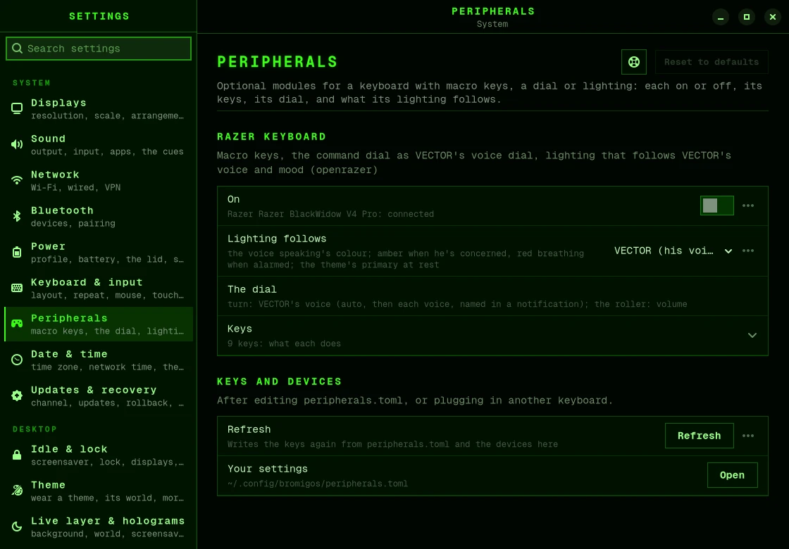

# Keyboards and peripherals

Some devices can do more on bromigOS than type. A keyboard's macro keys can open VECTOR
and the holograms, its dial can change VECTOR's voice, and its lighting can take his
colour. Each device's extras come in a *peripheral module*, which is off until you turn it
on.

bromigOS has a module for Razer keyboards. You can write one for a similar keyboard.

## Turn a module on

1. Connect the device.
2. Open **Settings › Peripherals**, and turn the module on. Or open the menu and choose
   **SETUP › Peripherals**.

The [first run](first-run.md) also asks, when a device with a module is connected.



From a terminal:

```bash
bromigos peripheral                         # the modules, and whether your device is connected
bromigos peripheral enable razer-keyboard   # turn one on
bromigos peripheral status                  # what each key does now
bromigos peripheral disable razer-keyboard  # turn it off again
```

## A Razer keyboard

This module works with the Razer keyboards that openrazer supports, such as the
BlackWidow, Huntsman and Ornata.

Turning it on:

- installs openrazer, the driver the macro keys and the lighting need;
- adds you to the `openrazer` group, so log out and back in once;
- sets up the keys, the dial and the lighting.

A new driver loads after you restart the computer.

| Key | What it does |
|---|---|
| M1 | Show or hide VECTOR. |
| M2 | Hold to talk to VECTOR. |
| M3 | Show VECTOR, and turn conversation mode on or off. |
| M4 | Open the holo deck. |
| M5 | Take a screenshot of an area. |
| Side 1 | Open the menu. |
| Side 2 | Open the timeline. |
| Side 3 | Start or stop recording an area of the screen. |
| Press the dial | Mute or unmute the desktop's sounds and VECTOR's voice. |
| Turn the dial | Change VECTOR's voice. A notification names it. |
| Volume roller | Change the volume. |

These keys only work on this keyboard, so other keyboards never set them off. A keyboard
without some of these keys simply doesn't have them. Without VECTOR, his keys do nothing.

### The lighting

The keyboard lights up in the colour of the voice VECTOR is using:

- amber when he's concerned;
- red and pulsing when he's alarmed;
- brighter while he listens or speaks;
- your theme's main colour, dimmed, when he isn't running.

To use your theme's colour all the time, set **Lighting follows** to the theme in
**Settings › Peripherals**, or set `rgb_follow = "theme"` in the file below.

## Change what a key does

Your choices are in `~/.config/bromigos/peripherals.toml`:

```toml
[razer-keyboard]
enabled = true
rgb = "all"            # all: the keyboard and a Razer mouse; device: the keyboard only; off
rgb_follow = "theme"   # the theme's colour; "vector" (the default) follows his voice
dial = true            # false: leave the dial alone

[razer-keyboard.keys]
side1 = "bromigos-live timeline"   # any command
m5 = ""                            # nothing
```

After you save it, run `bromigos peripheral refresh`. If you made a typo,
`bromigos peripheral status` tells you.

## Another keyboard

A keyboard that can send the keys F13 to F24, as many programmable keyboards can, works
with a module of your own: a folder in `~/.config/bromigos/peripherals/` with one file
that describes its keys. The lighting needs openrazer, so for now it works on Razer
devices only.

The format is in the developer docs:
[peripherals.md](https://github.com/bromigos-org/bromigOS/blob/main/docs/peripherals.md).

## Playing games

On a BlackWidow V4 Pro with the Razer module enabled, Fn+F10 toggles
[game mode](games.md). Its gaming LED follows the mode. Ctrl+Shift+F12 leaves it, even
if the keyboard has disabled Super. This needs the module's existing OpenRazer and
input-device permissions. You can always enter with Super+Ctrl+G or `bromigos game on`.
