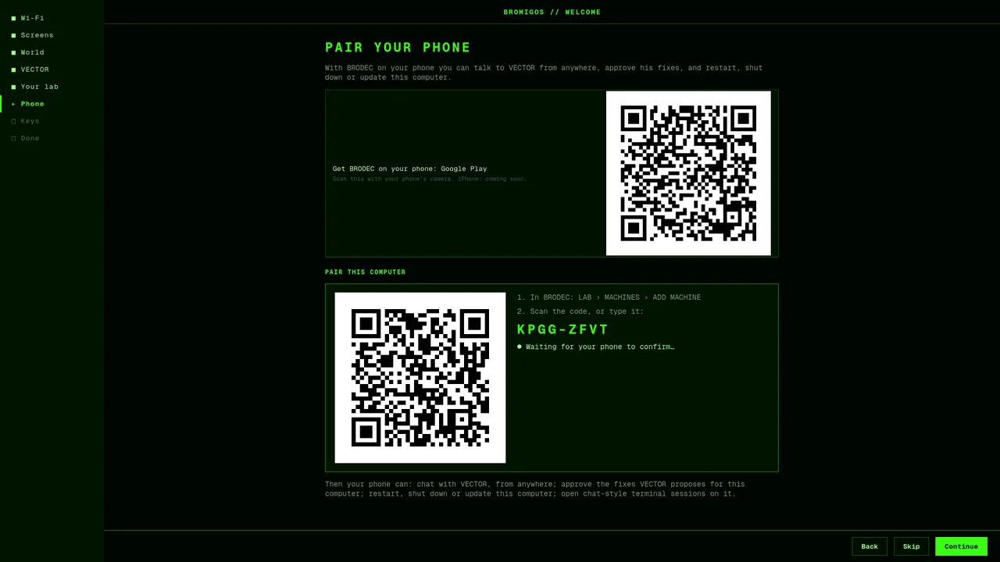

# Pair your phone

With the BRODEC app on your phone paired to this computer, you can reach it from anywhere.
The welcome tour's **Pair your phone** step sets it up, and you can do it again any time.

## Get BRODEC

BRODEC is on Google Play (`org.bromigos.brodec`): the tour shows a QR code that opens it.
BRODEC for iPhone is coming.

## Pair

1. **BRODEC's helper.** Pairing uses BRODEC's machine helper, `brodec-machine`. The step
   explains it and installs it when you agree, the usual way: the system asks for your
   password in its own window. No terminal. The same password lets the helper run on this
   computer (**Allow pairing**, if it was installed some other way).
2. **Scan the code.** The step shows a big QR code and a short code. In BRODEC, open
   LAB › MACHINES › **ADD MACHINE** and scan the QR, or type the short code. A code runs
   out after a few minutes; the next one appears by itself.
3. **Confirm on your phone.** BRODEC shows this computer's name and asks you to confirm.
   When it's done, the step ticks ✓.
4. **Let your phone run things here** (optional). Restarting, updating and terminal
   sessions from the phone also need your say-so at this computer. In BRODEC, open LAB ›
   MACHINES › this computer › **ALLOW THIS PHONE**, then press **Allow…** in the step. It
   asks for your password and shows the phone's key: compare it with the one on the
   phone, then **Allow**.

If this computer runs your lab's VECTOR bridge (`brodec-lab`), the step offers to pair it
too: **Pair it** asks for your password and shows the bridge's own code.

On bromigOS Server the same step runs in the console tour: the QR is drawn in the
terminal, and sudo asks for the password where the window would.

## What your phone can do then

- Chat with VECTOR, from anywhere.
- Approve the fixes VECTOR proposes for this computer.
- Restart, shut down or update this computer.
- Open chat-style terminal sessions on it.

Nothing runs on this computer without your say-so: everything travels end-to-end
encrypted, from your account only, and the serious requests ask for your fingerprint on
the phone.

## For power users

The helper is `brodec-machine`, a user service (`brodec-machine.service`). It runs only once
root's `/etc/brodec-machine/machine.toml` exists; the step writes it from the packaged
example (`/usr/share/brodec-machine/machine.toml.example`) through polkit. On a desktop the
helper comes in `brodec-desktop`; a server gets the separate `brodec-machine` package when
the repository has it.

| Command | What it does |
|---|---|
| `brodec-machine pair` | Shows the pairing code and its QR in the terminal, until it's paired |
| `brodec-machine pair --json --start --timeout 900` | What the tour runs: one JSON event a line (`code`, `expired`, `waiting`, `paired`, `failed`, `cancelled`); exits 0 paired, 1 failed or timed out, 130 cancelled |
| `brodec-machine status` | Paired with whom, the switch, jobs |
| `sudo brodec-machine enroll` | Allows a phone that asked to send jobs: the machine owner's own step, at the machine (the tour runs it through `pkexec`, answering its question with your choice) |
| `sudo brodec-lab pair --json` | The same events for a lab's VECTOR bridge |
| `brodec-machine off` | STOP ALL: every job on this machine stops |

A `code` event carries the QR's text (`qr`), the QR drawn as SVG (`qr_svg`, the window's)
and as terminal text (`qr_text`, the console's), and the code to type
(`user_code_display`). Leaving the step stops only the watching (SIGTERM): the agent keeps
offering codes, so pairing later still works. Pairing is the Bromigos account's device
flow, approved from the phone with `kind: "machine"`; the phone checks the machine's key
against the fingerprint in the QR, so one scan verifies both ways. BRODEC's own
description is its `docs/MACHINE_JOBS.md`, "Pairing from a setup screen".
