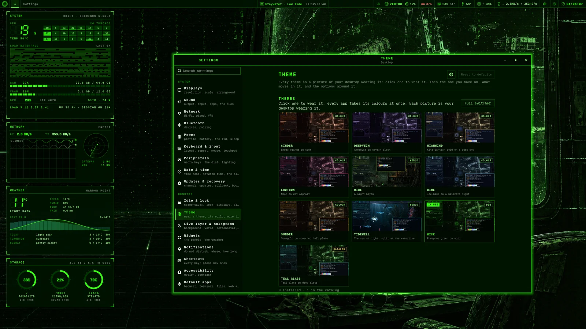
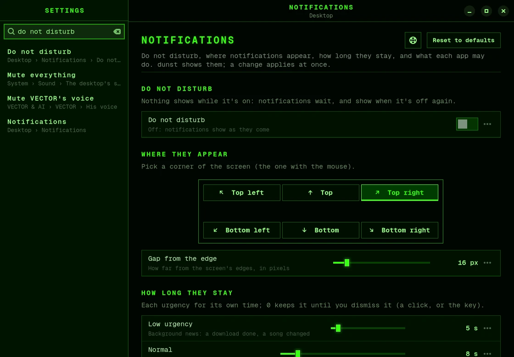

# Settings

Settings is one window for the desktop's settings: displays, sound, network, the theme,
VECTOR and the rest. It takes your theme's colours.

## Open Settings

- Press <kbd>Super</kbd>+<kbd>,</kbd> (Super and the comma key).
- Or click the gear on the bar.
- Or open the menu (<kbd>Super</kbd>+<kbd>Space</kbd>) and choose **SETUP › Settings…**.
- Or run `bromigos settings` in a terminal. Add a page's name to open it, such as
  `bromigos settings sound`.

## Find a setting

Start typing anywhere in the window, or press <kbd>Ctrl</kbd>+<kbd>F</kbd>. Settings finds
a setting by its name or by what you'd call it: `wifi`, `mic`, `do not disturb`,
`24 hour`.

- Press <kbd>Enter</kbd> to open the first result.
- Press <kbd>↓</kbd> to move through the results.
- Press <kbd>Esc</kbd> to clear the search.

The pages are also listed on the left, in groups: **System**, **Desktop**,
**VECTOR & AI**, **Lab**, **Personal** and **About**.

## How changes work

- **Changes apply at once.** A note at the bottom says what changed. Choose **Undo** there,
  or press <kbd>Ctrl</kbd>+<kbd>Z</kbd>, to take it back.
- **Displays are the exception.** Their changes wait until you choose **Apply**.
- **Reset to defaults**, at the top of a page, puts that page back to bromigOS's
  settings. It asks first. On some pages, such as Date & time and Shortcuts, you can undo
  it. On others you can't. Where a page has nothing to reset, such as Network, the button
  is greyed out.
- **Some changes need your password.** Updating and changing the update channel open a
  terminal that shows the command it runs, and asks there. A few others, such as what the
  lid does, ask in a password window.
- **Hover over anything** to see what it is and what it does. The **⋯** at the end of a row
  shows the file it changes and the command it runs.

## Keys in Settings

| To | Press |
|---|---|
| search | Start typing, or <kbd>Ctrl</kbd>+<kbd>F</kbd> |
| go to the previous or next page | <kbd>Ctrl</kbd>+<kbd>Page Up</kbd> or <kbd>Ctrl</kbd>+<kbd>Page Down</kbd> |
| jump to a group | <kbd>Ctrl</kbd>+<kbd>1</kbd> to <kbd>Ctrl</kbd>+<kbd>6</kbd> |
| undo the last change | <kbd>Ctrl</kbd>+<kbd>Z</kbd> |
| open this manual on the page you're on | <kbd>F1</kbd> |
| close Settings | <kbd>Ctrl</kbd>+<kbd>W</kbd> |

## The pages

Each section below is one page. The command in brackets does the same from a terminal.

These pages have chapters of their own:

- **Idle & lock**: see [Idle and lock](idle.md).
- **Theme**: see [Themes and worlds](themes-and-worlds.md).
- **Shortcuts**: see [Your own shortcuts](shortcuts.md).
- **Accessibility**: see [Accessibility](accessibility.md).
- **Lab**: see [The lab console](lab.md#in-settings).

## Displays

Your monitors: resolution, refresh rate, scale, which way up each one is, whether it's on,
and which is the primary. The primary monitor is where the background, the panels and
VECTOR appear.

To change your displays:

1. Drag the monitors in the picture to match where they sit on your desk.
2. Click a monitor to choose it, and set its resolution, refresh rate and scale. The scale
   that suits its size is marked.
3. Choose **Apply**.
4. bromigOS asks "Keep these display settings?" Choose **Keep** within 15 seconds.

If a screen goes dark and you can't answer, the old settings come back by themselves after
15 seconds. **Reset to defaults** puts every monitor back to what it prefers.
(`bromigos display`)

## Sound

Choose your speakers or headphones and your microphone, and set their volume. Each app
that's playing has its own volume, and you can send it to different speakers.

Below that are the desktop's own sounds: **Mute everything**, which mutes the theme's
sounds and VECTOR's voice together, and the theme's sound cues and their volume.
(`bromigos sound`)

## Network

- **Wi-Fi**: turn it on or off, and join a network. A lock means the network needs a
  password: you type it once, and bromigOS remembers it.
- **Join another network…** joins a hidden network by its name.
- **Saved networks**: choose whether each one joins by itself, or forget it.
- **Wired** and **VPN**: your network ports, and a switch for each VPN.
- **More settings** opens the full network editor, for fixed addresses, proxies, VPN
  profiles and company networks.

(`bromigos net`)

## Bluetooth

Turn Bluetooth on or off, and make this computer visible to devices nearby.

To pair a new device:

1. Put the device in pairing mode. This is often a long press on its button.
2. Choose **Scan**.
3. When the device appears, choose **Pair**.

If the device asks for a code, **Pair in the panel** pairs it in the bar's Bluetooth panel,
which asks you for the code. Paired devices show their battery, and you can connect,
disconnect or forget each one. **Switch the sound over on connect** makes headphones the
sound output when they connect. [Bluetooth](bluetooth.md) covers the bar's icon and panel.
(`bromigos bluetooth`)

## Power

- **Power profile**: Power saver, Balanced or Performance.
- **Battery**: the charge, the time left, and the battery's health. Other devices'
  batteries show here too.
- **The lid**: what closing a laptop's lid does, on battery, plugged in, and docked. This
  setting is for the whole machine, so it asks for your password.
- **Suspend now** puts the machine to sleep.

When the machine sleeps by itself is set on the Idle & lock page. (`bromigos power`)

## Keyboard and input

- **Keyboard**: the layout and its variant, a second layout and the key that switches
  between them, how fast keys repeat (with a box to try it), what Caps Lock does, and
  whether Num Lock is on at start.
- **Mouse**: speed, acceleration, natural scrolling, left-handed buttons, scroll speed,
  and whether the window under the pointer becomes the active one.
- **Touchpad**: tap to click, natural scrolling, turning the touchpad off while you type,
  how clicking works, and scroll speed.

(`bromigos setup input`)

## Peripherals

For a keyboard with macro keys, a dial or lighting: turn its module on or off, choose what
its lighting follows, VECTOR or the theme, and see what each key and the dial do. See
[Keyboards and peripherals](peripherals.md). (`bromigos peripheral`)

## Date and time

Turn network time on or off, choose your time zone, and choose how the bar's clock looks:
24-hour, with seconds, with the date. (`bromigos clock`)

## Updates and recovery

- **Channel**: which [update channel](update-and-rollback.md#channels) you follow.
- **Update now**, the last update, and what an update would do now.
- **Snapshots and rolling back**: whether this machine can undo updates, and
  **Roll back…** to undo one.
- **Boot menu**: whether the [boot menu](boot-menu.md) wears your theme.

These need your password, so each opens a terminal that shows its command. See
[Updating and rolling back](update-and-rollback.md).

## Live layer and holograms

The animated background on or off, each of its animations, the theme's world and its
sounds, what the screensaver shows (and **Try it** to see it now), the spoken
[codec calls](glossary.md#codec-call), how smoothly it draws, and the holograms' keys.
Turning a deck's key off frees the key for something else. See
[Themes and worlds](themes-and-worlds.md) and [Holograms](holograms.md).

## Widgets

Which [panels](panels.md) show, a small picture of where they sit, the monitor they're
on, and the weather panel's place and units. (`bromigos panels`)

## Notifications

- **Do not disturb**: nothing shows while it's on. Notifications wait until you turn it
  off.
- **Where they appear**: which corner of the screen.
- **How long they stay**, for low, normal and critical notifications.
- **Apps**: for each app that has sent a notification, choose Show, Quiet or Hide.
- **Send a test**, and clear the history.

(`bromigos notifications`)

## Default apps

Which app opens links, folders, text files, Markdown notes, pictures, videos, music, PDFs
and email. Also
the terminal and file manager that bromigOS's keys open, and your
[web apps](webapps.md). (`bromigos defaults`)

## Startup

What starts when you log in: bromigOS's own programs (listed, so you know), yours (add an
app or a command, or remove one), and which floating windows go back where you left them.
See [Windows and workspaces](windows.md#put-floating-windows-back-where-you-left-them).
(`bromigos startup`)

## Extensions

The [extensions](extensions.md) you have, with a switch to turn each on or off, the
updates waiting, and the catalog to find more. A theme installs at once. Anything that runs
code, and every update, opens a terminal that shows what it will do and asks you there.

## VECTOR

- **His brain**: the model he thinks with, and where it runs.
- **His voice**: mute it, or choose a voice. Turn conversation mode on or off.
- **His keys.**
- **Emergency switch**: turns him off at once. See [VECTOR](vector.md#the-emergency-switch).
- **What he remembers**: export it, or clear his history or his memory. **Undo** brings
  them back.

## Creation targets

Each kind of AI work has a row, such as pictures, video, 3D models, and VECTOR's voice,
hearing and brain. Each row shows what that work uses now. Choose where it runs first:
your homelab, this machine or the cloud. The cloud asks first, because it costs money. See
[Creating with AI](where-ai-runs.md).

## Account

Your name, full name, pronouns and other names, what VECTOR calls you, and your picture.
If you keep your settings in dotfiles you share, the
page tells you to keep private values in the
[private overlay](glossary.md#private-overlay). (`bromigos profile`, `bromigos avatar`)

**Bromigos account** shows whether this computer is signed in to your
[Bromigos account](bromigos-account.md), and as whom. It's optional. **Sign in…** and
**Sign in with SSH key…** run the sign-in in a terminal. **Sign out** asks first.
(`bromigos login`, `bromigos whoami`, `bromigos logout`)

## About

The bromigOS version and channel, the last update, this computer's hardware, and the
packages with their versions and licences. **Copy system info** copies all of it, ready to
paste into a bug report. (`bromigos about`)

**The manual** opens this manual. It's installed on your computer, so it matches your
version of bromigOS and works without a network. <kbd>F1</kbd> opens it on the page
you're on.

## Add your own page

Packages, extensions and you can add pages to Settings. A page of your own is a small
Python file in `~/.config/bromigos/plugins/settings/`. The developer docs'
[settings.md](https://github.com/bromigos-org/bromigOS/blob/main/docs/settings.md) shows
one.

The **Prompt** row in Default apps chooses mehshell, Starship or a plain zsh
prompt. See [Shell and terminal](shell.md) for existing installs.
