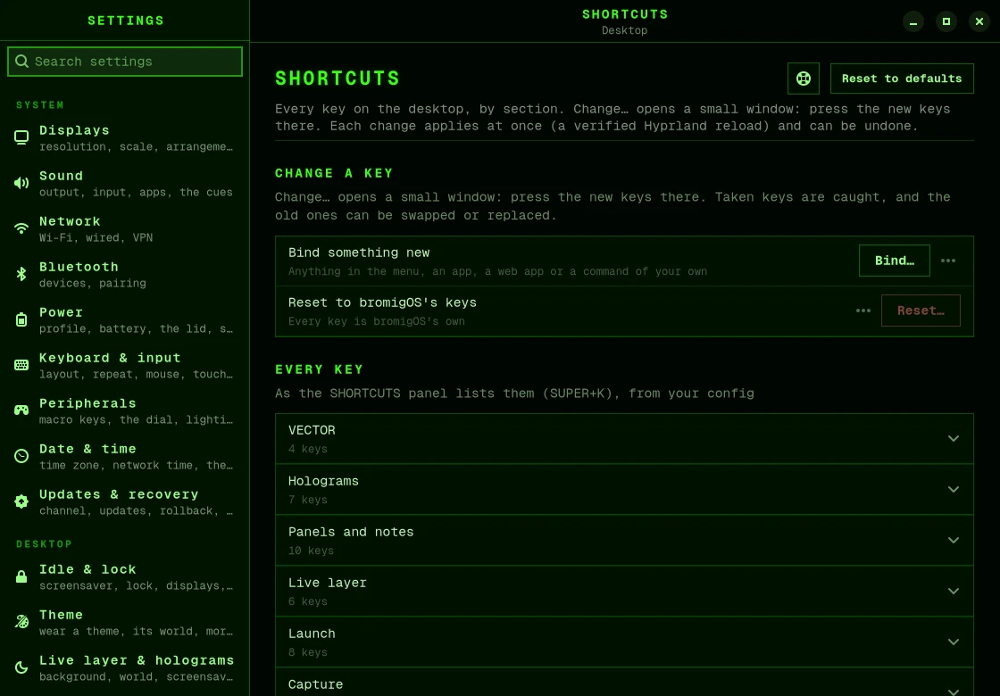

# Your own shortcuts

You can change any of bromigOS's keys, and give a key to anything: a menu item, an app, a
[web app](webapps.md) or a command of your own. You don't need to edit any files.

## Change a key

1. Open **Settings › Shortcuts**.
2. Under **Every key**, open the section the key is in, such as **Launch**, and choose
   **Change…** next to the key.
3. A small window opens. Press the new keys. The window shows them while you hold them.
4. Let go. The new key is saved.



In that window:

| To | Press |
|---|---|
| save at once, after you let go | <kbd>Enter</kbd> |
| clear the keys and start again | <kbd>Backspace</kbd> |
| cancel | <kbd>Esc</kbd> |

If the keys you pressed are already in use, bromigOS says what uses them. You can swap the
two keys, take the keys from the other action, or pick different keys.

## Give a key to something new

1. Open **Settings › Shortcuts** and choose **Bind…** next to **Bind something new**. Or
   open the menu and choose **SETUP › Shortcuts…**, or run `bromigos keys` in a terminal.
2. Choose what the key should do: one of bromigOS's actions, any item in the menu, an app,
   a web app, or a command you type.
3. Press the new keys, and let go.

Your shortcuts show in the SHORTCUTS panel (<kbd>Super</kbd>+<kbd>K</kbd>), under YOURS.

## Remove or reset keys

From the same places you can change or remove one of your shortcuts, or put one of
bromigOS's keys back as it was. To put every key back to bromigOS's own and remove your
shortcuts, choose **Reset…** next to **Reset to bromigOS's keys** in
**Settings › Shortcuts**, or run:

```bash
bromigos keys reset
```

`bromigos keys undo` puts back what your last change replaced.

## From a terminal

```bash
bromigos keys                                           # the picker
bromigos keys bind "SUPER + ALT + G" --webapp gmail     # a key for a web app
bromigos keys bind "SUPER + ALT + T" --exec kitty      # a key for a command
bromigos keys check "SUPER + ALT + T"                   # what a key does now
bromigos keys list                                      # your shortcuts
bromigos keys unbind "SUPER + ALT + T"                  # take a key off
```

Write keys in capitals, with a plus sign and a space on each side, as in
`"SUPER + SHIFT + K"`.

bromigOS checks every change with Hyprland before it uses it. If anything goes wrong, your
files are put back as they were.

## Use Super for the window keys

The keys that move and arrange windows use **Alt**. To move one of them to **Super**,
change it in **Settings › Shortcuts**, as above.

One setting moves them all to Super. It moves every key that uses Alt, not only the window
keys: the launcher, the terminal and screenshots too.

Many of bromigOS's own keys already use Super with the same letters. When a window key
takes one of them, bromigOS moves its own key to **Alt**, so no key does two things. For
example, <kbd>Super</kbd>+<kbd>L</kbd> moves to the window on the right, and the lock moves
to <kbd>Alt</kbd>+<kbd>L</kbd>. About a dozen keys move this way, including the SHORTCUTS
panel itself, which moves to <kbd>Alt</kbd>+<kbd>K</kbd>.

To move them all:

1. Run `bromigos setup config` and choose your Hyprland file. It opens
   `~/.config/hypr/hyprland.lua`, and reloads the desktop safely when you close the editor.
2. In the `bromigos = { … }` table at the top, change the line `-- mod = "ALT",` to:

   ```lua
   mod = "SUPER",
   ```

3. Save and close the file.
4. Press <kbd>Alt</kbd>+<kbd>K</kbd> to open the SHORTCUTS panel and see where every key
   is now. `bromigos keys list --all` lists them in a terminal.

The [Keys](keys.md) page lists bromigOS's keys as they are with Alt.

## Add keys by hand

If you prefer editing files, add keys to your `~/.config/hypr/hyprland.lua`, after the line
that loads bromigOS's defaults. Use the same helper bromigOS uses, so the SHORTCUTS panel
lists your keys:

```lua
local K = require("bromigos.keys")
K.exec("SUPER + SHIFT + W", "firefox")
```

To use one of bromigOS's keys for something else, list it in the `unbind` setting first,
then bind it yourself:

```lua
bromigos = {
    unbind = { "SUPER + E" },
}
```

`bromigos setup keybindings` lists every key in a menu. Its EDIT item opens this file, and
reloads the desktop safely afterwards.
