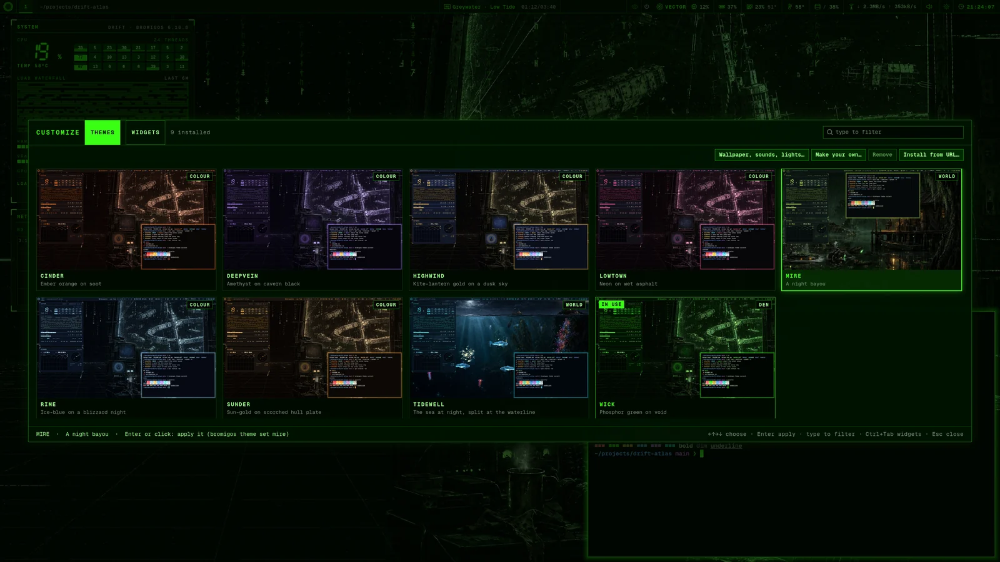
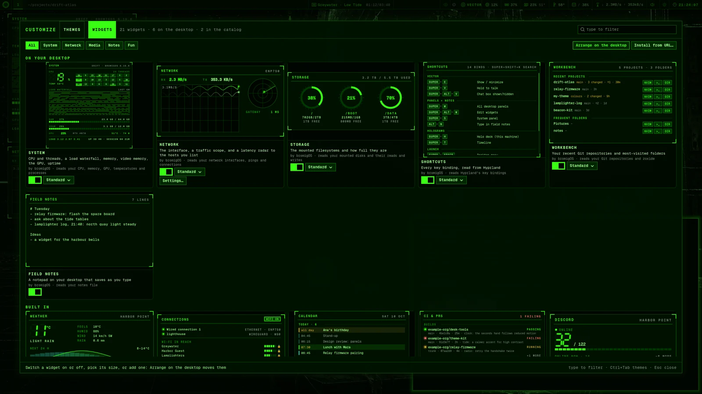
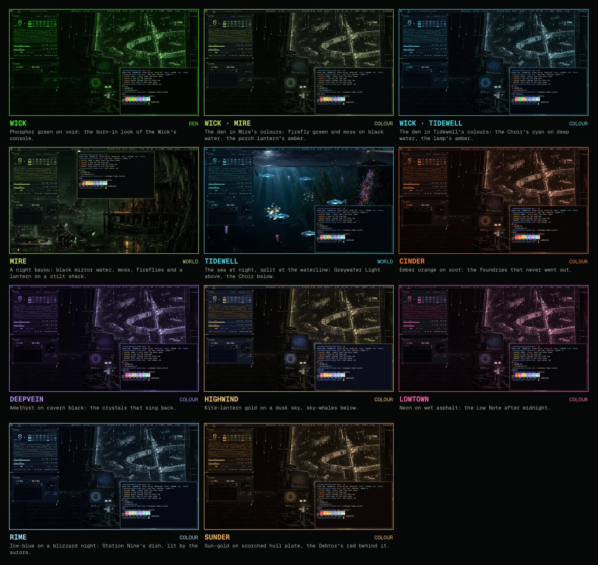
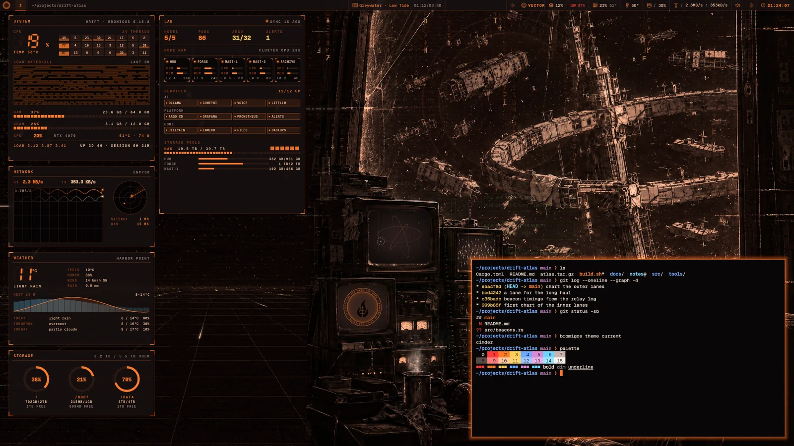
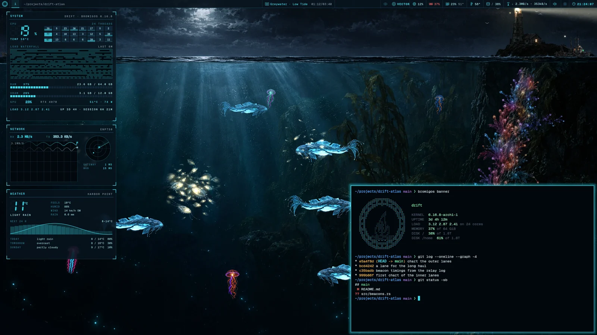

# Themes and worlds

A theme changes the look of the whole desktop at once: the colours of every app, the
bar's icons, the wallpaper, the lock screen and the [boot menu](boot-menu.md). Some themes
are [worlds](glossary.md#world): instead of a still wallpaper, they bring a living scene
that reacts to what your machine is doing.

## Change the theme

1. Press <kbd>Super</kbd>+<kbd>Ctrl</kbd>+<kbd>Shift</kbd>+<kbd>Space</kbd>. The
   Customize window opens on its Themes tab, with a picture of your desktop wearing each
   theme.
2. Choose a theme with the arrow keys or the mouse. To narrow the list, type part of a
   name, or `world` or `colour`.
3. Press <kbd>Enter</kbd>, or click the theme. The desktop changes colour within a second.
   A few apps change the next time you open them.



Press <kbd>Esc</kbd> to close the switcher without changing anything. Hover over a card to
read what the theme is.

## Customize

The window you choose themes in is called Customize. It has two tabs:

- **Themes**, the pictures above;
- **Widgets**, every [panel](panels.md) you can put on your desktop, with a switch for
  each, its sizes, and more to install.

Press <kbd>Ctrl</kbd>+<kbd>Tab</kbd> to change tab. In the menu, **STYLE** has an item for
each tab. The app launcher lists it as **Customize**.



On the Themes tab:

- **Make your own…** copies the theme you've selected into a new theme of yours, to
  change as you like.
- **Remove** removes a theme you added. It can't remove bromigOS's own themes, or the one
  you're wearing.
- **Install from URL…** adds a theme someone shared as a link.
- **Wallpaper, sounds, lights…** opens Settings at what goes with any theme.

You can also choose a theme in **Settings › Theme**, or in the menu under **STYLE**. Or
from a terminal:

```bash
bromigos theme             # list the themes; the one in use is marked
bromigos theme set mire    # switch to Mire
bromigos theme set wick    # back to the default
```

The switcher draws its pictures in the background after an update, or when you add a
theme. A card that's still being drawn shows the theme's colours and the word DRAWING.
To draw any missing pictures now, run `bromigos theme previews`.

A few things keep the Wick's look in every theme: the login screen and the splash screen
while the computer starts.

## The themes

bromigOS comes with nine themes.



| Theme | Kind | Look |
|---|---|---|
| Wick | the default | Phosphor green on black, with the [den](glossary.md#den) behind your windows. |
| Mire | world | A night bayou: black water, moss, fireflies and a lantern on a stilt shack. |
| Tidewell | world | The sea at night, split at the waterline: a lighthouse above, glowing creatures below. |
| Rime | colour | Ice blue on a blizzard night. |
| Sunder | colour | Sun-gold on scorched metal. |
| Cinder | colour | Ember orange on soot. |
| Lowtown | colour | Neon on wet asphalt. |
| Highwind | colour | Lantern gold on a dusk sky. |
| Deepvein | colour | Amethyst on cavern black. |

A colour theme shows the den in its own colours.



## The worlds

In a world, everything that moves shows something real. Nothing moves just for
decoration. If bromigOS can't read something, such as a homelab you haven't connected,
the part of the scene it drives isn't drawn.

Each world has a [keeper](glossary.md#keeper), a figure who works while you work and
dozes when you leave the computer.

### Mire

A night bayou.


| You see | It shows |
|---|---|
| Hollis rocking on the porch | You're working. He dozes when you're idle. |
| The Sleepers, old machines half-sunk in the water | Your [coding agents](glossary.md#coding-agent). One surfaces for each agent. Its eyes glow while it works, and it rises and signals when it needs you. |
| Rain | Your agents and your homelab's AI models at work. A downpour when the processor is busy. |
| Fireflies and passing ships | Your network traffic. |
| The heron taking off | A notification. |

### Tidewell

The sea at night, under a lighthouse called Greywater Light.



| You see | It shows |
|---|---|
| The Choir, great glowing creatures | Your coding agents. |
| Small fish, the lampfry, drifting | You're working. |
| Trawlers coming and going | Your network traffic, in and out. |
| The lighthouse beam and the reef on the rock | Your homelab's health. |
| A storm | A machine or service in your homelab is down. |

Craft cross the sky now and then in both worlds.

### Make it calmer

Both worlds can move less, or hold still like a photograph. See
[Accessibility](accessibility.md).

## The den TV

The den's screens can show your own videos, like a TV that's always on. A TV channel plays
from your Jellyfin or Plex server, a YouTube playlist or channel, or a folder of videos.
Whenever you look, it's part-way through something, as if it had been on all along. It's
silent until you turn the sound on. (A TV channel has nothing to do with the update
[channel](glossary.md#channel) your machine follows.)


Every channel can play on any of the den's three screens, and each screen plays its own
channel at the same time. Channel 1 is what the screen always shows, such as the relay map
on the big monitor. Your channels come after it, and the den stays exactly as it was until
you change channel. Two screens on the same channel show the same moment, like real TV.

### Watch it

Point at a screen that has channels. A hint shows what's on.

| To | Do this |
|---|---|
| Change channel | Scroll over the screen, or click ◀ ▶ in the hint |
| Watch it big, with sound | Click the screen, or **FULL** in the hint. mpv opens full screen at the same moment. Close it to go back. |
| Turn the sound on or off | The speaker in the hint, or <kbd>Super</kbd>+<kbd>Alt</kbd>+<kbd>M</kbd>. The sound comes from one screen at a time: turning it on for one turns it off on the others. |
| Change the volume | − and + in the hint, or scroll over its volume bar. Turning it up turns the sound on. |
| Open it in Jellyfin, Plex or YouTube | The button at the end of the hint |
| See every channel | **GUIDE** in the hint, or <kbd>Super</kbd>+<kbd>Alt</kbd>+<kbd>G</kbd> |

From the keyboard, <kbd>Super</kbd>+<kbd>Alt</kbd>+<kbd>P</kbd> opens what's on full
screen, and <kbd>Super</kbd>+<kbd>Alt</kbd>+<kbd>.</kbd> and
<kbd>Super</kbd>+<kbd>Alt</kbd>+<kbd>,</kbd> change channel. The keys act on the screen
under the pointer. Each screen remembers its channel, its sound and its volume.

If the sound is on but you hear nothing, the hint says why, such as "Your desktop is
muted".

The TV goes quiet when you lock the screen or the screensaver starts, and when you mute
everything with <kbd>Super</kbd>+<kbd>Shift</kbd>+<kbd>M</kbd>. It turns down while
VECTOR speaks. In the sound settings it's called **bromigOS den TV**.

It only plays while you can see it. With the screen locked, or behind a window while it's
silent, it pauses and costs nothing. A screen whose sound is on keeps playing behind
windows, so you can listen. When it shows again, it's where it would be by now.

### The channel guide

The channel guide shows every channel once, like a TV guide: what's on now and next, with
its poster and how far through it is. Under each one, **BIG**, **SCOPE** and **SMALL** put
that screen on it; the lit button shows where it's on air. Open the guide with **GUIDE** in
the hint, <kbd>Super</kbd>+<kbd>Alt</kbd>+<kbd>G</kbd>, or the **Den TV** app in the launcher.
`bromigos-live tv guide` and the MEDIA panel's guide button open the same app.
Settings keeps playback on/off, how many screens play at once, and when a window pauses
a silent screen. Its **Open Den TV…** button opens the guide.


| To | Do this |
|---|---|
| Add a channel | **Add channel…**, then choose what it plays, its name, its order and its screens |
| Make a channel of shows you pick | **Add channel…**, then **Shows or movies you pick**. Search, click the posters, and choose the order. |
| Watch a channel now | **BIG**, **SCOPE** or **SMALL** on its card, or 1, 2 or 3 |
| Reorder | Drag a card onto another one, or Alt and an arrow key |
| Keep a channel off a screen | Its menu's screens. Every channel is on every screen until you say. |
| Open each item with a station card | **Bumpers** in its menu: a few seconds with the channel's name, what's on and the time |
| Rename | The card's menu, or F2 |
| Remove | The card's menu, or Delete. Confirm first; **Undo** brings it back. Media files stay. |

Use a card's **Contents…** menu to see its titles, reorder picks, or add and remove
items. **Shuffle**, **In order** and **Alternate** choose its play order.

The den follows each change at once, without restarting. The
[media library and commands](media.md#make-channels-for-the-den-tv) edit these same
channels.

### Add a TV channel by hand

The guide is the easiest way. The MEDIA panel's settings make one channel too
([Panels](panels.md#media)).

The channels are kept in `~/.config/bromigos-live/config.toml`, and you can write them
there yourself:

```toml
[[tv.channel]]
name = "Saturday"
library = "TV Shows"          # or collection = "…" or playlist = "…"

[[tv.channel]]
name = "Lo-fi"
youtube = "https://www.youtube.com/playlist?list=<id>"
```

Replace `<id>` with the playlist's ID. The den TV reads the file when you save it.

- **Jellyfin or Plex** needs your server in [Your homelab](homelab.md), with a key: a
  Jellyfin API key or a Plex token. The MEDIA panel tells you if the key is missing.
- **YouTube:** a channel's address plays its
  videos. If it's live, a second channel follows it with the live stream.
- **Keep YouTube videos.** Add `keep = "~/Videos/YouTube"` to a YouTube channel. Each
  video it plays is saved there, in the layout Plex and Jellyfin read, and plays offline
  from then on. Any folder works, a NAS share included. `keep_max_gb = 50` caps it.
- **Videos on your disk.** `files = "~/Videos/Home"` plays a folder.
- **Shows you pick.** `shows = ["Example Show", "Another Show"]` plays those shows'
  episodes. Shuffled, they mix. With `order = "in order"`, they take turns, one episode of
  each, like an evening on a TV network. Each show goes on from where it left off, day
  after day. `items = [...]` picks movies, and `collections = [...]` collections.

A playlist plays in order, and anything else shuffled, the same way all day. Add
`order = "in order"` or `order = "shuffle"` to choose. Every channel plays on every screen.
To keep one to some screens, add `screens = ["wave"]` for the scope, or `"emblem"` for the
small monitor. `bumpers = true` opens each item with a station card.

To start each screen on its own channel, name them:

```toml
[tv.start]
big = "Saturday"
wave = "Lo-fi"
```

A screen starts there until you change its channel. Then it remembers yours.

The den TV's player (mpv) and YouTube support (yt-dlp) come with bromigOS. With the
background still or on a computer without a working graphics card, it shows posters
instead.

### The worlds

The den TV is the den's: the Wick and the colour themes have it. Mire and Tidewell have no
screens, so they don't.

## Turn parts of the background on and off

The background is made of many small animations: rain, stars, passing ships, the flash on
an urgent notification, and more. Each one has a switch.

- In the menu, open **TOGGLE**. Each animation is listed with its state.
- Or in **Settings › Live layer & holograms**.
- Or from a terminal:

  ```bash
  bromigos anim                 # every animation, and whether it's on
  bromigos anim off ships       # turn one off
  bromigos anim on all          # turn them all on
  bromigos anim reset           # back to the defaults
  ```

To turn the whole background off, press <kbd>Super</kbd>+<kbd>Shift</kbd>+<kbd>B</kbd>.

## Theme sounds

Themes have sounds: short cues, the world's own sounds, and spoken
[codec calls](glossary.md#codec-call) for important events.

- To mute the theme's sounds and VECTOR's voice together, press
  <kbd>Super</kbd>+<kbd>Shift</kbd>+<kbd>M</kbd>. Press it again to hear them.
- To mute only the theme's sounds, turn off **Theme sounds** in **Settings › Theme**.
- `bromigos anim off sounds` also turns the theme's sounds off.

## The den wallpaper

The Wick's background is the den. bromigOS ships one den picture.
<kbd>Super</kbd>+<kbd>Ctrl</kbd>+<kbd>Space</kbd> steps through den pictures, so it only
changes something when you've added den pictures of your own to `~/.config/wallpaper`. A
world brings its own painting, so the key does nothing there.

## Get more themes

Themes that other people share are [extensions](extensions.md).

- The theme switcher lists the catalog's themes after yours. Choose one to install it and
  switch to it.
- Or open **Settings › Theme** and search the catalog under **Get more themes**, or paste
  a theme's git address.
- Or from a terminal:

  ```bash
  bromigos theme install https://github.com/someone/their-theme
  bromigos theme remove their-theme
  ```

`bromigos ext update --all` keeps installed themes up to date.

## Make your own theme

1. Run `bromigos theme new dusk --from wick`. This makes a folder called `dusk` with a
   copy of the Wick to change.
2. Edit its `colors.toml`.
3. Install it with `bromigos ext install --copy ./dusk`, then switch with
   `bromigos theme set dusk`.

A theme can also be a plain folder in `~/.config/bromigos/themes/`, with a `colors.toml`
in it. The full format, and how to make a world, are in the developer docs:
[theming.md](https://github.com/bromigos-org/bromigOS/blob/main/docs/theming.md) and
[worlds.md](https://github.com/bromigos-org/bromigOS/blob/main/docs/worlds.md).

## Controls on the den's equipment

Each TV has a volume knob, a channel knob, MUTE and SKIP beneath its screen, plus a
standby lamp. Scroll a knob to turn it. Click the volume knob to mute; click the channel
knob to go to the next channel. Hover to see a small value readout; move away to hide it.
A change shows its
volume, channel or mute mark on the TV for about a second and a half. The same feedback
appears for commands, VECTOR, keys and the MEDIA widget. Reduced motion uses an
immediate on/off change.

The floating hover panel is optional. Turn **Floating controls** off in Settings › Den
TV or in the Den TV app, or run `bromigos-live tv hint off`. `tv hint on` brings it back.
The config setting is `[tv] hover_hint = false`; the equipment controls keep working.
Nothing is drawn when Den TV is disabled.

The MEDIA remote has a rotary volume dial. Its label names the screen with sound.
Scroll it or drag around it or up and down. Click to mute or unmute. Each screen's row
shows a speaker and percentage: click the speaker to move the sound there, or mute it;
scroll over the row to change that screen's volume. Only one screen has sound at a time.

Full screen uses its own themed mpv controls. Hover the volume icon to unfold a slider
upward; scroll to change volume, or click the icon to mute. The channel buttons change
what is playing, and **BACK** returns to the den. Audio and subtitle menus are beside
the timeline. Your normal mpv settings stay separate. Volume follows you back to the
screen when you close the player.

### The number-pad remote

Press Super+KP 1, 2 or 3 to select BIG, SCOPE or SMALL. Its bezel lights up. While selected,
the number pad controls that TV. NumLock may be on or off. Super+KP 0, Escape or fifteen
seconds without a key returns the pad to its normal use. Super+KP 1/2/3 switches screens.

```text
           / Guide       * Sound here     − Volume down
       7              8 Channel up     9          + Volume up
       4 Previous     5 Mute           6 Skip
       1              2 Channel down   3          Enter Full screen
       0 Leave remote                  . Enter channel number
```

Press decimal, then the channel's digits. It tunes after a one-second pause; Enter tunes
immediately. While entering a channel, zero is a digit; Escape still leaves the remote.
These keys appear in SHORTCUTS, Super+K and Settings › Keys, where you can rebind them.
The [keys page](keys.md#den-tv-remote) has the defaults.

Commands use the same controls:

```bash
bromigos-live tv select big --json
bromigos-live tv remote volume-up --json
bromigos-live tv remote mute --screen scope --json
bromigos-live tv select none --json
```

An explicit `--screen` sends a single action without taking over your number pad.
To choose an episode, movie or YouTube video, use **Play…** in the app or
[Play on den TV](media.md#play-something-on-a-den-screen).
