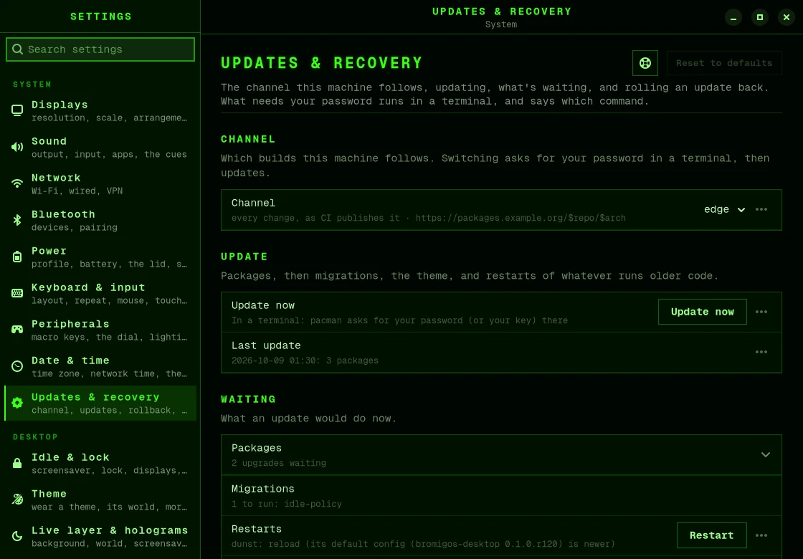

# Updating and rolling back

One command updates everything, and one undoes an update if something goes wrong.

## Update bromigOS

1. Open a terminal with <kbd>Alt</kbd>+<kbd>Shift</kbd>+<kbd>Enter</kbd>.
2. Run:

   ```bash
   bromigos update
   ```

3. Type your password when `sudo` asks, and answer the package manager's questions.

Or open the menu and choose **UPDATE › Update bromigOS**, or choose **Update now** in
**Settings › Updates & recovery**. Both open a terminal for you.



To see what an update would do first, without changing anything:

```bash
bromigos update --check
```

### What an update does

1. It updates every package on the system, bromigOS's and Arch Linux's, and then the
   packages you installed from the AUR. It takes a [snapshot](glossary.md#snapshot) just
   before and just after, so you can undo all of it.
2. It runs any [migrations](glossary.md#migration): small changes to your settings that a
   new version needs. A migration that has to change one of your files keeps a copy of
   the old one.
3. It applies your theme again.
4. It restarts the parts of the desktop that still run old code: the background, the
   panels, the bar, notifications, the volume display, VECTOR and his voice. Your apps keep
   running.

### When the update asks you to restart

A new Linux kernel or a new NVIDIA graphics driver only runs after the computer restarts.
When an update installs one, its last line says so, and a notification says the same:

```text
The graphics driver was updated: restart the computer to use it. Until then, the animated background stays off.
```

Until you restart, the update leaves alone what needs the graphics card: the animated
background and VECTOR. Started now, they couldn't use the card, and would run slowly on
the processor instead. Whatever is already running keeps running. Everything else
restarts as usual. Restart the computer when it suits you.

If the animated background starts anyway before then, it shows a still picture instead,
and a notification says the graphics card isn't available
([Troubleshooting](troubleshooting.md#the-background-is-a-still-picture)).

When an update brings a new release, its last line says so. To read what the release
brings, run `bromigos whats-new`, or see [What's new](whats-new.md).

Use `bromigos update` rather than `sudo pacman -Syu`. A plain `pacman -Syu` doesn't run the
migrations or the restarts, and `bromigos update --rollback` can't undo it. When it changes
bromigOS's packages, pacman reminds you to run `bromigos update`.

### Packages from the AUR

The [AUR](glossary.md#aur) is where Arch Linux users share recipes for software that Arch
Linux doesn't carry. bromigOS installs paru to build them. `bromigos update` updates the
packages you installed from it too, after everything else.

Anyone can write an AUR recipe, and nobody checks it. So before paru builds a package, it
shows you the recipe, or what changed in it, and asks. Read it, or trust whoever maintains
it.

- `bromigos update --check` lists the AUR updates waiting.
- `bromigos update --no-aur` leaves the AUR out this time.
- `bromigos update --yes` builds without showing the recipes. Use it only for AUR
  packages you trust.
- If one fails to build, the update still finishes. It tells you which package failed, and
  how to try again.
- Without a terminal and without `--yes`, the update leaves the AUR out, and says so.
- `bromigos aur off` turns the AUR off: bromigOS removes the paru it installed, and
  updates leave AUR packages alone. `bromigos aur on` turns it back on.

## Undo an update

If an update broke something:

```bash
bromigos update --rollback
```

It shows what the last update changed, such as the packages and how many files, and asks
before it does anything. Then it puts every system file back as it was before the update.
This happens on the running system. Afterwards, run `bromigos restart`, or restart the
computer. If the update included a new kernel, restart the computer.

To undo an older update, give its snapshot number. `bromigos update --check` lists the
updates you can undo, with their numbers.

```bash
bromigos update --rollback 151
```

In **Settings › Updates & recovery**, **Roll back…** undoes the last update.

### If the computer won't start

Start it from a snapshot in the
[boot menu](boot-menu.md#start-an-older-version-after-a-bad-update). That gives you the
system as it was before the update, until you restart. To keep it, run
`bromigos update --rollback` there. In a snapshot, it doesn't undo an update. It makes
the snapshot you started your system, so the next normal start comes up on it.

The system you rolled back from is kept, in case you need something from it. The rollback
prints how to delete it once everything works.

### What you need for snapshots

Snapshots need the system disk to use the btrfs file system, with snapper set up. An
install from the bromigOS USB stick has both. To check your machine:

```bash
bromigos rollback status
```

It says whether your updates are snapshotted, and what can be undone. If something's
missing, it tells you what to run:

- `bromigos rollback setup` sets up snapper, and adds the snapshots to the boot menu.
- `bromigos rollback allow` lets you list the system's snapshots without `sudo`, so
  updates can be recorded. It asks for your password once.

Not on btrfs? Updates still work. There's just no snapshot to go back to, and
`bromigos update --check` says so.

## Channels

A channel is the stream of updates you follow.

| Channel | What you get |
|---|---|
| `stable` | Released versions. The default. |
| `rc` | Release candidates: the next stable release, a little early. |
| `edge` | Every change, as soon as it's built. |
| `dev` | Your own builds, from a local repository. For people working on bromigOS. |

To see your channel and change it:

```bash
bromigos channel                    # which channel you follow
bromigos update --channel edge      # switch to edge, and update
```

Moving to an older channel, such as from `edge` back to `stable`, puts packages that are
newer than that channel's back to its versions. `bromigos update --channel` does this for
you.

You can also change the channel in **Settings › Updates & recovery**.

## The manual

This manual is published next to bromigOS's packages. It follows the newest code, so on
the `stable` channel it may describe things that haven't reached you yet. In Settings,
<kbd>F1</kbd> opens it on the page you're looking at.
