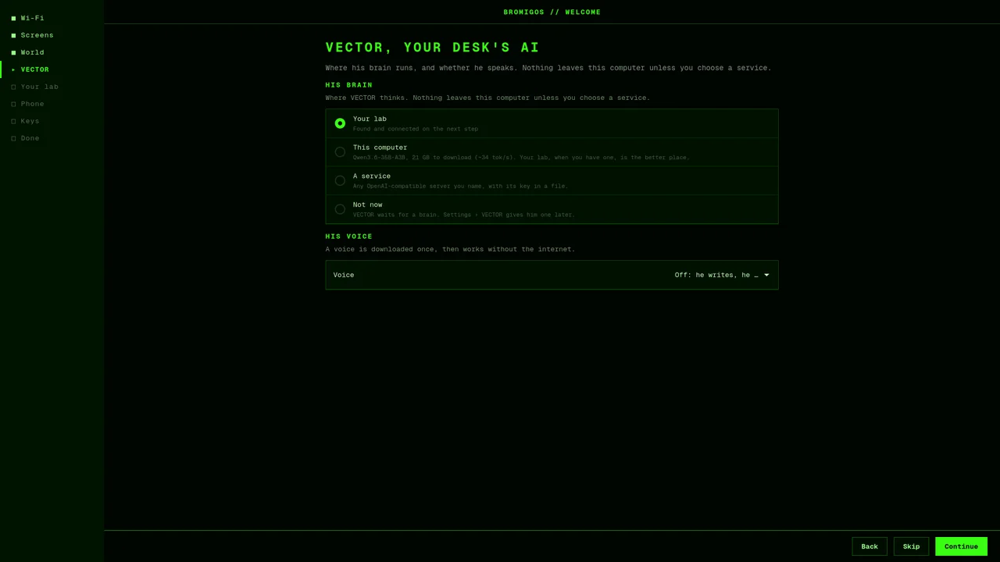
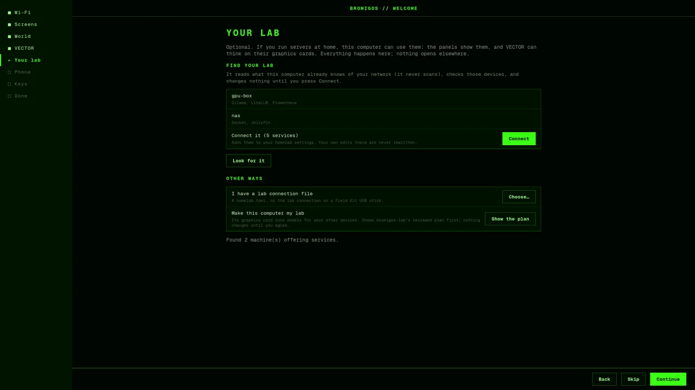

# The welcome tour

The first time you sign in after installing from the bromigOS USB stick, a short tour opens
full screen. It walks you through the things worth setting first. Every step has
**Skip**, and nothing changes until you press **Continue** on it.

To take the tour again: Settings › About › **Welcome tour**, or run `bromigos welcome`.

## The steps

1. **Wi-Fi**, only when you're not connected. Pick a network and type its password.
2. **Your screens.** Which screen is the main one: the live background and the panels go
   there. **Arrange and sizes…** opens Settings › Displays.
3. **A world.** The themes, as pictures of the desktop wearing them. Click one to put it
   on.

   

4. **VECTOR**, your desk's AI. Choose where his brain runs:
   - **Your lab**: your homelab's model server, found on the next step (or the one you
     already connected).
   - **This computer**: only offered when your graphics card has 8 GB of memory or more.
     The tour shows the model the lab catalog picks for your card and how much it
     downloads. It installs what's needed through the system's own password prompt, in
     the window: no terminal.
   - **A service**: any OpenAI-compatible server you name, with its address, model and a
     file holding its key.
   - **Not now**: he waits until you give him one.

   When the brain works, VECTOR says hello in the window, and out loud if he has a voice.
   His **voice** is the second choice: off, Kokoro (runs on the processor), or the
   designed voice (needs a graphics card). A voice downloads its model once; the window
   shows how far it's got.

   

5. **Your lab**, all in the window:
   - **Find** looks for your lab on your network. It only reads what this computer
     already knows (devices that announce themselves, its list of nearby devices, your
     Tailscale devices); it never scans. It lists each lab machine with what it offers,
     such as models and services. Nothing is written until you press **Connect**.
   - **I have a lab connection file**: pick a `homelab.toml`, or the lab connection
     from a Field Kit stick.
   - **Make this computer my lab**: only with a capable graphics card. It shows
     bromigos-lab's reviewed plan for this computer before anything happens.
   - **Skip.**

   Problems are said in plain words, with what to do.

   

6. **Pair your phone** with the BRODEC app: see [Pair your phone](phone.md).
7. **The keys.** Super+Space, Super+Enter, Super+, and a few more. Press one and its card
   lights up.
8. **Done**, with what you chose.

Every step works with the keyboard alone: <kbd>Tab</kbd> moves, <kbd>Enter</kbd>
continues, <kbd>Esc</kbd> goes back. Every control has a hover hint, which a screen reader
reads too.

## How you're guided

The tour starts the way you chose on the installer's first step, **How would you like to be
guided?**: VECTOR's voice on or off, and larger text, high contrast and reduced motion if
you chose them. The first time it opens, it also sets your desktop to match, and starts
the screen reader (Orca) if you chose one. Change any of it later in Settings.

## VECTOR's voice

VECTOR can read each step's line aloud, as in the installer. This is the voice guide.

- It starts as you left it in the installer: off unless you turned it on there.
- Press <kbd>Ctrl</kbd>+<kbd>Alt</kbd>+<kbd>V</kbd> to turn it on, then to mute and
  unmute him. The bar at the bottom shows whether he's on, and clicking it does the same.
  On the server's own console, <kbd>Ctrl</kbd>+<kbd>V</kbd> does it too. The tour
  remembers.
- **Back**, <kbd>Esc</kbd> or the next step cuts off his line.
- He stays quiet while a screen reader talks (Orca on the desktop, speech on the server's
  console). His words are still on screen.
- On a computer with no sound device, such as a server reached over SSH, the tour says so
  once and shows his words only.

## Ask VECTOR

Once VECTOR has a brain (the VECTOR step, or one he already had), he says hello, and every
step gets an **Ask VECTOR** box. Type a question about the step and press
<kbd>Enter</kbd>: his answer appears under it. With the voice guide on and his voice set
up, he says it aloud too. Without a brain, the box isn't there and his lines stay the
written ones. If he takes too long, the box says so: ask again, or ask him later from the
desktop.

## bromigOS Server

bromigOS Server's tour runs in the terminal at your first sign-in, at its console or over
SSH (`bromigos welcome-console`). It has the same steps without the desktop ones: the
network, SSH, VECTOR, your lab, pairing your phone, and a short tour of what's on the
server. The pairing QR code is drawn in the terminal at 80×24 and bigger; on a smaller
window it shows the short code and asks you to make the window bigger for the QR.

## For power users

Every choice in the tour is one `bromigos setup` command, the same one you can run
yourself. The tour keeps no settings of its own.

| Tour step | The command |
|---|---|
| Your screens | `bromigos setup monitors --monitors auto --primary OUTPUT` |
| A world | `bromigos setup theme --theme NAME` |
| VECTOR: Not now | `bromigos setup vector --vector none` |
| VECTOR: This computer | `bromigos setup vector --vector ollama --model MODEL` (after Ollama and the model are installed) |
| VECTOR: Your lab, A service | `bromigos setup vector --vector openai --base-url URL/v1 [--model MODEL] [--api-key-file FILE]` |
| VECTOR's voice | `bromigos setup voice --voice off\|cpu\|gpu` |
| Your lab: Find | `bromigos setup homelab --find --yes --json --print` (what it found, nothing written) |
| Your lab: Connect | `bromigos setup homelab --find --yes` |
| Your lab: a file | `bromigos setup homelab --homelab FILE` |
| Make this computer my lab | `bromigos lab provision plan --repo DIR --preset core` (the plan) |

To script the whole tour, run those commands in order, or put the answers in a file:
`bromigos setup --answers FILE` takes the same TOML the installer's first-run answers use
([First run](first-run.md)). The hello test is `bromigos-holo ask "Say hello"`.

The tour opens once because the installer leaves `~/.local/state/bromigos/welcome-pending`;
the session's autostart runs `bromigos welcome --if-pending`, which does nothing without
it. Finishing removes the file and writes what you chose to
`~/.local/state/bromigos/welcome.json`. `bromigos welcome --step STEP` opens it on one
step; `bromigos welcome --render DIR` draws every step to pictures and exits.

The voice guide keeps its setting in `~/.local/state/bromigos/voice-guide.json`
(`enabled` and `muted`). Its lines and clips are in `/usr/share/bromigos/guide/`. The
repository's `docs/voice-guide.md` explains the catalogue, how the clips are made, and the
check.

The installer's other choices are in `~/.local/state/bromigos/accessibility.json`
(`screen_reader`, `large_text`, `high_contrast`, `reduce_motion`, `console_font`). The
desktop tour applies them once and then sets `applied` to true. What it sets:

| Choice | On the desktop |
|---|---|
| Larger text | `gsettings set org.gnome.desktop.interface text-scaling-factor 1.25` |
| High contrast | `gsettings set org.gnome.desktop.a11y.interface high-contrast true` (bromigOS's own: `bromigos accessibility contrast high`, set by the installer) |
| Reduce motion | `gsettings set org.gnome.desktop.interface enable-animations false` (bromigOS's own: `bromigos accessibility motion reduced`) |
| Screen reader | `gsettings set org.gnome.desktop.a11y.applications screen-reader-enabled true`, and Orca started |

Ask VECTOR sends your question and the step's own words to VECTOR's brain, the
OpenAI-compatible server his settings name (`~/.config/bromigos/vector/vector.toml`'s
`[llm]`, or his fallbacks), and nothing else. An answer is spoken through his running
voice service (`$XDG_RUNTIME_DIR/bromigos-holo-voice.sock`) when there is one; the
greeting has a recorded clip for when there isn't. Orca's own keys work as usual:
<kbd>Insert</kbd>+<kbd>S</kbd> (<kbd>Caps Lock</kbd>+<kbd>S</kbd> on a laptop layout)
stops it talking for a moment.
