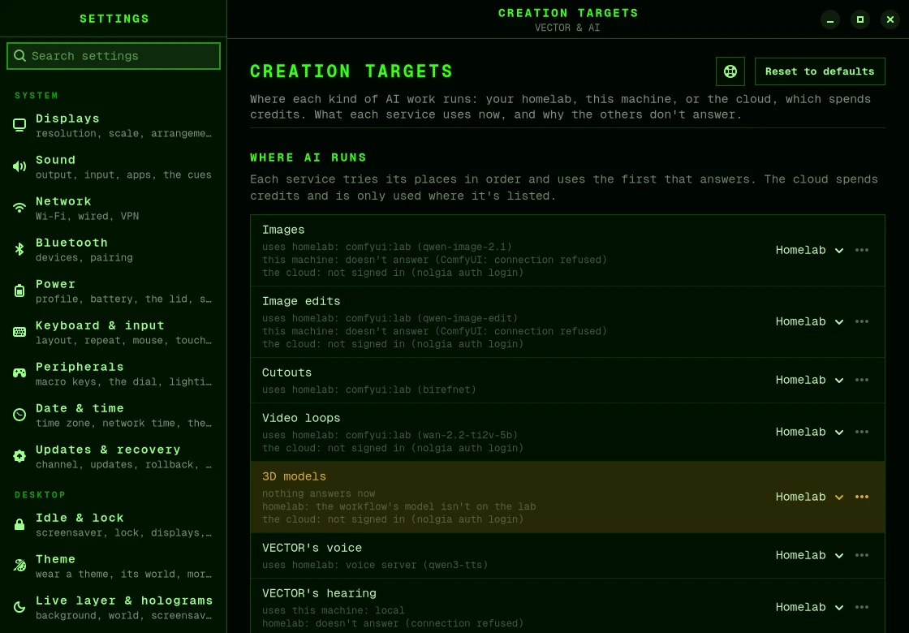

# Creating with AI

Some parts of bromigOS use AI:

- **VECTOR's brain**, the model he thinks with;
- **VECTOR's voice and hearing**;
- **the creation tools**, which make pictures, picture edits, cutouts, bigger copies of
  pictures and clips, 3D models and short video loops, for VECTOR and for themes'
  artwork.

Each of these can run in one of three places, called *targets*:

| Target | Where the work runs | Costs |
|---|---|---|
| `homelab` | [Your homelab's](homelab.md) services, such as its AI models or ComfyUI. | Nothing. |
| `local` | This machine: a local ComfyUI or Ollama, or VECTOR's voice on your graphics card or processor. | Nothing. |
| `cloud` | Paid services, such as [nolgia](glossary.md#nolgia) or a hosted model. | Money. |

You choose the order. Each job tries the first target, and moves to the next if that one
isn't set up or doesn't answer.

## Keep the cloud out, or let it in

The cloud costs money, so bromigOS is careful with it:

- The cloud only works once you've signed in to nolgia, or given a hosted model's key.
- Putting another target first never adds the cloud.
- bromigOS's built-in order is homelab, then this machine, then the cloud. The first run
  normally sets an order without the cloud.
- To be sure the cloud is never used, run `bromigos target order homelab local`.

VECTOR can't change this setting, and he never pays for anything on his own. When he makes
something, he uses your homelab or this machine. If neither can do it, he says so. He uses
nolgia only if you ask for it by name.

## See where AI runs now

```bash
bromigos target
```

For each kind of work, this shows what it would use now, and whether that answers. Or
open **Settings › Creation targets**.



## Change where AI runs

```bash
bromigos target local                 # this machine first
bromigos target homelab               # your homelab first
bromigos target order homelab local   # exactly this order; no cloud
bromigos target local --only llm      # just VECTOR's brain on this machine first
bromigos target reset                 # every kind of work back to the overall order
```

Or in **Settings › Creation targets**, choose where each kind of work runs first.

Changes apply at once: to VECTOR's next reply, and to the next picture you make.

The names for `--only` are `image.generate`, `image.edit`, `image.cutout`,
`image.upscale`, `video.loop`, `video.upscale`, `model3d.generate`, `voice.tts` (his
voice), `voice.stt` (his hearing) and `llm` (his brain).

## Set up the creation tools

The [first run](first-run.md) asked which tools make pictures, picture edits, cutouts, 3D
models and video loops. To answer again:

```bash
bromigos setup create
```

The default, "follow where AI runs", uses the order above. You can instead fix a list of
tools for each kind of work. This is also where you sign in to nolgia, if you use it.

## Make pictures and holograms

- Ask [VECTOR](vector.md#ask-him-to-make-things): "make me a picture of…", "make a
  hologram of…".
- Or run a job on your homelab yourself with `bromigos lab run`. See
  [The lab console](lab.md#make-things-on-your-lab).

## Your settings files

- `~/.config/bromigos/targets.toml`: where AI runs.
- `~/.config/bromigos/create.toml`: the creation tools.

The developer docs'
[targets.md](https://github.com/bromigos-org/bromigOS/blob/main/docs/targets.md) describes
both files.
